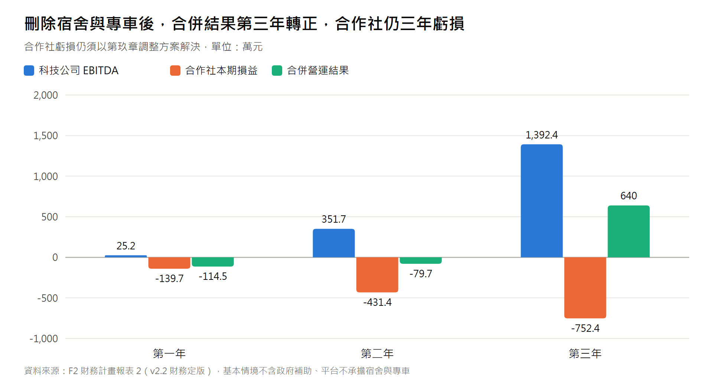

# 智農派工 (AgriDispatch) 創業計畫書【精簡版 / 投資摘要】
## 合法外展農務動態調度與避險平台 (Executive Summary)

> 2026-10-01 修訂版：財務數字引用《財務計畫報表 2》v2.2（F2 定版，2026 最低工資月 29,500 元／時 196 元；平台不承擔宿舍與專車），基本情境不含補助。

---

### 一、 一句話定位 (One-Liner)
**「智農派工是農業勞務的調度與避險平台」**——透過「科技公司 ╳ 農業合作社」雙軌架構與動態排程演算法，將合法外展移工組成外銷級標準化採收隊，為小農提供契約保障之出工與雨天備援，為移工提供跨產區連續排程的合法就業。

---

### 二、 核心痛點與破局方案 (Problem vs. Solution)

| 台灣農業三大死穴 | 地下黑工與傳統農會的失敗 | ★ 智農派工 (AgriDispatch) 破局方案 |
| :--- | :--- | :--- |
| **1. 產季大放鳥** (芒果熟透易爛果) | 非法人力無合約約束，出工不穩定；農民損失可達數十萬元【待補來源】。 | **早鳥保證工時包 (120H)**： 產前付定 20%，承諾**「遲到免單、放鳥雙倍賠償現金」**。 |
| **2. 外銷品質損耗** (果粉掉光、破蒂流膠) | 採收不當造成短蒂流膠污染，外銷果遭包裝場降級。 | **三語標準化採收 SOP (留蒂 0.5cm)**： 配發定距剪，目標外銷果合格率 ≥ 92%（以包裝場驗收紀錄衡量）。 |
| **3. 梅雨停工損失** (下雨天工資照付或失聯)| 下雨天果園泥濘無法採收，移工無事可做吃老本，放晴後叫不回工人。 | **雨天冷鏈備援**： 下雨改派至已簽約包裝廠進行室內分級清洗，降低停工損失。 |
| **4. 非法查緝與退貨** (就服法罰鍰、通路稽核) | 非法用工無合法憑證，可能面臨《就業服務法》罰鍰【待確認】；通路稽核可能影響契作【待補來源】。 | **合作社開立合法憑證**： 協助產銷班滿足通路供應鏈勞動合規要求。 |

---

### 三、 商業模式與定價矩陣 (Business Model & Pricing)

1. **營收來源**：
   * **早鳥主力工時包 (120H)**：早鳥價 $33,600 元 ($280/hr)，預收 20% 定金 ($6,720)。
   * **產季 24H 緊急救火派工**：急單價 $360/hr ($2,880/工日)。
   * **平台抽成 (Take Rate)**：科技公司向合作社收取 **18% 技術代管與媒合費**。
2. **防跳單護城河**：
   * 農民跳單：非法聘僱可能面臨罰鍰【待確認】，並失去放鳥賠償與合法憑證。
   * 移工跳單：私下接工屬違法並失去連續排程；平台薪資不低於 2026 年最低工資月 29,500 元（另計加班與績效獎金）。原版「每月 8,800 元獎勵、月領近 4 萬」【待確認：此獎勵適用對象須向農業部確認，若移工不適用，相關薪資與防跳單論述需調整】

---

### 四、 財務模型與單位經濟亮點 (Key Financial Metrics)

* **單位經濟**：原版 LTV 27,719 元、COCA 7,100 元、回本 <4 個月無法由文件參數驗證，已移除；待合作社定價方案確定後重算（公式見完整版第六章）。
* **三年營運預估（F2 v2.2，不含補助）**：
  * **Year 1 (灘頭堡屏東枋山)**：外展移工 12 人、服務 12 戶、GMV 813.1 萬元、科技公司營收 171.1 萬元、EBITDA 25.2 萬元。
  * **Year 2 (跨作物輪轉擴張)**：移工 50 人、服務 75 戶、GMV 3,696.0 萬元、EBITDA 351.7 萬元。
  * **Year 3 (全台平台化規模)**：移工 150 人、服務 260 戶、GMV 1 億 1,519 萬元、EBITDA 1,392.4 萬元。
* **合作社端（法定雇主）重要揭露**：宿舍與專車改由特約場域與用工農戶負擔後【待確認：合規性】，現行定價與 18% 代管費下合作社仍虧損（約 −139.7 萬／−431.4 萬／−752.4 萬元，主因為 2026 最低工資與帶班師傅成本）；合併營運結果第三年轉正（約 +640 萬元）。已研擬定價、師傅計費與代管費率之組合調整方案（示例 C1：合作社第一年約 +14.6 萬元；示例 C2 另精簡帶班人力、擴大本土兼職並內含住宿預備金：合作社約 +17.5 萬／+212.4 萬／+1,073.6 萬元，F2 v2.3），**待經營團隊決定**。
* **啟動資金**：110 萬元（資本額 10 萬元 + 青創貸款 100 萬元；v2.2 刪除專車與宿舍押金 30 萬元，改列週轉金）。

---

### 五、 法律架構與雙法人治理 (Dual-Entity Structure)

* **智農科技股份有限公司 (創辦團隊 100% 持股)**：擁有調度演算法、軟體著作與商標，依協議向合作社收取 18% 技術代管費（須經合作社依章程決議【待確認：關係人交易規範】）。
* **農業勞務生產合作社 (法定雇主)**：申請農業部外展農務服務資格與移工配額，開立合法憑證。
* **合作契約**：《營運委託暨技術代管協議》期間 5 年、期滿無異議自動展延 3 年，含違約金 500 萬元條款【待確認：違約金合理性與人員兼任之利益衝突規範，請律師審閱】。

---

### 六、 團隊現況與加速器進駐訴求 (The Ask)

* **團隊現狀**：**一人全端技術創辦人**，資本額 10 萬元，已完成三語 Demo 原型、調度演算法雛形，並參考 MIT《Disciplined Entrepreneurship》24 步架構撰寫商業計畫。
* **資本規劃**：申請經濟部青創貸款 100 萬元（利息補貼年限【待確認：2 年或 5 年】）。
* **Garage+ 加速器進駐訴求**：
  1. **企業 ESG 通路對接**：透過加速器網絡對接企業契作認購與連鎖通路供應鏈【待確認：合作對象】。
  2. **尋找商務/農業合夥人 (Co-founder)**：招募懂產地業務與供應鏈的互補夥伴。
  3. **雲端運算資源**：申請 GCP / AWS 算力抵用金，運行全台產曆動態調度大腦。
