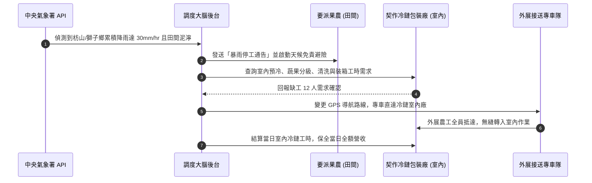

# 智農派工 (AgriDispatch) 營運與外展機構計畫書【實戰落地完整版】
## 台灣合法外展農務機構設立、動態調度大腦與全台產曆避險營運手冊

> **適用範疇**：
> 1. 農業部（農糧署／農民輔導司）與勞動部審查「外展農務試辦計畫」之正式送審計畫書。
> 2. 智農派工團隊跨縣市派工、天候避險、車隊調度與宿舍生活管理之實戰營運標準作業程序 (SOP)。

---

## 壹、 申請機構概況與組織編制

### 1. 機構基本資料
* **機構名稱**：有限責任【智農】農業勞務生產合作社（特許外展機構主體）
* **技術支援單位**：智農科技股份有限公司（演算法研發與營運代管主體）
* **主事務所地址**：屏東縣枋山鄉／高雄市美濃區（首期基地）
* **法定代表人（理事主席）**：【姓名】（具農保或實耕者身分）
* **專案執行長（總經理）**：【創辦人姓名】（兼任科技公司董事長，統籌調度後台與外展隊）
* **發起社員結構**：由在地愛文芒果產銷班、蜜棗產銷班、溫室蔬菜班共 15 位實耕農民共同發起，社員耕作總面積達 48.5 公頃。

### 2. 營運團隊編制與專業職能

```mermaid
graph TD
    subgraph Coop_Board [合作社理事會與監事會]
        DIR[理事主席 / 理事會 (5人)]
        SUP[監事主席 / 監事會 (3人)]
    end

    subgraph Operation_Team [外展營運調度指揮中心]
        CEO[專案執行長 (創辦人)]
        DISP[調度管理專員 (1人)]
        BILING[越/印雙語通譯暨舍監 (2人)]
        FOREMAN[本土農業師傅兼帶班組長 (2人)]
    end

    subgraph Field_Force [田間與室內作業部隊]
        W1[外展農工先鋒隊 (12~20人)]
        W2[中高齡後勤包裝隊 (8人)]
    end

    DIR --- CEO
    CEO --> DISP
    CEO --> BILING
    CEO --> FOREMAN
    DISP --> W1
    BILING --> W1
    FOREMAN --> W1
    FOREMAN --> W2
```

* **調度管理專員（1 名）**：負責審核小農 LINE 官方帳號工單、比對氣象雷達回波、規劃派工車隊最佳路線。
* **越南語 / 印尼語雙語舍監（各 1 名）**：負責集中宿舍生活輔導、就醫陪同、田間職安三語宣導及心理關懷。
* **本土農業師傅（2 名）**：領有農業部農業技術團合格證書，負責現場 1 對 6 帶班採收、剪枝嫁接技術指導與留蒂品質抽驗。

---

## 貳、 全台作物產曆平滑化排程（確保全年 365 天充分就業）

傳統農會外展隊虧損的主因在於「產季結束後移工閒置在宿舍吃老本」。智農派工的核心解方在於建立**「跨縣市作物產曆輪轉大腦」**，透過接續不同產區的高經濟作物，達成移工全年出工率 ≥ 93%：

```
┌────────────────────────────────────────────────────────────────────────────────────────┐
│                        智農派工全台作物產曆平滑化輪轉藍圖                              │
├──────────────┬────────────────────────────┬─────────────────────────────┬─────────────┤
│ 季度 / 月份  │ 主要作業產區               │ 主要作物與作業項目          │ 預期出工率  │
├──────────────┼────────────────────────────┼─────────────────────────────┼─────────────┤
│ **第 1 季**  │ 屏東車城、恆春、高樹       │ • 洋蔥採收、剪根裝袋        │ **92.0%**   │
│ (1月 ~ 3月)  │ 高雄燕巢、大社             │ • 蜜棗、蓮霧疏果與採收      │ (南部旱季)  │
├──────────────┼────────────────────────────┼─────────────────────────────┼─────────────┤
│ **第 2 季**  │ 屏東枋山、獅子鄉           │ • 愛文芒果疏果、套袋、採收  │ **98.5%**   │
│ (4月 ~ 6月)  │ 嘉南平原                   │ • 一期水稻代耕、西瓜採收    │ (採收大尖峰)│
├──────────────┼────────────────────────────┼─────────────────────────────┼─────────────┤
│ **第 3 季**  │ 雲林西螺、嘉義新港         │ • 設施有機蔬菜挑菜、整地    │ **94.0%**   │
│ (7月 ~ 9月)  │ 宜蘭三星、南投高山         │ • 三星蔥洗蔥、夏季高山茶採收│ (梅雨避險期)│
├──────────────┼────────────────────────────┼─────────────────────────────┼─────────────┤
│ **第 4 季**  │ 台南麻豆、新竹新埔         │ • 麻豆文旦柚採收分級        │ **95.0%**   │
│ (10月~12月)  │ 高雄六龜、屏東九如         │ • 柿子採收削皮、秋冬蔬菜包裝│ (冷鏈旺季)  │
└──────────────┴────────────────────────────┴─────────────────────────────┴─────────────┘
```

---

## 參、 突發天候避險機制（梅雨降雨零閒置 SOP）

農業戶外派工最大之不可抗力為「暴雨泥濘無法下田」。智農派工建立業界首創之**「雙軌避險機制」**：



### 突發豪雨收費與結算標準：
1. **已出勤遇雨停工**：若專車已抵達農場，因突發暴雨無法作業且果農現場無室內遮雨作業空間，當日上午酌收 **50% 基本出勤準備費**（補貼專車車資與移工半日保障），下午工班由調度大腦立即無償改派至冷鏈廠。
2. **提前轉移**：前一日晚間 20:00 氣象預報降雨機率逾 80% 時，系統主動協調小農順延田間工期，並全額無損轉派冷鏈包裝線，小農免付任何空轉費用。

---

## 肆、 輕資產外展派工日常維運流程 (SOP)

### 1. 數位工單流（小農、平台、移工三端互聯）

```
[小農端 (LINE OA)] ──發布工時需求──► [調度大腦 (SaaS 後台)] ──派發三語工單──► [移工行動端 (Web App)]
      ▲                                        │                                       │
      │                                    路線最適化                               GPS現場打卡
      │                                        │                                       │
      └───每日採收驗收簽名與發票明細查詢◄────────┴──每日出勤核銷與滿意度評分◄──────────────┘
```

1. **工單發布**：小農透過 LINE 官方帳號點選「預約叫工」，選取作物類別、田區定位、人數與工時包方案。
2. **智能排程**：調度大腦綜合評估「田區距離、專車動線、移工農技熟練度（果樹/蔬菜/機耕）」，於出工前一日 18:00 自動推播工單。
3. **出勤與報到**：
   * 專車統一接送抵達農場。
   * 移工以手機開啟 `Demo/app.html#worker` 進行 GPS 打卡。
   * 系統以越南語／印尼語語音播報今日農作注意事項（如「留蒂 0.5cm 護果粉」、「高溫多喝水」）。
4. **現場驗收與簽核**：每日 17:00 工作結束，小農於手機螢幕數位簽名確認工時與成果，系統即時產出發票明細並扣抵工時包點數。

---

## 伍、 移工生活照顧、宿舍規範與逃逸防範

### 1. 集中宿舍設施標準（完全符合勞動部外國人生活照顧服務計畫）
* **宿舍地點**：特約合格透天農舍或合法農村社區，遠離危險工業區。
* **居住空間**：每人居住生活空間達 **4.5 平方公尺以上**（高於法定 3.6 平方公尺），配備個人單人床、獨立儲物櫃及門鎖。
* **衛浴與通風**：每 5 人設置 1 套獨立乾濕分離衛浴；全棟安裝冷暖變頻空調、強制排氣熱水器、高畫質監視器（僅公共通道與大門）及 500M 高速光纖 Wi-Fi。
* **公共安全**：定期實施消防演練，配備滅火器、火災偵煙警報器、緊急照明燈及逃生標示。

### 2. 移工逃逸防範四大護城河（將失聯率降至 0%）
1. **實質高收入保障**：基本底薪 $28,590 + 農業部就業獎勵金 $8,800 + 採收超額績效獎金，移工實質月領達 **$35,000 ~ $40,000 元**，遠高於非法黑工不穩定之風險收入。
2. **全年 300 天連續排程**：無淡季斷炊風險，移工無需為了賺錢而私自冒險兼差。
3. **母語專人生活陪伴**：聘任全職越/印雙語舍監，每週安排母語心理諮商，協助家鄉匯款、健保就醫，營造「像家一樣」的歸屬感。
4. **合法轉聘與續聘獎金**：工作滿期表現優異者，合作社主動協助展延聘僱，並發放續約留任獎金。

---

## 陸、 職業安全衛生與高溫熱危害防護 SOP

1. **熱危害分級通報**：調度後台介接氣象署「高溫綜合熱指數 (WBGT)」，當指數達黃色／橙色警戒時，強制推播通告：
   * **上午作業時段調整**：提早至 05:30 出工，11:00 前結束上午露天田間作業。
   * **中午避暑休息**：11:00 ~ 13:30 於農會冷氣集貨場或遮蔭工寮休息，嚴禁正午曝曬作業。
2. **防護裝備統一配發**：合作社為每位外展農工配發抗 UV 遮陽大盤帽、透氣防曬袖套、防穿刺安全雨鞋、專用定距剪刀、以及 2,000c.c. 保溫水壺。
3. **職災保險 100% 覆蓋**：全額投保《勞工職業災害保險》，若遇田間蜂螫、蛇咬、中暑或跌倒，即刻啟動專車送醫，並由保險全額支付醫療費與薪資補償。

---

## 柒、 效益評估與送審承諾指標

| 評估指標 | 第一年 (Year 1) | 第二年 (Year 2) | 第三年 (Year 3) |
| :--- | :---: | :---: | :---: |
| **合法外展移工聘僱人數** | 12 人 | 50 人 | 150 人 |
| **累計服務農戶與契作商** | 10 戶 | 60 戶 | 220 戶 |
| **全年提供合法外展農務工時** | 24,000 小時 | 100,000 小時 | 300,000 小時 |
| **移工逃逸失聯率 (Target)** | **0%** | **< 1.0%** | **< 1.0%** |
| **小農非法黑工使用替代率** | 100% 替代 (服務戶內) | 100% 替代 | 100% 替代 |
| **重大職業災害事故件數** | **0 件** | **0 件** | **0 件** |

> **送審總結**：  
> 本計畫完全符合農業部推動外展農務試辦計畫之政策宗旨，透過科技調度平滑產曆、梅雨避險保障移工權益，並以嚴格之雙語舍監管理消滅逃逸誘因。建請農業部農糧署、農民輔導司及勞動部勞動力發展署惠予核准外展農務機構資格及首期 12~20 名外展農工聘僱配額。
