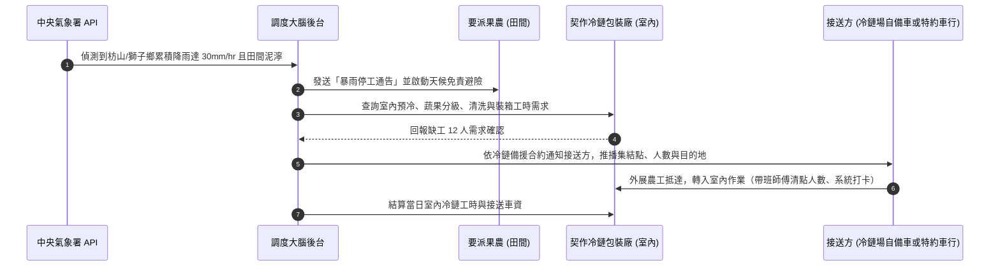

# 智農派工 (AgriDispatch) 營運與外展機構計畫書【實戰落地完整版】
## 台灣合法外展農務機構設立、動態調度大腦與全台產曆避險營運手冊

> **適用範疇**：
> 1. 農業部（農糧署／農民輔導司）與勞動部審查「外展農務試辦計畫」之正式送審計畫書。
> 2. 智農派工團隊跨縣市派工、天候避險、接送協調與特約住宿管理之實戰營運標準作業程序 (SOP)。
>
> **修訂**：2026-10-01。營運規模與工時依《財務計畫報表 2》v2.2（F2 定版）；工資基準為 2026 年最低工資（月 29,500 元／時 196 元）。  
> **v2.2 營運模式**：合作社**不承租宿舍、不配置專車**。住宿由特約農場／產銷班／冷鏈場提供（第伍章），交通以用工農戶接送為原則、特約車行按趟接送為備案（第肆章）。合作社仍為外展移工之法定雇主，生活照顧與通勤安全之責任不因委由第三方提供而免除【待確認：雇主住宿義務可否以特約住宿履行、外展農務是否要求外展單位統一接送；若主管機關要求統一接送，改採第肆章第 2 節「方案 B」為唯一方式】。

---

## 壹、 申請機構概況與組織編制

### 1. 機構基本資料
* **機構名稱**：有限責任【智農】農業勞務生產合作社（外展農務服務申請主體）
* **技術支援單位**：智農科技股份有限公司（演算法研發與營運代管主體）
* **主事務所地址**：屏東縣枋山鄉／高雄市美濃區（首期基地）
* **法定代表人（理事主席）**：【姓名】（具農保或實耕者身分）
* **專案執行長（總經理）**：【創辦人姓名】（兼任科技公司董事長，統籌調度後台與外展隊）
* **發起社員結構**：由在地愛文芒果產銷班、蜜棗產銷班、溫室蔬菜班共 15 位實耕農民共同發起，社員耕作總面積達 48.5 公頃。

### 2. 營運團隊編制與專業職能

```mermaid
graph TD
    subgraph Coop_Board [合作社理事會與監事會]
        DIR[理事主席 / 理事會 (5人)]
        SUP[監事主席 / 監事會 (3人)]
    end

    subgraph Operation_Team [外展營運調度指揮中心]
        CEO[專案執行長 (創辦人)]
        DISP[調度管理專員 (1人)]
        BILING[越/印雙語通譯暨生活照顧員 (2人)]
        FOREMAN[本土農業師傅兼帶班組長 (2人)]
    end

    subgraph Field_Force [田間與室內作業部隊]
        W1[外展農工先鋒隊 (12~20人)]
        W2[中高齡後勤包裝隊 (8人)]
    end

    DIR --- CEO
    CEO --> DISP
    CEO --> BILING
    CEO --> FOREMAN
    DISP --> W1
    BILING --> W1
    FOREMAN --> W1
    FOREMAN --> W2
```

* **調度管理專員（1 名）**：負責審核小農 LINE 官方帳號工單、比對氣象雷達回波、安排特約住宿與田區之配對、確認每日接送登記（第肆章第 2 節）。
* **越南語 / 印尼語雙語通譯暨生活照顧員（各 1 名，第一年兼職；原「舍監」）**：負責至各特約住宿處訪視與住宿查核（第伍章）、就醫陪同、田間職安三語宣導及心理關懷（F2 第一年編列 18 萬元，以時薪 196 元計約每人每月 38 小時；第二年起隨移工人數增加改聘全職）。
* **本土農業師傅（2 名）**：具農業技術團資歷者優先【待確認：證書名稱】，負責現場 1 對 6 帶班採收、剪枝嫁接技術指導與留蒂品質抽驗，並於集結點清點上下車人數（v2.2 起不兼任司機）。

---

## 貳、 全台作物產曆平滑化排程（提高全年就業穩定性）

外展服務的主要財務壓力之一是產季結束後人力閒置。智農派工透過**「跨縣市作物產曆輪轉排程」**接續不同產區作物，目標利用率第一年 92%、第三年 96%（F2；以法定正常工時約 1,960 小時/年為分母，季別目標如下）：

```
┌────────────────────────────────────────────────────────────────────────────────────────┐
│                        智農派工全台作物產曆平滑化輪轉藍圖                              │
├──────────────┬────────────────────────────┬─────────────────────────────┬─────────────┤
│ 季度 / 月份  │ 主要作業產區               │ 主要作物與作業項目          │ 預期出工率  │
├──────────────┼────────────────────────────┼─────────────────────────────┼─────────────┤
│ **第 1 季**  │ 屏東車城、恆春、高樹       │ • 洋蔥採收、剪根裝袋        │ **92.0%**   │
│ (1月 ~ 3月)  │ 高雄燕巢、大社             │ • 蜜棗、蓮霧疏果與採收      │ (南部旱季)  │
├──────────────┼────────────────────────────┼─────────────────────────────┼─────────────┤
│ **第 2 季**  │ 屏東枋山、獅子鄉           │ • 愛文芒果疏果、套袋、採收  │ **98.5%**   │
│ (4月 ~ 6月)  │ 嘉南平原                   │ • 一期水稻代耕、西瓜採收    │ (採收大尖峰)│
├──────────────┼────────────────────────────┼─────────────────────────────┼─────────────┤
│ **第 3 季**  │ 雲林西螺、嘉義新港         │ • 設施有機蔬菜挑菜、整地    │ **94.0%**   │
│ (7月 ~ 9月)  │ 宜蘭三星、南投高山         │ • 三星蔥洗蔥、夏季高山茶採收│ (梅雨避險期)│
├──────────────┼────────────────────────────┼─────────────────────────────┼─────────────┤
│ **第 4 季**  │ 台南麻豆、新竹新埔         │ • 麻豆文旦柚採收分級        │ **95.0%**   │
│ (10月~12月)  │ 高雄六龜、屏東九如         │ • 柿子採收削皮、秋冬蔬菜包裝│ (冷鏈旺季)  │
└──────────────┴────────────────────────────┴─────────────────────────────┴─────────────┘
```

---

## 參、 突發天候避險機制（梅雨降雨零閒置 SOP）

農業戶外派工最大之不可抗力為「暴雨泥濘無法下田」。智農派工建立業界首創之**「雙軌避險機制」**：



### 突發豪雨收費與結算標準：
1. **已出勤遇雨停工**：若工班已抵達農場，因突發暴雨無法作業且果農現場無室內遮雨作業空間，當日上午酌收 **50% 基本出勤準備費**（用以支應移工半日工資保障），下午工班由調度大腦改派至冷鏈廠。
2. **提前轉移**：前一日晚間 20:00 氣象預報降雨機率逾 80% 時，系統主動協調小農順延田間工期，並轉派冷鏈包裝線，小農免付任何空轉費用。
3. **轉派冷鏈廠之接送**：由冷鏈場依《冷鏈備援合約》自備合法載客車輛接送，或由合作社叫派特約車行，車資依備援合約向冷鏈場實報實銷收取（不計入 GMV、不抽成）【待確認：備援合約條款】。

---

## 肆、 輕資產外展派工日常維運流程 (SOP)

### 1. 數位工單流（小農、平台、移工三端互聯）

```
[小農端 (LINE OA)] ──發布工時需求──► [調度大腦 (SaaS 後台)] ──派發三語工單──► [移工行動端 (Web App)]
      ▲                                        │                                       │
      │                                    路線最適化                               GPS現場打卡
      │                                        │                                       │
      └───每日採收驗收簽名與發票明細查詢◄────────┴──每日出勤核銷與滿意度評分◄──────────────┘
```

1. **工單發布**：小農透過 LINE 官方帳號點選「預約叫工」，選取作物類別、田區定位、人數與工時包方案。
2. **智能排程**：調度大腦綜合評估「特約住宿點至田區之車程、接送方可載人數、移工農技熟練度（果樹/蔬菜/機耕）」，優先派往住宿點 30 分鐘車程內之田區，於出工前一日 18:00 自動推播工單（含集結點、接送時間、接送方與車號）。
3. **出勤與報到**：
   * 依本章第 2 節於特約住宿處之集結點上車，抵達農場後下車清點。
   * 移工以手機開啟 `Software/demo/app.html#worker` 進行 GPS 打卡。
   * 系統以越南語／印尼語語音播報今日農作注意事項（如「留蒂 0.5cm 護果粉」、「高溫多喝水」）。
4. **現場驗收與簽核**：每日 17:00 工作結束，小農於手機螢幕數位簽名確認工時與成果，系統即時產出發票明細並扣抵工時包點數。

### 2. 通勤接送 SOP（v2.2：合作社不配置專車）

合作社不自備車輛，但負責**安排、登記與查核**每日接送，確保移工通勤安全與工時紀錄完整。

| 方案 | 適用情形 | 接送方 | 費用 |
| :--- | :--- | :--- | :--- |
| **方案 A（原則）：用工農戶接送** | 單一農戶、田區距住宿點 30 分鐘車程內 | 用工農戶或其指定之駕駛 | 由用工農戶自行負擔，不計入 GMV |
| **方案 B（備案）：特約車行按趟接送** | 農戶無合法載客車輛、多戶共乘、跨鄉鎮派工，或主管機關要求外展單位統一接送 | 合作社簽約之合格車行 | 按趟實報實銷向用工農戶另收（多戶共乘依人數分攤），不計入 GMV、合作社與科技公司不抽成 |

**(1) 接送方資格（簽約時查核，每年複查）**
* 車輛須為合法登記之載客車輛，座位數不得少於乘載人數，並投保強制險與乘客責任險（每人保額依要派契約約定【待確認：最低保額】）。
* **嚴禁**以貨車車斗載人，**嚴禁**移工自行騎乘機車或電動車跨區通勤。
* 駕駛須持有效駕照，並於要派契約／車行合約中承諾不酒駕、不疲勞駕駛；違反者合作社得停止派工。

**(2) 每日流程**
1. **前一日 18:00**：系統推播工單時，同步要求接送方回填駕駛姓名、車號與預計抵達集結點時間；**未回填者不得派工**，調度專員改派方案 B 或順延。
2. **出車**：帶班師傅（或移工代表）於集結點清點人數，移工上車時以手機打卡（記錄時間與位置）。
3. **抵達田區**：移工以 GPS 打卡報到；系統比對上車與抵達時間，異常（逾預定車程 30 分鐘以上、人數不符）即通知調度專員追蹤。
4. **收工返程**：17:00 簽核後，接送方送回集結點，移工打卡確認返抵住宿處。
5. **通勤時間**：自集結點出發至返抵之通勤時間是否計入工時，依勞動法令與勞動契約辦理【待確認】。

**(3) 跨產區移動（產曆輪轉）**
* 工班隨產曆跨縣市移動時（例如第 2 季屏東 → 第 3 季雲林），由合作社叫派方案 B 車行一次性載運，並於出發前確認下一產區之特約住宿已完成查核（第伍章）。
* 跨產區移動車資依要派契約由接續產區之用工方分攤；未能分攤時由合作社負擔。**F2 v2.2 未編列此項成本**【待確認：分攤條款與預估金額】。

---

## 伍、 移工生活照顧、特約住宿管理與失聯風險防範

### 1. 特約住宿模式（v2.2：合作社不承租宿舍）

合作社不自行承租宿舍，改與**特約住宿提供者**簽訂《特約住宿協議》，由其提供合格住宿；合作社仍以雇主身分提出並執行《外國人生活照顧服務計畫書》，負查核與改善之責【待確認：主管機關是否接受雇主以第三方提供之住宿履行住宿安排義務，及計畫書應如何載明】。

* **特約住宿提供者**：要派農場、產銷班或契作冷鏈集貨場所有或承租之合法建物，或合格之現成宿舍業者（按人月計）。
* **《特約住宿協議》應載明**：住宿地址與床位數、符合本章第 2 節標準之承諾、住宿費用之負擔方式、合作社與主管機關之查核權、不合格時之改善期限與終止條件、移工緊急遷出之配合義務【待確認：協議範本請律師擬定】。
* **住宿費用**：原則由住宿提供者負擔，或計入其要派費用；如須向移工收取，金額不得逾法定上限，並應事先書面告知且經移工同意【待確認：收費上限與程序】。合作社不再代扣膳宿費，F2 v2.2 亦未編列合作社住宿成本。
* **住宿與派工配對**：一處特約住宿以服務鄰近 30 分鐘車程內之田區為原則；調度大腦以住宿點為出發點排程（第肆章）。
* **緊急遷出**：住宿查核不合格、提供者違約或發生安全事件時，合作社須於 24 小時內將移工安置至合格之短期住宿（合格宿舍業者或旅宿），再於 14 日內完成新特約住宿查核與遷入。**緊急安置費用 F2 v2.2 未編列**【待確認：預備金額度】。

### 2. 特約住宿查核標準（依勞動部外國人生活照顧服務計畫書規定規劃【待確認：最新法定標準】）
* **住宿地點**：合法建物（含合法農舍）或合法農村社區，遠離危險工業區；不得以工寮、貨櫃或倉庫充作住宿。
* **居住空間**：每人居住生活空間規劃 **4.5 平方公尺以上**（法定最低標準【待確認：現行規定之面積】），配備個人單人床、獨立儲物櫃及門鎖。
* **衛浴與通風**：每 5 人設置 1 套衛浴、具通風或空調設備、安全之熱水設備（燃氣熱水器須裝設於室外或具強制排氣）、對外聯絡用網路；監視器僅限公共通道與大門。
* **公共安全**：配備滅火器、火災偵煙警報器、緊急照明燈及逃生標示，並定期實施消防演練。

### 3. 特約住宿查核 SOP
| 時點 | 執行者 | 內容 | 紀錄 |
| :--- | :--- | :--- | :--- |
| **簽約前** | 調度專員 + 雙語生活照顧員 | 依第 2 節逐項實地查核、拍照，確認建物合法證明 | 查核表與照片存入系統，未全數合格不得簽約 |
| **移工入住後 7 日內** | 雙語生活照顧員 | 以母語訪談入住移工，確認實際狀況與協議相符 | 訪談紀錄 |
| **每月** | 雙語生活照顧員 | 例行訪視：環境整潔、設備堪用、生活需求與申訴 | 訪視紀錄；移工亦可隨時以系統三語申訴 |
| **每季** | 調度專員 | 依第 2 節全項稽核 | 稽核報告；缺失限期 7 日內改善，未改善者啟動緊急遷出 |
| **申訴或事故發生時** | 調度專員 | 24 小時內到場處理 | 事件紀錄，並依規定通報主管機關【待確認：通報義務】 |

### 4. 移工失聯風險降低四項措施
1. **合法穩定收入**：基本底薪 **$29,500**（2026 年最低工資；F2 v2.2 起合作社不提供宿舍、不代扣膳宿費，住宿費依本章第 1 節【待確認】）＋ 加班費（依法、經勞工同意）＋ 採收績效獎金。原版另列農業部就業獎勵金 $8,800 並稱實領 $35,000 ~ $40,000 元【待確認：此獎勵適用對象須向農業部確認，若移工不適用，相關薪資與防跳單論述需調整】。
2. **跨產區連續排程**：降低淡季收入中斷，減少私下兼差誘因。
3. **母語專人生活陪伴**：配置越/印雙語生活照顧員（第一年兼職、第二年起全職），定期至特約住宿處訪視並安排母語關懷，協助家鄉匯款、健保就醫。
4. **合法轉聘與續聘獎金**：工作滿期表現優異者，合作社主動協助展延聘僱，並發放續約留任獎金。

---

## 陸、 職業安全衛生與高溫熱危害防護 SOP

1. **熱危害分級通報**：調度後台介接氣象署「高溫綜合熱指數 (WBGT)」，當指數達黃色／橙色警戒時，強制推播通告：
   * **上午作業時段調整**：提早至 05:30 出工，11:00 前結束上午露天田間作業。
   * **中午避暑休息**：11:00 ~ 13:30 於農會冷氣集貨場或遮蔭工寮休息，嚴禁正午曝曬作業。
2. **防護裝備統一配發**：合作社為每位外展農工配發抗 UV 遮陽大盤帽、透氣防曬袖套、防穿刺安全雨鞋、專用定距剪刀、以及 2,000c.c. 保溫水壺。
3. **職災保險全員投保**：依法投保《勞工職業災害保險》，若遇田間蜂螫、蛇咬、中暑或跌倒，重大傷病立即撥打 119，輕傷由帶班師傅會同用工農戶以合法載客車輛就近送醫，並依職災保險及相關法令給付醫療與薪資補償。

---

## 柒、 效益評估與送審承諾指標

| 評估指標 | 第一年 (Year 1) | 第二年 (Year 2) | 第三年 (Year 3) |
| :--- | :---: | :---: | :---: |
| **合法外展移工聘僱人數** | 12 人 | 50 人 | 150 人 |
| **累計服務農戶與契作商** | 12 戶 | 75 戶 | 260 戶 |
| **全年提供合法外展農務工時（第一層）** | 21,600 小時 | 92,000 小時 | 282,000 小時 |
| **移工失聯率（目標值）** | 低於同期全國外籍農業移工平均失聯率 | 同左 | 同左 |
| **服務戶非法用工替代（目標值）** | 服務戶內以本平台人力取代非法用工之比率逐年提升 | 同左 | 同左 |
| **職業災害（目標值）** | 失能傷害頻率低於農業平均；以零重大職災為努力目標 | 同左 | 同左 |
| **特約住宿查核（目標值）** | 每處每季完成全項稽核；缺失 7 日內改善率 100% | 同左 | 同左 |
| **接送登記完整率（目標值）** | 每日派工接送方資料回填率 100%；通勤交通事故零件 | 同左 | 同左 |

> **KPI 衡量方式**：(1) 失聯率＝年度失聯人數 ÷ 年度平均在籍移工人數，比較基準採勞動部公布之外籍農業移工統計【待補來源：勞動部統計資料名稱與年度】；(2) 非法用工替代以服務戶年度問卷與要派契約用工紀錄衡量；(3) 職業災害依職業安全衛生法規定之統計方式計算，比較基準【待補來源】。以上為目標值，非保證。

> **送審總結**：  
> 本計畫配合農業部推動外展農務之政策方向，透過科技調度平滑產曆、雨天備援保障移工權益，並以雙語生活照顧員、特約住宿查核與接送登記制度保障移工生活與通勤安全、降低失聯風險。建請農業部農糧署、農民輔導司及勞動部勞動力發展署惠予核准外展農務機構資格及首期 12~20 名外展農工聘僱配額。
