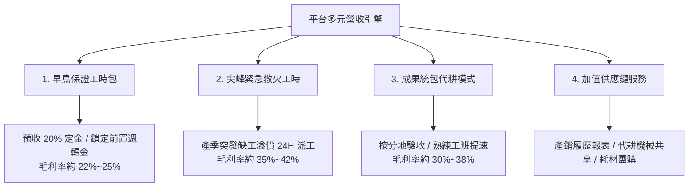

# 智農派工 (AgriDispatch) 三年財務模型與資金預算精算書

> ⚠️ **本文件為早期/情境版本，正式數字以 F2（`03_財務計畫報表2_三層混合人力模型精算與損益推演.md` v2.2）為準。** 本文件保留作為模型演進紀錄；2026-09-23 已更新最低工資基準（月 29,500 元／時 196 元）並修正明顯錯誤，但第參、肆章之損益、現金流與損益平衡仍為早期假設（工時超過法定上限、未扣折舊/利息/所得稅、補助列為確定收入、預收定金列為科技公司現金），**不得對外引用**。  
> **文件版本**：v2.0（早期版本；2026-09-23 修訂註記）  
> **編撰目的**：本精算書依據勞動部最新法定薪資規範、農業部外展農務試辦要點及實務商業調度數據，建立完整之「單位經濟模型 (Unit Economics)」、「外展人力法定成本係數」、「三年損益預估 (P&L)」、「現金流量預算」及「政策資金槓桿方案」，作為銀行青創貸款、創投機構 (VC) 評估與農業部審查之財務核心憑據。

---

## 壹、 單位經濟模型 (Unit Economics) 與成本係數精算

### 1. 外展農工人事法定硬成本精算表 (以每人每月為基準)

依據中華民國現行《勞動基準法》、《勞工保險條例》、《全民健康保險法》、《勞工職業災害保險及保護法》及《就業服務法》規定，外展農務移工之法定人事成本結構如下（以 2026 年最低工資月薪新台幣 $29,500 元試算；勞動部公告 2026/1/1 起實施）：

| 項目代碼 | 成本項目 | 金額 (新台幣/月) | 計算基礎與法規說明 |
| :---: | :--- | :---: | :--- |
| **A1** | **法定基本工資 (底薪)** | **$29,500** | 勞動部公告 2026 年最低工資（月薪制）。 |
| **A2** | **勞工保險（雇主負擔 70%）** | **$2,478** | 投保薪資 $29,500，普通事故費率 11% + 就業保險 1%，雇主負擔 70%【待確認：2026 年費率與級距】。 |
| **A3** | **全民健康保險（雇主負擔 60%）** | **$1,428** | 投保金額 $29,500，費率 5.17%，雇主負擔比率 60% ×（1 + 平均眷口數 0.56）。 |
| **A4** | **勞工職業災害保險（雇主 100%）**| **$106** | 依農林漁牧業職災費率約 0.36% 計算，由雇主全額負擔【待確認】。 |
| **A5** | **就業安定費** | **$2,000** | 外展農務移工雇主繳納之就業安定費，沿用原估每月 $2,000 元【待確認：現行繳納標準】。 |
| **A6** | **團體意外險與海外突發醫療** | **$350** | 商業雇主責任險暨 200 萬意外身故 + 實支實付醫療險。 |
| **A7** | **定期體檢與居留證攤提** | **$450** | 半年一次法定體檢、居留證展延費與工作許可規費（年化月攤提）。 |
| **SUB** | **法定人事硬成本小計** | **$36,312** | **成本係數約為底薪之 1.231 倍**（2025 年基準為 $35,273／1.234 倍）。 |
| **A8** | *(法定膳宿費代扣額)* | *(-$3,000)* | 依勞動部生活照顧計畫書標準，於發薪時依法代扣膳宿設施費。 |
| **TOTAL**| **雇主實質淨人事現金流出** | **$33,312** | 每位移工每月最低現金固定支出（膳宿代扣係用以支應宿舍支出，實際淨額須扣宿舍成本後計算，見 F2 第肆章）。 |

> **就業獎勵金（適用對象待確認）**：  
> 原文件假設派出之外展農工可向農業部「農業人力團」計畫每人每月領取最高 **新台幣 $8,800 元就業獎勵金** 與交通津貼。【待確認：此獎勵適用對象須向農業部確認，若移工不適用，相關薪資與防跳單論述需調整】此獎勵金不計入雇主法定工資成本，本文件與 F2 均不將其列為任何一方之收入；在確認前，不以此作為移工實領薪資或留才之承諾。

---

### 2. 營運調度與輕資產變動成本結構

| 成本類別 | 傳統重資產模式 (業界虧損主因) | 智農派工輕資產調度模型 (本案) | 財務節流效益 |
| :--- | :--- | :--- | :--- |
| **交通載具** | 自購 9 人座車輛 (車貸每台 $2.2 萬/月 + 專職司機月薪 $4 萬 + 牌照保險) | **特約車行簽約租賃** (產季按出工趟次實報實銷，非產季零固定成本) 或 **小農自行集結接送** | 每月每 10 人節省固定開銷 **$65,000 元** 以上。 |
| **宿舍設施** | 長租整棟透天宿舍 (固定年租約 $60 萬 + 巨額押金裝修) | **特約合格農舍合作** (與大農場/產銷班合作，按人月租賃彈性進駐，淡季退租) | 消除淡季閒置租金負擔，資金佔用減少 **75%**。 |
| **天候停工** | 連日豪雨田間停工，移工在宿舍乾領底薪，雇主單月虧損數十萬 | **梅雨冷鏈無縫轉運** (預簽契作冷鏈集貨場，遇雨立即轉派室內清洗包裝線) | 目標出工率 92%~96%（F2 假設），降低雨天停工損失【待驗證：冷鏈備援合約簽署後以實績衡量】。 |

---

## 貳、 收入模型與階梯定價策略

平台設計三層式收入機制，兼顧「現金流預收穩定性」、「尖峰超額毛利」與「高階成果統包」：



### 1. 方案定價與毛利試算

| 方案名稱 | 規格與時數 | 對小農收費標準 | 移工直接成本 (含法定附加) | 毛利額 (Gross Margin) | 毛利率 (%) |
| :--- | :--- | :---: | :---: | :---: | :---: |
| **早鳥外銷主力包** | 120 小時 (約 15 工日) | $33,600 ($280/hr)<br>*(預收 20% 定金 $6,720)* | $29,052 ($242.1/hr) | **$4,548** | **13.5%** |
| **標準體驗工時包** | 40 小時 (約 5 工日) | $12,000 ($300/hr)<br>*(預收 50% 定金 $6,000)* | $9,684 ($242.1/hr) | **$2,316** | **19.3%** |
| **尖峰 24H 緊急工時** | 單日 8 小時 (救火) | $2,880 ($360/hr)<br>*(出工日前全額預付)* | $1,937 ($242.1/hr) | **$943** | **32.7%** |
| **成果統包 (每分地)** | 愛文芒果套袋剪枝 | $35,000 / 分地 | $23,000 (發包承攬工班，同 F2) | **$12,000** | **34.3%** |

> 註（2026-09-23）：移工直接成本 $242.1/hr ＝ 月法定成本 $36,312 ÷ 月均可計費 150 小時（年可排正常工時約 1,960 小時 × 利用率 92%，見 F2）。原 $216.7/hr 係以月均 176 小時 × 92.5% 推算，176 小時已超過法定正常工時。上表毛利為合作社與科技公司合計、未扣交通與帶班師傅之價差；科技公司抽取 18% 後，合作社端實際為虧損（見 F2 第肆章）。

### 2. 雙軌實質分流模型 (科技公司 vs. 合作社)
* **合作社帳端 (非營利/平移成本)**：
  * 收取要派費用中之法定底薪、勞健保、職保、就安費與專車交通津貼。
  * 原設計為維持合作社年度微利結餘；惟依 F2 v2.2 重算，現行定價下合作社為虧損，須調整定價或拆帳（見 F2 第玖章）。合作社之租稅待遇【待確認：請會計師依《合作社法》及所得稅相關規定確認】。
* **科技公司帳端 (實質利潤池)**：
  * 向合作社開立發票收取 **18% 技術代管與演算法授權費 (Take Rate)**，費率應與實際提供之服務相當並經合作社依章程決議【待確認：關係人交易與常規交易原則】。
  * 承攬「成果統包代耕」及「特約機耕設備租賃」之價差收入。

---

## 參、 三年財務預估表 (Three-Year Financial Projections)

### 1. 營運規模假設 (Base Assumptions)

| 關鍵指標 | 第一年 (Year 1: 灘頭堡) | 第二年 (Year 2: 跨作物) | 第三年 (Year 3: 全國規模化) |
| :--- | :---: | :---: | :---: |
| **外展農工人數 (在籍管理)** | 12 人 | 50 人 | 150 人 |
| **本土農業師傅 (帶班組長)** | 2 人 | 8 人 | 20 人 |
| **服務農戶與契作商總數** | 10 戶 (枋山/獅子) | 60 戶 (高屏/台南/嘉義) | 220 戶 (全台產曆) |
| **全年度總出勤工時 (Hours)** | 24,000 小時 ⚠️ | 100,000 小時 ⚠️ | 300,000 小時 ⚠️ |
| **移工平均出勤率 (利用率)** | 88.5% (首年磨合) | 93.0% (產曆對接) | 96.0% (全自動排程) |
| **早鳥預售比例 (%)** | 70% | 80% | 85% |

> ⚠️ 修正註記：本表以每人每年約 2,000 小時、出勤率 88.5%~96% 推算，隱含年可排工時 2,080~2,260 小時，**超過法定正常工時上限**（週 40 小時、扣除國定假日與特休後約 1,960 小時）。F2 v2.2 已修正為每人 1,800／1,840／1,880 小時（12 人全年 21,600 小時）。

---

### 2. 三年損益預估表 (Pro Forma Income Statement, 單位：新台幣元)

```
========================================================================================
項目                            第一年 (Year 1)     第二年 (Year 2)     第三年 (Year 3)
========================================================================================
【合作社全案流水 GMV】             $ 7,200,000        $ 31,500,000        $ 96,000,000
----------------------------------------------------------------------------------------
一、科技公司營業收入 (Revenue)
  1. 系統代管與調度服務費 (18%)     $ 1,296,000         $ 5,670,000        $ 17,280,000
  2. 機耕成果統包代耕營收            $   600,000         $ 2,500,000        $  8,000,000
  3. 產銷數據與資材服務收入          $   100,000         $   650,000        $  2,200,000
  ────────────────────────────────────────────────────────────────────────────────────
  科技公司總營收                   $ 1,996,000         $ 8,820,000        $ 27,480,000

二、直接營業成本 (Cost of Goods Sold)
  1. 統包代耕機具油料與耗損折舊      $   380,000         $ 1,550,000        $  4,800,000
  2. 雲端伺服器 (GCP/AWS) 與 API   $    72,000         $   240,000        $    600,000
  3. 調度幹部現場差旅與防護耗材      $    96,000         $   360,000        $  1,100,000
  ────────────────────────────────────────────────────────────────────────────────────
  營業成本小計                     $   548,000         $ 2,150,000        $  6,500,000

三、營業毛利 (Gross Profit)        $ 1,448,000         $ 6,670,000        $ 20,980,000
    (毛利率 %)                         72.5%               75.6%               76.3%

四、營業費用 (Operating Expenses)
  1. 創辦團隊與核心研發人員薪資      $   720,000         $ 2,400,000        $  6,000,000
  2. 雙語通譯暨舍監兼職津貼          $   180,000         $   600,000        $  1,500,000
  3. 市場開拓、文宣推廣與客戶招商    $   150,000         $   450,000        $  1,200,000
  4. 法律顧問、會計師與行政規費      $   120,000         $   250,000        $    500,000
  5. 辦公室租金與水電雜支            $    96,000         $   240,000        $    600,000
  ────────────────────────────────────────────────────────────────────────────────────
  營業費用小計                     $ 1,266,000         $ 3,940,000        $  9,800,000

五、營業淨利 (EBITDA)              $   182,000         $ 2,730,000        $ 11,180,000
    (淨利率 %)                          9.1%               31.0%               40.7%

六、業外收入 (政府專案補助款入帳)    $ 1,000,000         $ 2,000,000        $  1,500,000
    (SBIR 研發補助 / 地方創生款)
七、稅前淨利 (EBT)                 $ 1,182,000         $ 4,730,000        $ 12,680,000
========================================================================================
```

> ⚠️ 修正註記：本表(1) 工時超過法定上限；(2) 未扣折舊、利息與所得稅（「EBITDA」下直接加補助即稱稅前淨利）；(3) 將尚未核定之補助列為收入；(4) 未編列合作社端損益。**正式數字請改用 F2 v2.2**：第一年 GMV 813.1 萬元、科技公司營收 171.1 萬元、EBITDA 25.2 萬元（不含補助），合作社端現行定價下虧損約 139.7 萬元（v2.2 起平台不承擔宿舍與專車）。

---

### 3. 三年現金流量預估表 (Pro Forma Cash Flow Statement)

外展派工為「先收定金、月結工資、短期放帳」之營運模式。現金流敏感度關鍵在於小農帳期（合約約定出工後 7 日結清）與移工薪資給付日（次月 5 日）。

```
========================================================================================
現金流量項目 (單位：新台幣元)       第一年 (Year 1)     第二年 (Year 2)     第三年 (Year 3)
========================================================================================
【營業活動現金流 (Operating Cash Flow)】
  稅前淨利 (含補助)                $ 1,182,000         $ 4,730,000        $ 12,680,000
  折舊與攤銷加回                   $    60,000         $   250,000        $    650,000
  應收帳款變動 (小農 7 日款)       -$   140,000        -$   480,000       -$  1,200,000
  早鳥定金預收增加 (20% 資金池)    +$   450,000        +$ 1,800,000       +$  5,200,000  ⚠️
  應付薪資與勞健保費用變動         +$   120,000        +$   420,000       +$  1,100,000
  ────────────────────────────────────────────────────────────────────────────────────
  營業活動淨現金流入               $ 1,672,000         $ 6,720,000        $ 18,430,000

【投資活動現金流 (Investing Cash Flow)】
  伺服器架構與核心演算法資本化支出 -$   200,000        -$   600,000       -$  1,200,000
  無人機與機耕作業設備購置         -$   150,000        -$   800,000       -$  2,500,000
  ────────────────────────────────────────────────────────────────────────────────────
  投資活動淨現金流出              -$   350,000        -$ 1,400,000       -$  3,700,000

【融資活動現金流 (Financing Cash Flow)】
  青年創業貸款注入 (政府免息保證)  +$ 1,000,000                  $ 0                 $ 0
  創始股東出資資本額               +$   100,000                  $ 0                 $ 0
  償還青創貸款本金                          $ 0        -$   200,000       -$   250,000
  ────────────────────────────────────────────────────────────────────────────────────
  融資活動淨現金流入 (流出)        +$ 1,100,000        -$   200,000       -$   250,000

【現金淨增加額】                   $ 2,422,000         $ 5,120,000        $ 14,480,000
  期初現金餘額                              $ 0         $ 2,422,000        $  7,542,000
  期末現金餘額                     $ 2,422,000         $ 7,542,000        $ 22,022,000
========================================================================================
```

> ⚠️ 修正註記：早鳥定金由小農支付予合作社（締約主體），屬合作社預收款（負債），不應列入科技公司現金流；折舊在損益表未扣除卻於此加回，屬不一致；補助款未核定即列入。F2 v2.2 修正後科技公司第一年期末現金約 58 萬元（含第 0 年籌備期；v2.2 刪除專車與宿舍押金）。

---

## 肆、 損益平衡點分析 (Break-Even Analysis)

### 1. 第一年損益平衡出工時數與移工人數試算
* **固定費用總額 (Fixed Costs, 包含管理人員薪資、辦公室、固定軟體等)**：每年約 **$1,266,000 元**。
* **單位工時科技代管平均貢獻邊際 (Contribution Margin per Hour)**：
  * 平均每工時平台收費：$295 元。
  * 科技公司代管抽成 18%：$53.1 元/小時。
  * 扣除雲端伺服器與調度可變成本 ($3.5 元/小時)，單位邊際貢獻 = **$49.6 元/小時**。
* **損益平衡總工時 (Break-Even Hours)**：
  * **計算式**：**BEP 工時 = $1,266,000 ÷ $49.6 ≈ 25,524 小時**
* **對應所需管理移工人數**：
  * 每位移工年標準出工時數 = 2,000 小時（出勤率 90%）⚠️ 隱含年工時 2,222 小時，超過法定上限；F2 v2.2 改以 1,800 小時計。
  * **計算式**：**損益平衡移工人數 = 25,524 小時 ÷ 2,000 小時/人 ≈ 12.7 人**。
  * **結論（早期版本）**：原推算首期約 13 名外展農工可使科技公司跨過損益平衡點；「計入補助僅需 8 人」無計算依據，已刪除。
  * ⚠️ 修正註記：F2 v2.2 重算科技公司損益平衡約 **9 名移工**（每人 1,800 小時）；但合作社端每增加一名移工即擴大虧損，現行定價下**合併層面無損益平衡點**，須先完成 F2 第玖章之定價/拆帳調整。

---

## 伍、 啟動資金籌措與政策資金槓桿

### 1. 初始啟動資金預算表 (Capital Allocation: 早期估算 70 萬元；F2 v2.2 定版為 110 萬元)

| 預算項目 | 編列金額 (新台幣) | 用途說明與支配方式 |
| :--- | :---: | :--- |
| **公司與合作社設立法務規費** | $100,000 | 合作社創立發起、會計師驗資、農業部外展審查送件、律師合約見證。 |
| **租賃專車與宿舍履約押金** | $150,000 | 特約租賃車行履約保證金、特約農舍首期租金押金。 |
| **田間樣品工具與三語文宣** | $80,000 | 採收定距剪刀、防刮手套、三語圖解手冊、農會徵才紅紙印刷。 |
| **移工前置安全訓練與雙語津貼**| $120,000 | 抵台後農安訓練、職災預防講習、專職通譯人員前置調度車馬費。 |
| **初期應急流動準備金** | $250,000 | 應對小農首期帳期時間差與緊急醫療週轉。 |
| **合計** | **$700,000** | 早期估算。F2 v2.2 定版之啟動資金需求為 **110 萬元**（青創貸款 100 萬 + 資本額 10 萬），用途見 F2 第柒章。 |

### 2. 政策性低利融資與無償補助款對接路線圖

```
┌────────────────────────────────────────────────────────────────────────────────────────┐
│                        智農派工政策資金槓桿對接矩陣                                    │
├────────────────────┬───────────────────┬───────────────────┬───────────────────┤
│ 資金管道           │ 額度與利率        │ 適用對象與用途    │ 申請時程與關鍵條件│
├────────────────────┼───────────────────┼───────────────────┼───────────────────┤
│ 1. 經濟部青年創業  │ • 最高 100 萬元   │ • 科技公司名義    │ • 公司設立 5 年內 │
│    及啟動金貸款    │ • 信保 100% 保證※ │ • 充當首期營運資金│ • 負責人年滿 18~45│
│                    │ • 前 2 年免息※    │ • 採購設備與押金  │ • 完成 20 小時課  │
├────────────────────┼───────────────────┼───────────────────┼───────────────────┤
│ 2. 農業部外展農務  │ • 每人每月$8,800※│ • 派出外展農工    │ • 取得外展服務資格│
│    就業獎勵金      │ • 交通津貼另計    │ • 直撥移工提高實領│ • 按月登錄人力平台│
│                    │ • 行政管理費補助※ │ • 合作社管銷補貼  │ • 合法在籍        │
├────────────────────┼───────────────────┼───────────────────┼───────────────────┤
│ 3. 經濟部小型企業  │ • 100 萬 ~ 300 萬 │ • 調度大腦演算法  │ • 每年 4 月 / 9 月│
│    創新研發 (SBIR) │ • 無償補助 (Grant)│ • 天候避險與路線排│ • 具備軟體著作權  │
│                    │ • 需自籌 50%      │ • 專利申請與雲端費│ • 原型已驗證加分  │
├────────────────────┼───────────────────┼───────────────────┼───────────────────┤
│ 4. 國發會地方創生  │ • 每年最高 300 萬 │ • 農村缺工青年培力│ • 與地方公所合署  │
│    青年培力工作站  │ • 連續補助最長 3年│ • 閒置農舍活化改建│ • 解決高齡化農村  │
└────────────────────┴───────────────────┴───────────────────┴───────────────────┘
```

> ※【待確認】青創貸款信保成數（各文件曾出現 95% 與 100%）與利息補貼年限（2 年或 5 年），以經濟部中小及新創企業署與承貸銀行最新規定為準；8,800 元獎勵【待確認：此獎勵適用對象須向農業部確認，若移工不適用，相關薪資與防跳單論述需調整】；各項補助額度與時程以主管機關最新公告為準。

> **財務總結**：  
> （早期版本結論，已由 F2 v2.2 取代）本案以輕資產營運降低初期資本開銷，啟動資金需求依 F2 定版為 110 萬元（青年創業貸款 100 萬元，利息補貼年限【待確認】＋資本額 10 萬元）。早鳥定金屬合作社預收款，不作為科技公司營運資金；就業獎勵金適用對象待確認，不列入財務模型。
