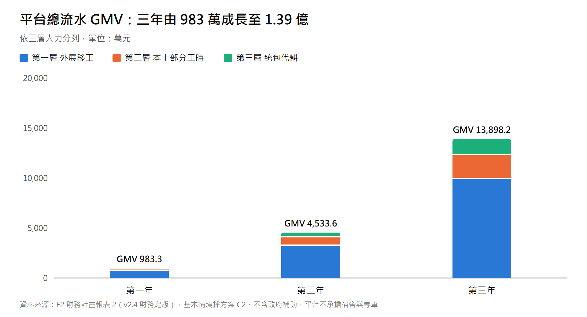
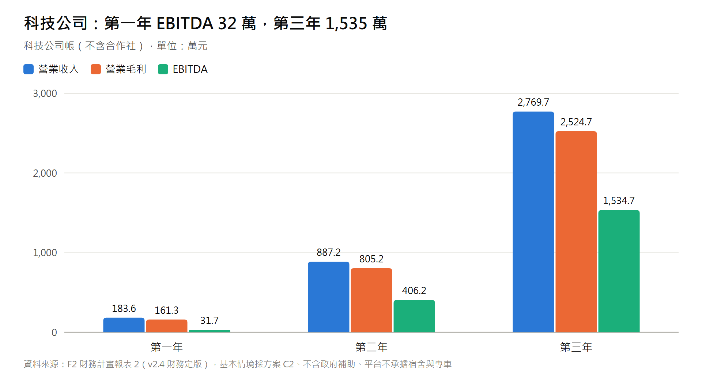
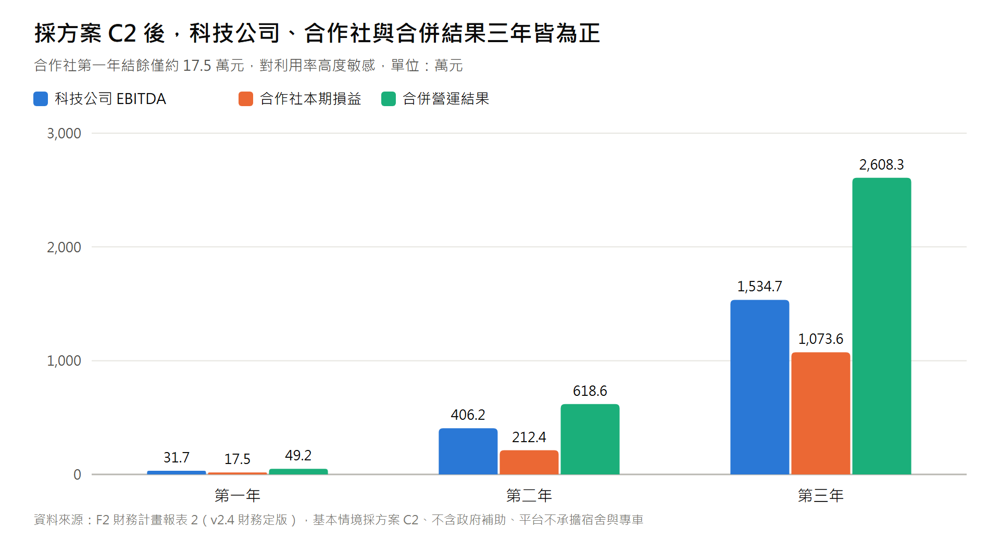
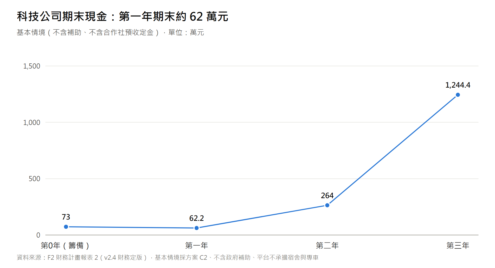
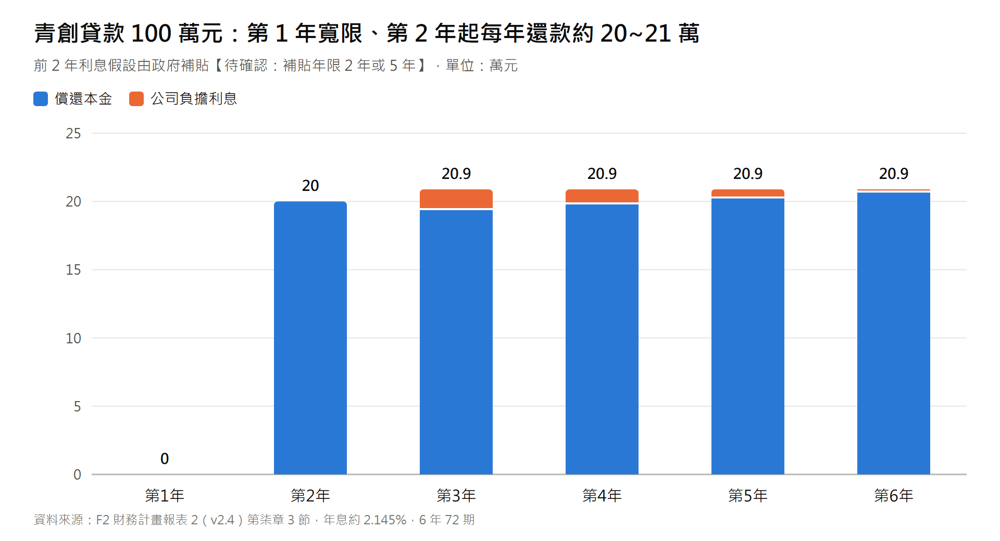
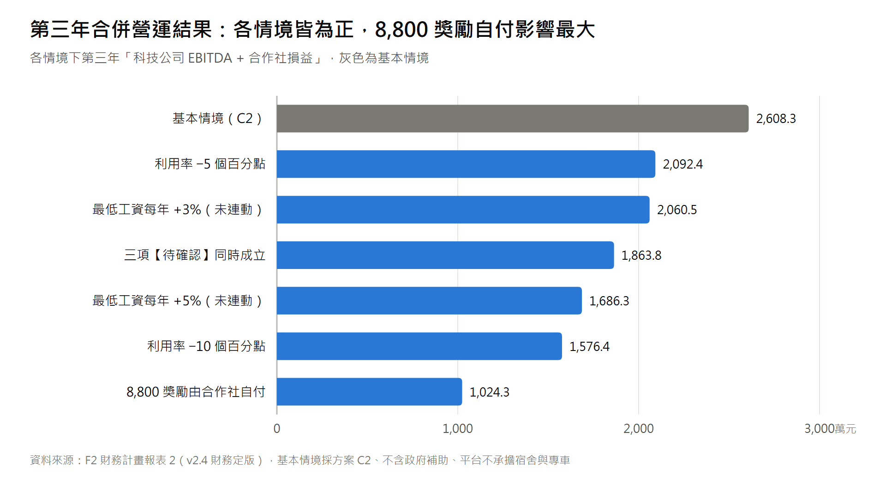
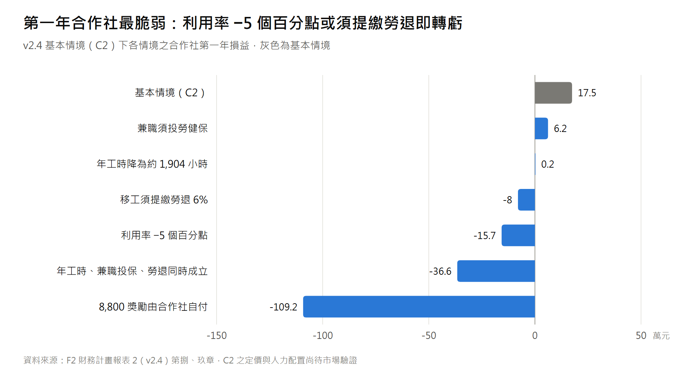
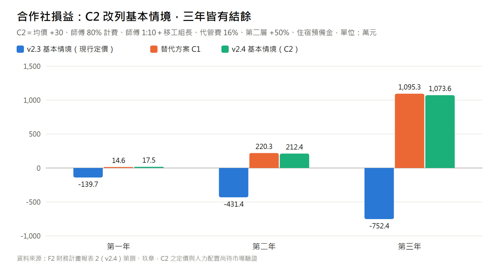

# 智農派工 (AgriDispatch) 財務計畫報表 2
## 三層混合人力模型 (Three-Tier Hybrid Labor Model) 財務精算與損益推演報告

> **報表版本**：Financial Report v2.4（**財務定版**；基本情境改採建議方案 C2，2026-10-01）  
> **定版說明**：本報表為全案**唯一正式財務數字來源**。計畫書、精簡版、貸款計畫書、Pitch 簡報引用之 GMV、營收、EBITDA、損益平衡、資金需求與貸款條件，一律以本報表為準。報表 1（01_三年財務模型）與報表 3（04_北部產區）為早期／情境版本，僅供參考。  
> **編撰依據**：「外展移工（核心全職）」+「本土中高齡/大專生（部分工時時計）」+「專業機耕/無人機（Freelancer 純承攬統包）」三層混合架構，分別精算**科技公司**與**合作社（法定雇主）**兩端損益。

### v2.4 相對 v2.3 之修正摘要（**基本情境改採建議方案 C2**）

| # | 項目 | v2.3 基本情境（現行定價） | v2.4 基本情境（C2） |
| :---: | :--- | :--- | :--- |
| 1 | 定價與拆帳 | 第一層均價 $285／$290／$295、代管費 18% | **第一層均價 $315／$320／$325、代管費 16%**；早鳥工時包不打折 |
| 2 | 帶班人力 | 本土師傅 2／8／20 人，不計費 | **師傅 1／6／15 人、80% 工時下田計費，另設資深移工組長 1／2／5 人（加給 3,000 元/月）** |
| 3 | 第二層 | 4,000／18,000／50,000 小時（8／30／80 人） | **6,000／27,000／75,000 小時（12／45／120 人）**，科技公司招募推廣費 +6／15／40 萬 |
| 4 | 合規預備金 | 無 | **生活照顧與住宿預備金 500 元/人月 ＋ 查核費 6／15／30 萬** |
| 5 | 平台 GMV | 813.1 萬／3,696.0 萬／1 億 1,519 萬 | **983.3 萬／4,533.6 萬／1 億 3,898.2 萬** |
| 6 | 科技公司營收 | 171.1 萬／817.7 萬／2,587.4 萬 | **183.6 萬／887.2 萬／2,769.7 萬** |
| 7 | 科技公司 EBITDA | 25.2 萬／351.7 萬／1,392.4 萬 | **31.7 萬／406.2 萬／1,534.7 萬** |
| 8 | 合作社損益 | −139.7 萬／−431.4 萬／−752.4 萬 | **+17.5 萬／+212.4 萬／+1,073.6 萬** |
| 9 | 合併營運結果 | −114.5 萬／−79.7 萬／+640.0 萬 | **+49.2 萬／+618.6 萬／+2,608.3 萬** |
| 10 | 科技公司期末現金（Y1／Y2／Y3） | 58.1 萬／221.0 萬／1,096.9 萬 | **62.2 萬／264.0 萬／1,244.4 萬** |
| 11 | DSCR（Y2／Y3） | 14.3 倍／54.0 倍 | **16.5 倍／59.4 倍** |
| 12 | 損益平衡 | 科技公司約 9 名移工；合作社無損益平衡點 | **科技公司約 8 名移工；合作社約 7 名移工（第一年）** |
| 13 | 敏感度分析、8,800 獎勵情境 | 以現行定價計算 | **以 C2 重算**；v2.3 第玖章 C2 壓力測試併入第捌章 |
| 14 | 第玖章 | 調整方向與 C1／C2 建議方案 | 改為「採行方案說明」，保留 v2.3 基本情境與 C1 作為對照 |

> **v2.4 前提（如實揭露）**：C2 依賴之假設**尚未經市場與現場驗證**：(1) 第一層均價 $315～$325/hr 之農戶接受度；(2) 帶班師傅 1:10 搭配資深移工組長之可行性；(3) 第二層人才庫可擴大 50%；(4) 代管費率 16% 須經合作社依章程決議。驗證未通過時，應退回第玖章所列 v2.3 基本情境或 C1 之數字，**不得以 v2.4 數字對外承諾**。C2 第一年仍脆弱：利用率降 5 個百分點或移工須提繳勞退，合作社第一年即轉虧（第捌章）。

### v2.3 相對 v2.2 之修正摘要

| # | 修正項目 | v2.2 | v2.3 |
| :---: | :--- | :--- | :--- |
| 1 | 基本情境（第壹～捌章） | — | **不變**。GMV、科技公司損益、合作社損益、現金流、DSCR、敏感度分析均沿用 v2.2 |
| 2 | 第玖章單一槓桿 | A～E | 新增 **F. 師傅配比 1:10 ＋ 資深移工組長**、**G. 第二層工時 +50%**、**H. 代管費率 16%**、**I. 生活照顧與住宿預備金**（成本面，非槓桿） |
| 3 | 第玖章組合方案 | 僅 C1 | 新增 **建議方案 C2**（成本結構調整 ＋ 定價 ＋ 合規預備金），合作社 Y1／Y2／Y3 損益 **+17.5 萬／+212.4 萬／+1,073.6 萬** |
| 4 | 第玖章壓力測試 | 無 | 新增 C2 壓力測試（利用率、年工時上限、兼職投保、移工勞退、最低工資連動、8,800 獎勵） |
| 5 | 第拾壹章 | 下一步「決定後更新為 v2.3」 | 改為「經營團隊決定採行方案後更新為 v2.4，並將採行方案改列基本情境」；【待確認】新增第 13～16 項 |

> v2.3 僅新增試算方案，**不代表經營團隊已採行 C2**；對外引用之基本情境數字仍與 v2.2 相同。

### v2.2 相對 v2.1 之修正摘要

| # | 修正項目 | v2.1 | v2.2 |
| :---: | :--- | :--- | :--- |
| 1 | 宿舍 | 合作社承租宿舍，淨支出 1,000 元/人月（14.4 萬／60 萬／180 萬） | **平台不承租宿舍**：移工住宿由特約農場、產銷班或冷鏈場依生活照顧服務計畫書提供；合作社宿舍成本 0，亦不代扣膳宿費【待確認：見下方說明】 |
| 2 | 專車 | 合作社長租 9 人座專車 2／7／19 輛（104.4 萬／365.4 萬／991.8 萬，含師傅兼司機加給） | **平台不配置專車**：移工往返由用工農戶接送或自行安排之交通方式，費用不計入 GMV、平台不抽成；合作社專車成本 0【待確認：見下方說明】 |
| 3 | 第 0 年資金用途 | 專車押金與 GPS 15 萬、宿舍押金與修繕 15 萬 | **刪除，共 30 萬元改列營運週轉金**（貸款額度維持 100 萬元） |
| 4 | 合作社損益 | −258.5 萬／−856.8 萬／−1,924.2 萬 | **−139.7 萬／−431.4 萬／−752.4 萬** |
| 5 | 合併營運結果 | −233.3 萬／−505.1 萬／−531.8 萬 | **−114.5 萬／−79.7 萬／+640.0 萬** |
| 6 | 科技公司期末現金 | 43.0 萬／28.1 萬／191.0 萬／1,066.9 萬 | **73.0 萬／58.1 萬／221.0 萬／1,096.9 萬** |
| 7 | 第玖章槓桿 | B 槓桿「專車交通費另收」 | B 槓桿已併入基本情境；建議方案 C1 改為「均價 +$30、師傅 80% 計費、代管費 15%」 |
| 8 | 科技公司損益、DSCR | — | **不變**（宿舍與專車原即列在合作社帳，科技公司損益表無此二項） |

> **v2.2 前提與風險（如實揭露）**：本版係經營團隊決定「平台不承擔宿舍與專車」後之試算，**不代表此二項成本消失**，而是改由第三方（特約農場／用工農戶）提供或負擔。須注意：
> 1. 外籍移工之雇主（合作社）依《就業服務法》及生活照顧服務計畫書，仍負有安排住宿之義務；改由特約農場提供時，雇主責任、住宿品質查核與費用歸屬須書面約定【待確認：律師／勞動部確認雇主可否以第三方提供住宿履行義務】。
> 2. 外展農務規範如要求由外展單位統一接送，則「農戶自行接送」可能不符規定【待確認：農業部外展農務試辦要點對交通之要求】。若須由合作社接送，應改採第玖章 v2.1 之 B 槓桿（交通費按趟實報實銷另收），合作社損益與本版相同，但 GMV 外另有代收代付。
> 3. 不提供宿舍即不得代扣膳宿費 3,000 元；移工實領金額之對外說法須一併調整（見第拾章）。
> 4. 原由組長兼任司機之出勤加給（每車每月 1 萬元）一併刪除。

### v2.1 相對 v2.0 之修正摘要

| # | 修正項目 | v2.0 | v2.1 |
| :---: | :--- | :--- | :--- |
| 1 | 最低工資基準 | 月 28,590 元／時 190 元（2025 年數字） | **月 29,500 元／時 196 元**（勞動部公告 2026/1/1 起實施） |
| 2 | 每名移工年可計費工時 | 2,000 小時（隱含年工時上限約 2,174 小時，超過法定正常工時） | **1,800／1,840／1,880 小時**（年可排正常工時約 1,960 小時 × 利用率 92%／94%／96%） |
| 3 | 第一層時薪成本 | $216.7／hr 標示「月均 176 小時」（35,273÷176 實為 200.4，標示錯誤） | **$242.1／hr**（月法定成本 36,312 ÷ 月均可計費 150 小時） |
| 4 | 第三層統包毛利 | 273,000／1,642,000／5,640,000 | **267,000／1,620,000／5,520,000**（依單價×數量重算） |
| 5 | 損益表 | 未扣折舊、無利息、無所得稅，補助列入稅前淨利 | 補列折舊、利息、所得稅；**補助改列「情境」，不計入基本情境** |
| 6 | 現金流量 | 早鳥定金計入科技公司現金；DSCR 含補助 | 定金屬合作社預收款，移出科技公司現金流；DSCR 不含補助與定金 |
| 7 | 合作社端損益 | 未編列 | **新增第肆章**（合作社在現行定價下虧損，如實揭露） |
| 8 | 敏感度分析 | 未編列 | **新增第捌章**（利用率、工資調漲、移工延後到位、補助落空、8,800 獎勵不適用） |
| 9 | 貸款還款 | 第 3 年還本 250,000 | 依 48 期本息攤還重算：第 3 年還本 193,617、利息 15,264（月付約 17,407 元） |

---

## 壹、三層混合人力模型架構與成本係數矩陣

三層混合人力模型的目的，是在合規前提下降低固定人事成本：核心全職人力由合作社依法聘僱；尖峰需求由本土部分工時人員支應；機耕、無人機等成果型作業以承攬方式發包。三層各自的法律性質（僱傭或承攬）須符合實際作業型態【待確認：第三層承攬之從屬性判斷，須由律師依個案契約與作業方式審閱，避免「假承攬、真僱傭」】。

```mermaid
graph TD
    subgraph Three_Tier_Model [三層混合人力財務模型]
        T1[第一層：核心固定部隊<br/>外展移工 (全職定期僱傭，合作社為雇主)<br/>• 月薪 $29,500 (2026 最低工資)<br/>• 法定人事成本係數約 1.231 倍<br/>• 利用率 92%~96%]
        T2[第二層：彈性部隊<br/>本土中高齡 / 大專生 (部分工時時計制)<br/>• 時薪 $196/hr 起 (出勤才計薪)<br/>• 雇主附加成本約 7%]
        T3[第三層：統包部隊<br/>機耕 / 無人機工班 (承攬)<br/>• 自備機具資材、按分地/成果計價<br/>• 平台價差約 34%~36%]
    end
```

### 1. 第一層外展移工每人每月法定人事成本（2026 年基準）

| 代碼 | 成本項目 | 金額 (元/月) | 計算基礎 |
| :---: | :--- | :---: | :--- |
| A1 | 基本工資 (月薪) | **29,500** | 勞動部公告 2026/1/1 起每月最低工資 29,500 元。 |
| A2 | 勞工保險 (雇主負擔 70%) | 2,478 | 投保薪資 29,500 × (普通事故 11% + 就業保險 1%) × 70%【待確認：2026 年適用費率與投保級距】。 |
| A3 | 全民健康保險 (雇主負擔) | 1,428 | 29,500 × 5.17% × 60% × (1 + 平均眷口數 0.56)【待確認：現行費率與眷口數】。 |
| A4 | 職業災害保險 (雇主 100%) | 106 | 29,500 × 約 0.36%（農林漁牧業費率估算）【待確認】。 |
| A5 | 就業安定費 | 2,000 | 沿用原文件金額【待確認：外展農務類別之現行繳納標準】。 |
| A6 | 團體意外險與醫療險 | 350 | 商業保險估算。 |
| A7 | 定期體檢與居留證攤提 | 450 | 年化月攤提估算。 |
| **小計** | **法定人事硬成本** | **36,312** | **約為底薪之 1.231 倍**（v2.0：35,273 元／1.234 倍）。 |
| A8 | (膳宿費代扣) | 0 | v2.2 起合作社不提供宿舍，不代扣膳宿費（v2.1 為 −3,000 元）；若特約農場向移工收取住宿費，須依法定標準並書面告知【待確認】。 |

> 註：本表未列勞工退休金 6% 提繳【待確認：外籍移工是否適用《勞工退休金條例》提繳，請律師/勞動主管機關確認】。

### 2. 三層人力成本與收費精算矩陣

| 人力層級 | 法律性質 | 計薪方式 | 對外收費標準 | 直接人事成本 (含法定附加) | 單位毛利 | 毛利率 |
| :--- | :--- | :--- | :---: | :---: | :---: | :---: |
| **第一層：外展移工** | 全職定期僱傭 (合作社名義) | 固定月薪 (底薪 $29,500) | **$315 ~ $325 / hr**（早鳥不打折） | **$242.1 / hr**（36,312 ÷ 月均可計費 150 小時） | **$72.9 ~ $82.9 / hr** | **23.1% ~ 25.5%** |
| **第二層：本土兼職** | 部分工時 | 時薪制 (出勤才發薪) | **$300 ~ $320 / hr** | **$209.8 / hr**（時薪 $196 + 勞退 6% + 職保）【待確認：部分工時人員勞保、就保、健保之投保義務，若須投保成本約再增 8%~10%】 | **$90.2 ~ $110.2 / hr** | **30.1% ~ 34.4%** |
| **第三層：統包工班** | 承攬 (成果包乾) | 按分地驗收結算 | **$35,000 / 分地** | **$23,000 / 分地** (發包承攬工班) | **$12,000 / 分地** | **34.3%** |
| **第三層：無人機植保** | 承攬 (代噴航線) | 按甲地結算 | **$2,500 / 甲地** | **$1,600 / 甲地** (發包特約飛手) | **$900 / 甲地** | **36.0%** |

> **重要說明**：
> 1. 上表「單位毛利」是**合作社與科技公司合計**的價差，尚未扣除帶班師傅、資深移工組長、合作社行政與住宿預備金。v2.4 起科技公司自第一、二層流水收取 **16%** 代管費（以 $315 計為 $50.4/hr），合作社實收 **$264.6/hr**，高於第一層移工每小時法定成本 $242.1（v2.3 現行定價下實收僅 $233.7/hr，低於成本）。扣除帶班分攤等成本後，合作社第一年損益率約 2.3%（第肆章）。
> 2. 第二層毛利率（約 30%~34%）高於第一層（約 23%~26%），因無就業安定費、無體檢攤提，且無出勤即無成本；v2.4 將第二層工時擴大 50%。
> 3. 第三層由承攬工班自備機具，平台不需購置曳引機或無人機。

---

## 貳、營運規模假設與三層產能結構（三年對照）

> **第一年定義**：自首批外展移工到位並開始派工起算之 12 個月。外展機構資格審查與移工引進所需之籌備期列為「第 0 年」（見第柒章），其延誤影響見第捌章敏感度分析。

| 關鍵營運指標 | 第一年 (灘頭堡) | 第二年 (跨作物) | 第三年 (規模化) |
| :--- | :---: | :---: | :---: |
| **【第一層：外展移工】在籍人數** | **12 人** | **50 人** | **150 人** |
| • 每人年可計費工時 | 1,800 小時 (利用率約 92%) | 1,840 小時 (約 94%) | 1,880 小時 (約 96%) |
| • 移工全年可計費工時 | 21,600 小時 | 92,000 小時 | 282,000 小時 |
| **【本土帶班師傅】(合作社聘僱，80% 工時下田計費)** | 1 人 | 6 人 | 15 人 |
| • 師傅計費工時（每人年工時 × 80%） | 1,440 小時 | 8,832 小時 | 22,560 小時 |
| **【資深移工組長】(由在籍移工兼任，加給 3,000 元/月)** | 1 人 | 2 人 | 5 人 |
| • **第一層全年計費工時（移工 + 師傅）** | **23,040 小時** | **100,832 小時** | **304,560 小時** |
| • 第一層平均收費 | $315 / hr | $320 / hr | $325 / hr |
| **【專車】(v2.2 起平台不配置)** | 0 輛 | 0 輛 | 0 輛 |
| **【第二層：本土兼職】人才庫活躍人數** | **12 人** | **45 人** | **120 人** |
| • 第二層全年出勤工時 | 6,000 小時 | 27,000 小時 | 75,000 小時 |
| • 第二層平均收費 | $300 / hr | $310 / hr | $320 / hr |
| **【第三層：Freelancer 統包】作業量** |  |  |  |
| • 果樹套袋/採收統包 (分地數) | 20 分地 | 120 分地 | 400 分地 |
| • 無人機植保代噴 (甲地數) | 30 甲地 | 200 甲地 | 800 甲地 |
| **第一、二層總計費工時** | **29,040 小時** | **127,832 小時** | **379,560 小時** |
| **服務農戶與合作冷鏈場總數** | 12 戶 | 75 戶 | 260 戶 |

> **v2.4 調整說明**：帶班師傅與移工比由約 1:6 放寬至約 1:10，並由資深移工組長分擔帶班職能【待確認：現場帶班可行性】；師傅 80% 工時下田並計費【待確認：師傅勞動契約之職務內容調整】。第二層人才庫依每人年出勤工時不變之原則同比例擴大 50%。

> **工時上限說明**：勞基法正常工時每週 40 小時，全年約 2,080 小時；扣除國定假日與特別休假後，每名移工年可排正常工時以約 **1,960 小時**估算【待確認：依當年度行事曆、國定假日天數與特休天數實際計算；若降為約 1,904 小時之影響見第捌章】。v2.0 以每人 2,000 可計費小時、利用率 92% 推算，隱含年工時約 2,174 小時，已超過法定正常工時，已於 v2.1 修正。延長工時（加班）須經勞工同意並依法加給工資，本模型未計入。

---

## 參、科技公司三年損益預估表 (Pro Forma P&L)

```
========================================================================================
項目 (單位：新台幣元)           第一年 (Year 1)     第二年 (Year 2)     第三年 (Year 3)
========================================================================================
【平台總流水 GMV】
  1. 第一層：外展移工派工 GMV              $ 7,257,600        $ 32,266,240        $ 98,982,000
  2. 第二層：本土部分工時 GMV              $ 1,800,000         $ 8,370,000        $ 24,000,000
  3. 第三層：Freelancer 統包代耕             $ 775,000         $ 4,700,000        $ 16,000,000
  ────────────────────────────────────────────────────────────────────────────────────
  全案平台總流水 GMV                       $ 9,832,600        $ 45,336,240       $ 138,982,000

【科技公司營業收入 (Net Revenue)】
  1. 系統代管與調度服務費 (16%)            $ 1,449,216         $ 6,501,798        $ 19,677,120
     (第一層與第二層流水 × 16%，由合作社支付)
  2. 第三層統包代耕價差                      $ 267,000         $ 1,620,000         $ 5,520,000
     (以淨額認列【待會計師確認：主理人或代理人判斷】)
  3. 產銷履歷報表與農資團購加值收入            $ 120,000           $ 750,000         $ 2,500,000
  ────────────────────────────────────────────────────────────────────────────────────
  科技公司總營業收入                       $ 1,836,216         $ 8,871,798        $ 27,697,120

【直接營業成本 (COGS)】
  1. 雲端伺服器 (AWS/GCP) 與 API              $ 72,000           $ 240,000           $ 600,000
  2. 第三層承攬工班品管與保險補貼             $ 55,000           $ 220,000           $ 750,000
  3. 現場調度幹部差旅與安全耗材               $ 96,000           $ 360,000         $ 1,100,000
  ────────────────────────────────────────────────────────────────────────────────────
  營業成本小計                               $ 223,000           $ 820,000         $ 2,450,000

【營業毛利 (Gross Profit)】                $ 1,613,216         $ 8,051,798        $ 25,247,120
  (毛利率 %)                                       87.9%               90.8%               91.2%

【營業費用 (OpEx)】
  1. 創辦團隊與後台研發薪資                  $ 720,000         $ 2,400,000         $ 6,000,000
  2. 雙語舍監與兼職通譯津貼                  $ 180,000           $ 600,000         $ 1,500,000
  3. 本土農工與兼職招募推廣費                $ 180,000           $ 500,000         $ 1,300,000
  4. 法律顧問、會計與合規規費                $ 120,000           $ 250,000           $ 500,000
  5. 辦公室租金與水電雜支                     $ 96,000           $ 240,000           $ 600,000
  ────────────────────────────────────────────────────────────────────────────────────
  營業費用小計                             $ 1,296,000         $ 3,990,000         $ 9,900,000

【EBITDA】                                   $ 317,216         $ 4,061,798        $ 15,347,120
  (EBITDA 率 %)                                    17.3%               45.8%               55.4%
  減：折舊與攤銷                             -$ 60,000          -$ 250,000          -$ 650,000
【營業淨利 (EBIT)】                          $ 257,216         $ 3,811,798        $ 14,697,120
  減：利息費用 (公司負擔部分)                      $ 0                 $ 0           -$ 15,264
【稅前淨利 (不含補助)】                      $ 257,216         $ 3,811,798        $ 14,681,856
  減：營利事業所得稅 (簡化 20%)              -$ 51,443          -$ 762,360        -$ 2,936,371
【稅後淨利 (基本情境)】                      $ 205,773         $ 3,049,438        $ 11,745,485
========================================================================================
【情境：政府補助核定 (非確定收入，不計入基本情境)】
  SBIR 研發款 + 職務再設計輔具補助          $ 1,000,000         $ 2,000,000         $ 1,500,000
  含補助稅前淨利 (情境)                    $ 1,257,216         $ 5,811,798        $ 16,181,856
========================================================================================
```

> **編製說明**：
> 1. 薪資費用說明：「創辦團隊與後台研發薪資」第一年 72 萬元，以創辦人 1 名、月支含雇主負擔約 6 萬元估算；若增聘 1 名全職調度專員（以最低工資 29,500 元、雇主負擔約 1.20 倍計），年增約 42.5 萬元。「雙語舍監與兼職通譯津貼」第一年 18 萬元，以時薪 196 元計約為 2 名兼職人員各每月 38 小時；v2.2 起平台不承租宿舍，此項職能改為至特約住宿處之生活照顧訪視與通譯，金額不變。
> 2. 「本土農工與兼職招募推廣費」v2.4 較 v2.3 增加 6／15／40 萬元，以支撐第二層工時擴大 50%。
> 3. 代管費率 v2.4 起由 18% 調為 16%（科技公司讓利予合作社），須經合作社社員（代表）大會或理事會依章程決議【待確認】。
> 4. 所得稅以 20% 簡化估列，未計起徵額、第 0 年開辦費虧損扣抵與研發投資抵減【待會計師確認】。政府補助款之課稅方式【待會計師確認】。
> 5. 利息：青創貸款前 2 年利息假設由政府補貼（公司負擔 0），第 3 年起由公司負擔【待確認：現行利息補貼年限為 2 年或 5 年；若為 5 年，第 3 年利息 15,264 元可免除】。
> 6. **科技公司的 16% 代管費收入來自合作社。本表須與第肆、伍章合併閱讀；合作社第一年結餘僅約 17.5 萬元，對利用率高度敏感（第捌章）。**






---

## 肆、合作社端損益（法定雇主）

合作社為外展移工與本土兼職人員之法定雇主，收取第一、二層流水扣除 16% 代管費後之 **84%**，並負擔全部人事、帶班師傅、資深移工組長、行政與住宿預備金。v2.2 起宿舍與專車不由合作社負擔（前提與風險見本報表 v2.2 修正摘要）。

### 1. 合作社端成本假設

| 成本項目 | 假設 | 來源 / 說明 |
| :--- | :--- | :--- |
| 外展移工法定人事成本 | 36,312 元/人月 | 本報表第壹章 A1~A7（2026 最低工資）。 |
| 本土帶班師傅 | 41,000 元/人月 × 雇主負擔 1.20；1／6／15 人 | 依《本土農業師傅勞動契約》月薪 36,000~45,000 元區間取 38,000 元 + 帶班加給 3,000 元；v2.4 起 80% 工時下田計費（計入第一層計費工時）。 |
| 資深移工組長加給 | 3,000 元/人月 × 1.20；1／2／5 人 | 由在籍移工兼任，分擔帶班職能（43,200／86,400／216,000 元）。 |
| 本土兼職人事成本 | 209.8 元/hr | 時薪 196 元 × 1.0705（勞退 6% + 職保）。 |
| 生活照顧與住宿預備金 | 500 元/人月 ＋ 查核費 6／15／30 萬 | 因應雇主住宿責任（住宿由特約場域提供）【待確認：雇主住宿義務之履行方式與預備金是否足夠】。 |
| 宿舍、專車 | 0 | v2.2 刪除。住宿由特約農場、產銷班或冷鏈場提供；交通由用工農戶接送或特約車行按趟實報實銷【待確認】。 |
| 合作社行政管理 | 18 萬 / 48 萬 / 120 萬 | 記帳、稅務、社務會議與雜支估算【待確認】。 |

### 2. 合作社三年損益（基本情境：C2）

```
========================================================================================
項目 (單位：新台幣元)           第一年 (Year 1)     第二年 (Year 2)     第三年 (Year 3)
========================================================================================
【合作社收入】第一、二層流水 × 84%          $ 7,608,384        $ 34,134,442       $ 103,304,880

【合作社成本】
  1. 外展移工法定人事成本                  $ 5,228,928        $ 21,787,200        $ 65,361,600
  2. 本土帶班師傅 (1/6/15 人)                $ 590,400         $ 3,542,400         $ 8,856,000
  3. 本土兼職人事成本                      $ 1,258,800         $ 5,664,600        $ 15,735,000
  4. 合作社行政管理                          $ 180,000           $ 480,000         $ 1,200,000
  5. 生活照顧與住宿預備金                    $ 132,000           $ 450,000         $ 1,200,000
  6. 資深移工組長加給                         $ 43,200            $ 86,400           $ 216,000
  ────────────────────────────────────────────────────────────────────────────────────
  合作社成本合計                           $ 7,433,328        $ 32,010,600        $ 92,568,600

【合作社本期損益】                           $ 175,056         $ 2,123,842        $ 10,736,280
  (合作社損益率 %)                                  2.3%                6.2%               10.4%
  (v2.3 現行定價，供對照)                 -$ 1,397,008        -$ 4,313,600        -$ 7,523,800
========================================================================================
```

> **每計費小時拆解（第一年第一層）**：合作社實收 $264.6（v2.3：$233.7）− 移工成本 $226.9（$242.1）− 師傅與組長分攤 $27.5（$54.7）＝ **+$10.1**（v2.3：−$63.0），尚未扣行政費用與住宿預備金。移工成本每小時下降，係因師傅下田計費使計費工時分母增加。

> **結論（如實揭露）**：採 C2 後合作社三年皆有結餘，但**第一年僅約 17.5 萬元（損益率 2.3%）**，緩衝極薄：利用率降 5 個百分點、移工須提繳勞退，或 8,800 元獎勵須由合作社補足時，第一年即轉為虧損（第捌章）。第一年宜以**淡季保底工時合約**（冷鏈場、集貨場、產銷班雨天室內作業）守住利用率【待確認：合作對象意願與契約形式】。
>
> 另：早鳥定金（20%）由小農支付予合作社（締約主體），屬合作社之「預收款項（負債）」，應依履約進度認列並專戶管理，不得視為科技公司現金或營運資金。

---

## 伍、合併觀點（科技公司 + 合作社）

| 項目 (元) | 第一年 | 第二年 | 第三年 |
| :--- | :---: | :---: | :---: |
| 科技公司 EBITDA | 317,216 | 4,061,798 | 15,347,120 |
| 合作社本期損益 | 175,056 | 2,123,842 | 10,736,280 |
| **合併營運結果** | **492,272** | **6,185,640** | **26,083,400** |
| (v2.3 現行定價之合併營運結果，供對照) | -1,144,928 | -796,800 | 6,400,400 |

> 兩個法人財務獨立，此表僅用於檢視整體商業模式是否成立。採 C2 後，**科技公司、合作社與合併結果三年皆為正**；科技公司帳面獲利不再建立在合作社虧損之上。惟 C2 之定價與人力配置須經市場與現場驗證（見本報表 v2.4 前提）。




---

## 陸、損益平衡點 (Break-Even Analysis)

### 1. 科技公司損益平衡（僅科技公司帳）
* **固定營業費用**：1,296,000 元/年。
* **扣除固定貢獻**：第三層統包價差 267,000 元 + 加值收入 120,000 元 → **淨固定費用 909,000 元**。
* **每計費工時邊際貢獻**：第一層 $315 × 16% = $50.40，第二層 $300 × 16% = $48.00；扣除變動營業成本約 $7.68/hr（223,000 ÷ 29,040 小時）→ 第一層 **$42.72/hr**、第二層 **$40.32/hr**。
* **計算式**：第二層 6,000 小時貢獻 241,926 元；第一層所需計費工時 =(909,000 − 241,926)÷ 42.72 ≈ **15,615 小時**。
* **換算移工人數**：扣除師傅計費 1,440 小時後 ÷ 1,800 小時/人 ≈ **7.9 人（約 8 名移工）**（v2.3：約 9 名）。

### 2. 合作社與合併損益平衡
* 每增加 1 名移工，合作社年損益約 **+34,536 元（第一年）／+52,848 元（第二年）／+71,496 元（第三年）**（移工人事與每人住宿預備金；v2.3 現行定價下約 −15,000／+1,800／+19,000 元）。
* 第一年扣除每名移工貢獻前之合作社淨固定負擔約 239,376 元（師傅成本扣除其計費收入、組長加給、行政、查核費，再加計第二層貢獻），故**合作社第一年損益平衡約需 6.9 名（約 7 名）移工**；本模型第一年 12 名。
* 在 C2 其他條件不變下，合作社損益兩平之第一層均價為：第一年約 **$306**、第二年約 **$295**、第三年約 **$283**（v2.3 現行條件：$364／$347／$328）。對外早鳥工時包不得以低於此價之折扣促銷（v2.4 起早鳥不打折）。
* 合併層面（科技公司 EBITDA + 合作社）三年皆為正（+49.2 萬／+618.6 萬／+2,608.3 萬元）。

---

## 柒、現金流量預估、資金需求與貸款條件（科技公司）

### 1. 第 0 年（籌備期）資金來源與用途

| 項目 | 金額 (元) | 說明 |
| :--- | :---: | :--- |
| **來源：青年創業及啟動金貸款** | **1,000,000** | 貸款條件見本章第 3 節。 |
| **來源：創始股東出資（資本額）** | **100,000** | 智農科技股份有限公司實收資本額。 |
| **資金來源合計** | **1,100,000** | **全案啟動資金需求 110 萬元** |
| 用途：公司與合作社設立法務規費 | 100,000 | 開辦費（費用化）。 |
| 用途：移工前置安全訓練與三語教材 | 150,000 | 開辦費（費用化）。 |
| 用途：田間安全裝備與採收工具 | 120,000 | 依貸款書 CAP-3（費用化）。 |
| 保留：伺服器建置（第一年資本支出）與營運週轉金 | 730,000 | 其中 180,000 元用於第一年伺服器建置，其餘 550,000 元為週轉準備（含 v2.2 刪除專車與宿舍押金後移入之 300,000 元）。 |

> v2.2 刪除「專車租賃押金與 GPS 設備 150,000 元」與「宿舍租賃押金與基本修繕 150,000 元」，貸款額度維持 100 萬元，30 萬元改列週轉金，用以補強第一年現金緩衝（v2.1 第一年期末現金僅約 28 萬元）。若承貸銀行要求貸款用途須有具體資本支出，可改為貸款 70 萬元（見本章第 3 節備註）。【待確認：移工訓練屬合作社（雇主）業務，若由科技公司以貸款資金支付，須以書面約定代墊與歸還方式，並確認貸款資金用途符合承貸銀行規定】。籌備期假設創辦人不支薪；籌備期長度【待確認：外展機構資格審查與移工引進所需時間】。

### 2. 三年現金流量預估表（基本情境：不含補助、不含合作社預收定金）

```
========================================================================================
現金流量項目 (單位：新台幣元)    第0年(籌備)   第一年 (Y1)     第二年 (Y2)     第三年 (Y3)
========================================================================================
【營業活動現金流】
  稅後淨利 (不含補助)            -$ 370,000      $ 205,773    $ 3,049,438   $ 11,745,485
  折舊與攤銷加回                        $ 0       $ 60,000      $ 250,000      $ 650,000
  應收帳款增加                          $ 0     -$ 135,631     -$ 496,322   -$ 1,314,656
    (合作社代管費月結 1 個月 + 第三層小農 7 日帳期)
  應付承攬工班款增加 (30 日)            $ 0      +$ 42,333     +$ 214,334     +$ 616,666
  ────────────────────────────────────────────────────────────────────────────────────
  營業活動淨現金流入 (流出)      -$ 370,000      $ 172,475    $ 3,017,450   $ 11,697,495

【投資活動現金流】
  存出保證金 (v2.2 刪除專車、宿舍押金)  $ 0            $ 0            $ 0            $ 0
  伺服器與演算法資本化支出              $ 0     -$ 200,000     -$ 600,000   -$ 1,200,000
  辦公室與基本設備購置                  $ 0      -$ 80,000     -$ 200,000     -$ 500,000
  ────────────────────────────────────────────────────────────────────────────────────
  投資活動淨現金流出                    $ 0     -$ 280,000     -$ 800,000   -$ 1,700,000

【融資活動現金流】
  青年創業貸款撥入              +$1,000,000            $ 0            $ 0            $ 0
  創始股東出資                  +$  100,000            $ 0            $ 0            $ 0
  償還青創貸款本金                      $ 0            $ 0     -$ 200,000     -$ 193,617
  ────────────────────────────────────────────────────────────────────────────────────
  融資活動淨現金流入 (流出)     +$1,100,000            $ 0     -$ 200,000     -$ 193,617

【現金淨增加額】                 $  730,000     -$ 107,525    $ 2,017,450    $ 9,803,878
  期初現金餘額                          $ 0      $ 730,000      $ 622,475    $ 2,639,925
  期末現金餘額                   $  730,000      $ 622,475    $ 2,639,925   $ 12,443,803
  (v2.3 現行定價之期末現金)      $  730,000      $ 580,794    $ 2,209,734   $ 10,969,270
========================================================================================
```

> **現金流說明**：
> 1. 採 C2 後代管費收入增加，各年期末現金較 v2.3 增加約 4.2 萬／43.0 萬／147.5 萬元，第一年期末約 62.2 萬元。若移工延後 6 個月到位（第捌章），第一年 EBITDA 轉為約 −26 萬元，期末現金粗估降至約 14 萬元，仍須預備額外週轉資金或延後資本支出。
> 2. 早鳥定金屬合作社預收款，不列入本表；補助款若核定，視為額外現金流入（情境）。
> 3. 以上現金流以合作社依約支付代管費為前提（見第肆章）。




### 3. 青創貸款條件（定版假設）

| 項目 | 條件 | 備註 |
| :--- | :--- | :--- |
| 貸款額度 | 1,000,000 元 | 借款人：智農科技股份有限公司 |
| 貸款期間 | 6 年（72 期） | 含寬限期 12 個月 |
| 利率 | 約年息 2.145%（中華郵政二年期定儲機動利率 + 0.575%） | 【待確認：以撥貸時實際利率為準】 |
| 利息補貼 | 前 2 年政府補貼（公司負擔 0） | 【待確認：現行為前 2 年或前 5 年免息】 |
| 信用保證 | 信保基金 100% 保證 | 【待確認：現行保證成數（各文件曾出現 95% 與 100%）】 |
| 第 1~12 期 | 寬限期，只付息（利息補貼） | 公司每月支付 0 元 |
| 第 13~24 期 | 每月還本 16,667 元（全年 200,000 元） | 利息補貼 |
| 第 25~72 期 | 剩餘本金 800,000 元，48 期本息平均攤還 | **每月約 17,407 元**（全年約 208,884 元） |

> 月付驗算：M = 800,000 × r ÷ [1 − (1 + r)^−48]，r = 2.145% ÷ 12 = 0.17875% → **M ≈ 17,407 元**（原貸款書所載 21,700 元有誤）。第 3~6 年分年還本約 193,617／197,812／202,097／206,474 元，利息約 15,264／11,070／6,785／2,407 元。

> **備註（替代方案：貸款降為 70 萬元）**：刪除專車與宿舍押金後，扣除週轉金之具體用途約 70 萬元即可支應。若改貸 70 萬元（同條件），第 2 年還本 140,000 元，第 3 年起月付約 12,185 元（第 3 年還本約 135,532 元、利息約 10,685 元）；以 v2.4 基本情境計，期末現金約 43.0 萬／32.2 萬／240.0 萬／1,226.6 萬元，DSCR 第二年約 23.6 倍、第三年約 84.9 倍。本報表基本情境仍以貸款 100 萬元計。




### 4. 償債能力（DSCR，科技公司，不含補助與定金）

| 項目 | 第一年 | 第二年 | 第三年 |
| :--- | :---: | :---: | :---: |
| EBITDA − 所得稅 (元) | 265,773 | 3,299,438 | 12,410,749 |
| 當年還本付息 (元) | 0（寬限期） | 200,000 | 208,881 |
| **DSCR** | 不適用 | **16.5 倍** | **59.4 倍** |
| 壓力情境：利用率 −10 個百分點 | 不適用 | 14.3 倍 | 53.1 倍 |
| (v2.3 現行定價，供對照) | 不適用 | 14.3 倍 | 54.0 倍 |

> DSCR 僅反映科技公司帳面；其前提是合作社能持續支付代管費。C2 下合作社第一年結餘有限，若利用率或法規成本不利（第捌章），合作社支付能力將直接影響科技公司收入與還款能力。

---

## 捌、敏感度分析

基本情境＝本報表第參、肆章（v2.4，C2）。單位：新台幣元。

| 情境 | 科技公司 EBITDA Y1 | 科技公司 EBITDA Y3 | 合作社損益 Y1 | 合作社損益 Y2 | 合作社損益 Y3 | 合併 Y1 | 合併 Y3 |
| :--- | ---: | ---: | ---: | ---: | ---: | ---: | ---: |
| **基本情境（v2.4，C2）** | **317,216** | **15,347,120** | **175,056** | **2,123,842** | **10,736,280** | **492,272** | **26,083,400** |
| 利用率 −5 個百分點（每人年少約 98 小時） | 253,994 | 14,521,568 | -156,858 | 680,278 | 6,402,132 | 97,136 | 20,923,700 |
| 利用率 −10 個百分點 | 190,772 | 13,696,016 | -488,772 | -763,285 | 2,067,984 | -298,000 | 15,764,000 |
| 年可排正常工時降為約 1,904 小時（計費工時 ×0.9714）【待確認：國定假日天數】 | 284,315 | 14,892,224 | 2,325 | 1,343,139 | 8,348,076 | 286,640 | 23,240,300 |
| 部分工時人員須投勞健保（第二層成本 ×1.09）【待確認】 | 317,216 | 15,347,120 | 61,764 | 1,614,028 | 9,320,130 | 378,980 | 24,667,250 |
| 外籍移工須提繳勞退 6%（+1,770 元/人月）【待確認】 | 317,216 | 15,347,120 | -79,824 | 1,061,842 | 7,550,280 | 237,392 | 22,897,400 |
| 上列年工時、兼職投保、勞退三項同時成立 | 284,315 | 14,892,224 | -365,847 | -228,675 | 3,745,926 | -81,532 | 18,638,150 |
| 最低工資自第二年起每年 +3%，售價**未**連動 | 317,216 | 15,347,120 | 175,056 | 1,194,016 | 5,258,167 | 492,272 | 20,605,287 |
| 最低工資自第二年起每年 +3%，售價**連動**調整 | 317,216 | 16,545,457 | 175,056 | 2,218,049 | 11,549,434 | 492,272 | 28,094,890 |
| 最低工資自第二年起每年 +5%，售價**未**連動 | 317,216 | 15,347,120 | 175,056 | 574,132 | 1,516,138 | 492,272 | 16,863,258 |
| 移工延後 3 個月到位（第一年僅 9 個月派工） | 26,912 | 同基本 | 134,592 | 同基本 | 同基本 | 161,504 | 同基本 |
| 移工延後 6 個月到位（第一年僅 6 個月派工） | -263,392 | 同基本 | 94,128 | 同基本 | 同基本 | -169,264 | 同基本 |
| 8,800 獎勵移工不適用、合作社自付補足（見第拾章） | 317,216 | 15,347,120 | -1,092,144 | -3,156,158 | -5,103,720 | -774,928 | 10,243,400 |
| 補助全數落空 | 同基本（基本情境已不含補助） | 同基本 | 同基本 | 同基本 | 同基本 | 同基本 | 同基本 |
| 補助全數核定（情境） | 稅前 +1,000,000 | 稅前 +1,500,000 | — | — | — | — | — |

> 註：利用率與年工時情境同步減少師傅計費工時；工資調漲情境同步放大移工、師傅與兼職成本；連動情境第一、二層售價同比例調整；移工延後到位情境，第一層收入、移工人事、帶班師傅、組長加給與每人住宿預備金按派工月數比例計算，第二層、合作社行政與查核費不變。

> 解讀：
> 1. **合作社第一年是全案最脆弱的環節**：利用率降 5 個百分點即轉虧約 −15.7 萬元；年工時、兼職投保、勞退三項【待確認】同時成立時，合作社第一、二年皆虧損。第一年應以淡季保底工時合約守住利用率，並優先釐清三項【待確認】。
> 2. 科技公司帳面對利用率與工資變動不敏感，工資風險主要落在合作社；但 C2 下利用率降 10 個百分點時合作社第一、二年皆虧，代管費支付能力將受影響。
> 3. 最低工資每年 +3% 時，有無價格連動條款使合作社第三年相差約 629 萬元；+5% 且未連動時，合作社第三年結餘縮至約 152 萬元。**建議在要派契約中訂定「價格隨最低工資連動調整」條款**【待確認：條款效力請律師審閱】。
> 4. 移工延後到位時，合作社因成本同步延後而影響有限，但科技公司固定費用照付；延後 6 個月時科技公司第一年 EBITDA 約 −26 萬元。
> 5. 8,800 元獎勵若須由合作社補足，C2 亦無法成立（合作社三年皆虧）。






---

## 玖、採行方案說明：C2 改列基本情境（v2.4）

v2.3 第玖章研擬之建議方案 C2，經經營團隊決定自 v2.4 起改列基本情境（第壹～捌章已依 C2 重算）。原「現行定價」基本情境與替代方案 C1 保留於本章作為對照。**定價與人力配置仍須經市場與現場驗證**【待確認：目標客群可接受之價格】；代管費率調整須經合作社社員（代表）大會或理事會依章程決議。

### 1. C2 調整內容（相對 v2.3 基本情境）

| 類別 | 項目 | v2.3 基本情境 | v2.4 基本情境（C2） | 說明 |
| :--- | :--- | :--- | :--- | :--- |
| 減少費用 | 本土帶班師傅人數 | 2／8／20 人（約 1:6） | **1／6／15 人**（約 1:10） | 第一年節省約 59 萬元【待確認：現場帶班可行性】 |
| 減少費用 | 師傅工時運用 | 不計費 | **80% 工時下田並計費** | 第一年增加 1,440 計費小時 |
| 減少費用 | 代管費率 | 18% | **16%** | 移轉科技公司收入予合作社；須經合作社理事會依章程決議 |
| 增加收費 | 第一層均價 | $285／$290／$295 | **$315／$320／$325** | 早鳥工時包不打折（120 工時 $37,800）；日費約 2,520 元【待確認：市場接受度】 |
| 增加收費 | 第二層工時 | 4,000／18,000／50,000 小時 | **6,000／27,000／75,000 小時** | 第二層合作社每小時貢獻約 +$42～$59（16% 代管費下） |
| 增加收費 | 價格隨最低工資連動 | 無 | **納入要派契約** | 見第捌章【待確認：條款效力請律師審閱】 |
| 增加支出 | 資深移工組長加給 | 0 | 1／2／5 人 × 3,000 元/月 × 1.20 | 43,200／86,400／216,000 元；分擔師傅帶班職能 |
| 增加支出 | 生活照顧與住宿預備金 | 0 | 500 元/人月 ＋ 查核費 6／15／30 萬 | 132,000／450,000／1,200,000 元；因應雇主住宿責任【待確認】 |
| 增加支出 | 第二層招募推廣（科技公司） | 12／35／90 萬 | **18／50／130 萬** | 支撐第二層工時 +50% |

> 未列入試算之上檔空間：急件（48 小時內）加成、單次最低計費 4 小時、加班接單【待確認】、外展農務就業安定費實際費率若低於 2,000 元【待確認】、政府補助。

### 2. 與 v2.3 基本情境、替代方案 C1 之比較（元）

| 方案 | 合作社 Y1 | 合作社 Y2 | 合作社 Y3 | 科技公司 EBITDA Y1 | 科技公司 EBITDA Y3 | 合併 Y1 | 合併 Y3 |
| :--- | ---: | ---: | ---: | ---: | ---: | ---: | ---: |
| v2.3 基本情境（現行定價、18% 代管費） | -1,397,008 | -4,313,600 | -7,523,800 | 252,080 | 13,924,200 | -1,144,928 | 6,400,400 |
| 替代方案 C1（均價 +$30、師傅 80% 計費、代管費 15%） | 145,592 | 2,203,272 | 10,952,500 | 264,680 | 13,683,900 | 410,272 | 24,636,400 |
| **v2.4 基本情境（C2）** | **175,056** | **2,123,842** | **10,736,280** | **317,216** | **15,347,120** | **492,272** | **26,083,400** |

> C1 與 C2 第一年合作社結餘相近（14.6 萬 vs 17.5 萬），但 C2 已內含 13.2 萬元合規預備金與第二層擴張，科技公司第一年 EBITDA 亦較高（31.7 萬 vs 26.5 萬）；代價是 C2 須同時落實帶班人力精簡與第二層招募。若 C2 之帶班配比或第二層擴張驗證不可行，可改採 C1；若定價驗證不可行，應退回 v2.3 基本情境並重新檢討商業模式。



### 3. 單一調整槓桿之效果（以 v2.3 基本情境為基準，合作社損益，元）

| 調整槓桿 | 合作社 Y1 | 合作社 Y2 | 合作社 Y3 | 科技公司 EBITDA Y1 | 備註 |
| :--- | ---: | ---: | ---: | ---: | :--- |
| v2.3 基本情境（現行定價，不含宿舍與專車） | -1,397,008 | -4,313,600 | -7,523,800 | 252,080 | — |
| A. 第一層均價 +$40/hr（Y1 $325 / Y2 $330 / Y3 $335） | -688,528 | -1,296,000 | 1,725,800 | 407,600 | 需市場驗證 |
| B. 專車交通費按趟實報實銷另向小農收取 | 已併入基本情境 | — | — | — | v2.2 起平台不配置專車 |
| C. 帶班師傅 80% 工時計入可計費工時 | -723,952 | -1,513,267 | -247,448 | 399,824 | 師傅兼作業並計費 |
| D. 代管費率 18% → 12% | -955,648 | -2,378,000 | -1,572,400 | -189,280 | 移轉科技公司收入 |
| E. 延長工時（加班）接單 | 未試算 | — | — | — | 【待確認：外展移工加班之規範與勞工同意】 |
| F. 師傅配比 1:6 → 1:10（2/8/20 → 1/6/15 人）＋資深移工組長 1/2/5 人（加給 3,000 元/月） | -849,808 | -3,219,200 | -4,787,800 | 252,080 | v2.3 新增；【待確認：現場帶班可行性】 |
| G. 第二層工時 +50%（6,000／27,000／75,000 小時）＋招募推廣費 +6／15／40 萬 | -1,324,608 | -3,914,000 | -6,208,800 | 300,080 | v2.3 新增；招募費由科技公司負擔 |
| H. 代管費率 18% → 16% | -1,249,888 | -3,668,400 | -5,540,000 | 104,960 | v2.3 新增；移轉科技公司收入 |
| I. 生活照顧與住宿預備金（500 元/人月＋查核費 6／15／30 萬） | -1,529,008 | -4,763,600 | -8,723,800 | 252,080 | v2.3 新增；為成本面預留，非改善槓桿 |

> 單一槓桿中，僅 A（均價 +$40）可使合作社第三年轉正；第一、二年仍須組合調整。F～H 單獨採行亦皆無法使合作社轉正。

### 4. 執行條件

1. **第一年保底工時合約**：與冷鏈場、集貨場、產銷班簽訂淡季保底時數（例如雨天改做室內分級包裝），守住 92% 利用率【待確認：合作對象意願與契約形式】。
2. **價格連動條款**：要派契約訂定「價格隨最低工資連動調整」【待確認：條款效力】。
3. **優先釐清【待確認】**：年工時、兼職投保、移工勞退三項若同時成立，合作社第一、二年皆虧損；8,800 獎勵若須由合作社補足，C2 亦無法成立。
4. **早鳥不打折**：早鳥工時包維持 $315/hr，誘因改為鎖定名額、優先排班與履約賠償；任何折扣不得使實收低於第陸章損益兩平價。
5. **第三年盈餘之運用**：合作社損益率達約 10% 時，可依《合作社法》與章程提列公積、社員分配，或回饋降價（例如第三年均價維持 $315）以強化競爭力。

---

## 拾、農業部 8,800 元就業獎勵之適用疑慮

**【待確認：此獎勵適用對象須向農業部確認，若移工不適用，相關薪資與防跳單論述需調整】**

各文件將外展移工列為每月最高 8,800 元就業獎勵之領取人，並據此宣稱移工實領可達 3.5 萬~4 萬元。該獎勵之適用對象可能僅限本國勞工。本模型基本情境**未將 8,800 元列為任何一方之收入**（獎勵係發給勞工本人，不影響雇主成本），但影響如下：

| 若移工不適用 | 影響 |
| :--- | :--- |
| 情境 1：不補差額 | 合作社成本不變；v2.2 起合作社不代扣膳宿費，移工實領約為最低工資 **29,500 元**（扣除勞健保自付額前；另加加班費或績效獎金），但住宿費改向特約住宿提供者支付【待確認：金額與支付方式】。所有「月領近 4 萬」「失去 8,800 元獎勵故不跳單」之論述須刪除或改寫。 |
| 情境 2：合作社自付補足至原宣稱水準 | 合作社年成本增加 **1,267,200 元（Y1，12 人）／5,280,000 元（Y2，50 人）／15,840,000 元（Y3，150 人）**；以 v2.4 基本情境計，合作社損益變為 −1,092,144／−3,156,158／−5,103,720 元，**C2 無法成立**（v2.3 現行定價：−2,664,208／−9,593,600／−23,363,800 元）。 |

> 建議：在確認前，對外文件一律不以 8,800 元作為移工收入或留才之承諾。

---

## 拾壹、財務總結與使用建議

1. **對創投與加速器**：可呈現科技公司毛利率約 88%~91%、EBITDA 率 17%~55% 之輕資產結構，並揭露合作社端三年皆有結餘（約 +17.5 萬／+212.4 萬／+1,073.6 萬元）但第一年緩衝極薄；**必須同時說明 C2 之定價與人力配置尚待市場驗證**，只呈現科技公司帳面會形成誤導。
2. **對銀行（青創貸款）**：以本報表第柒章基本情境（不含補助、不含定金）說明償債能力（DSCR 第二年 16.5 倍、第三年 59.4 倍），並揭露合作社為科技公司主要收入來源之集中風險。
3. **對農業部與勞動部**：強調第一層外展農工依法投保與最低工資保障、第二層本土中高齡就業、第三層機耕承攬共享；收費結構（含 16% 代管費）應如實揭露，與本報表一致。
4. **下一步**：(1) 以農戶訪談與早鳥預約驗證 $315/hr 定價，並於試營運驗證師傅 1:10 與第二層擴張；(2) 洽談淡季保底工時合約；(3) 向農業部確認 8,800 元獎勵適用對象；(4) 由律師確認第三層承攬、部分工時投保、移工退休金與價格連動條款；(5) 確認住宿由特約場域提供、交通由農戶安排之合規性；(6) 驗證未通過時，依第玖章退回 C1 或 v2.3 數字並升版。

### 本報表【待確認】事項彙整
1. 勞保、健保、職災保險 2026 年費率與投保級距；外展農務就業安定費標準。
2. 外籍移工是否適用勞工退休金 6% 提繳。
3. 部分工時人員之勞保、就保、健保投保義務。
4. 年可排正常工時（國定假日、特休天數）。
5. 合作社行政費用。
6. 青創貸款利率、利息補貼年限（2 年或 5 年）、信保成數（95% 或 100%）。
7. 第三層統包收入之認列方式（淨額或總額）、所得稅與補助課稅方式。
8. 移工訓練費用由科技公司或合作社負擔。
9. 8,800 元就業獎勵之適用對象。
10. 定價（$315～$325/hr，早鳥不打折）之市場可接受度、代管費率 16% 之合作社決議程序。
11. （v2.2）雇主住宿義務可否由特約農場／產銷班／冷鏈場提供履行，住宿費用歸屬與品質查核方式。
12. （v2.2）外展農務是否要求外展單位統一接送；若須接送，改採交通費實報實銷另收。
13. （v2.4 基本情境前提）帶班師傅配比 1:10 搭配資深移工組長之現場可行性，以及師傅兼作業並計費之勞動契約調整。
14. （v2.4 基本情境前提）第一層均價 $315～$325/hr 之市場接受度；第二層人才庫可否擴大至 6,000／27,000／75,000 小時。
15. （v2.4）要派契約「價格隨最低工資連動調整」條款之效力。
16. （v2.4）生活照顧與住宿預備金 500 元/人月是否足以因應雇主住宿責任；淡季保底工時合約之可行性。
