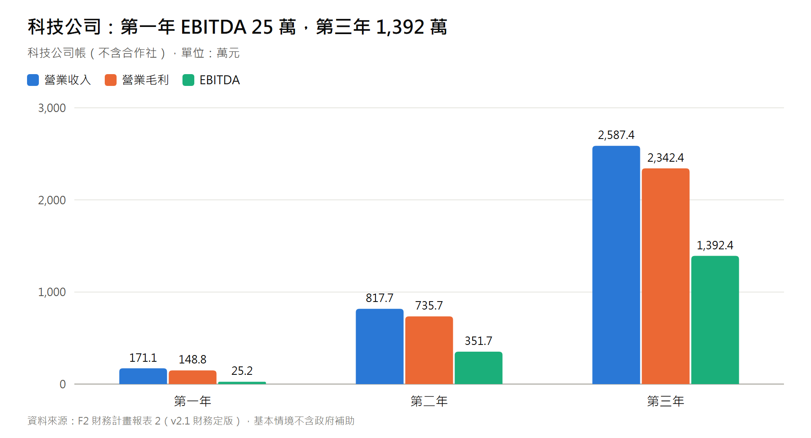
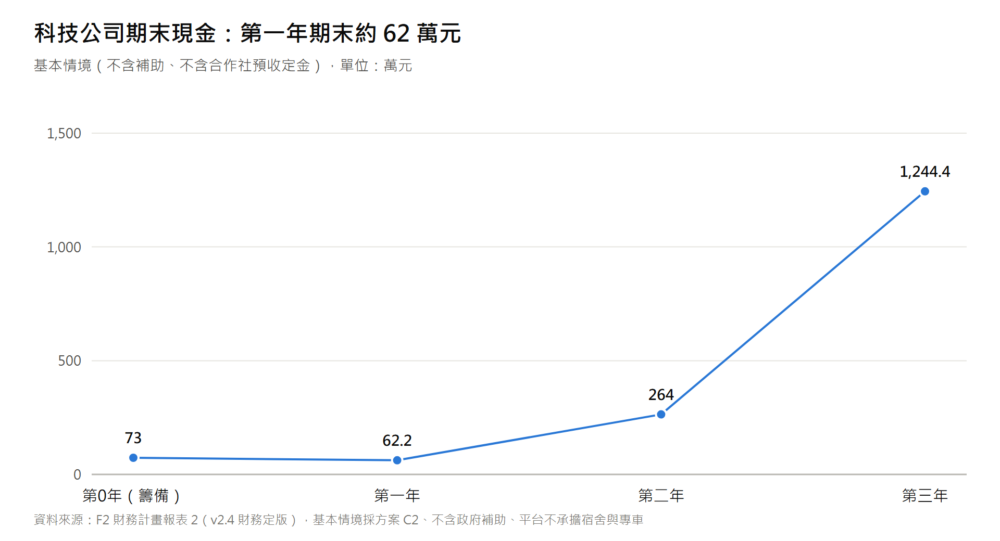
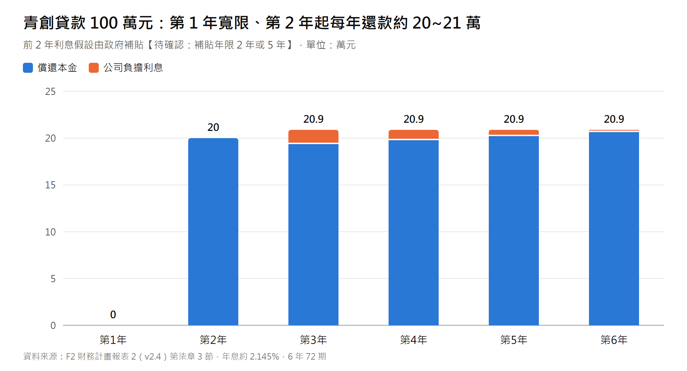

# 經濟部青年創業及啟動金貸款計畫書（官方審查標準版）

> **主管機關**：經濟部中小及新創企業署 / 承貸金融機構（台灣中小企業銀行、合作金庫、第一銀行等）  
> **申貸類別**：青年創業及啟動金貸款（資本性支出 ╳ 週轉性支出）  
> **申貸額度**：新台幣 **1,000,000 元整**（信用保證成數與利息補貼年限依主管機關與承貸銀行最新規定【待確認：信保成數 95% 或 100%；利息補貼 2 年或 5 年】）  
> **財務數字來源**：本計畫書所有財務數字引用《財務計畫報表 2》v2.4（F2 定版，2026-10-01；基本情境採建議方案 C2：第一層均價 $315～$325/hr、代管費 16%；平台不承擔宿舍與專車），以 2026 年最低工資（月 29,500 元／時 196 元）計算。C2 之定價與人力配置**尚未經市場與現場驗證**【待確認】，詳本計畫書肆、3。  
> **申貸企業**：智農科技股份有限公司

---

## 壹、 申請人與事業基本資料

### 1. 負責人（申請人）基本資料
* **負責人姓名**：【創辦人姓名】
* **性別 / 出生年月日**：男 / 民國【XX】年【XX】月【XX】日（年滿【XX】歲，符合 18~45 歲青年資格）
* **身分證字號**：【AXXXXXXXXX】
* **聯絡電話**：【09XX-XXX-XXX】
* **戶籍地址**：【某縣市某區某路段某號】
* **通訊地址**：【某縣市某區某路段某號】
* **最高學歷**：【國立臺灣大學 / 國立成功大學 資訊工程 / 電機 / 農業相關研究所】
* **主要經歷**：
  * 曾任科技公司資深全端軟體架構師 / 演算法工程師（【X】年）
  * 曾主導物流排程調度演算法與雲端高併發系統開發
  * 【待填：實際田野調查地點、期間與 PoC 驗證成果（請依事實填寫並檢附佐證）】
* **創業研習課程時數證明（符合法定 20 小時要件）**：
  * 研習機構：經濟部中小企業處「中小企業網路大學校」/ 商業發展研究院
  * 結業課程：財務會計實務、創業計畫書撰寫、稅務法規與勞動法規實務
  * 累計時數：**共計 24 小時**（檢附結業證書影本於附件一）

---

### 2. 事業基本資料
* **企業名稱**：智農科技股份有限公司 (AgriDispatch Tech Co., Ltd.)
* **統一編號**：【XXXXXXXX】（設立登記未滿五年）
* **設立登記日期**：中華民國【11X】年【X】月【X】日
* **實收資本額**：新台幣 **100,000 元整**（與 F2 一致）【待確認：承貸銀行是否就資本額與貸款額度比例另有審核標準】
* **負責人出資比例**：**100%**【待確認：青創貸款對負責人出資比例之要求】
* **登記地址**：【待確認：公司登記地址。第一期營運基地依計畫書定版為屏東枋山（高屏產區）；若改採北部方案，請改依報表 3 情境】
* **實際營業地址**：同登記地址（調度作業以雲端系統執行，無自建機房）
* **行業代號與主要營業項目**：
  * `I301010` 資訊軟體服務業
  * `I301020` 資料處理服務業
  * `A102080` 園藝服務業（農事作業代耕、智慧調度技術管理）
* **合作主體**：有限責任智農農業勞務生產合作社（擬申請農業部外展農務服務資格【待確認：申請進度】；與科技公司簽署《營運委託暨技術代管協議》，期間 5 年、期滿無異議自動展延 3 年）

---

## 貳、 創業理念、市場痛點與核心解決方案

### 1. 創業動機與市場痛點
1. **台灣農業面臨 64.4 歲斷崖式缺工**：
   * 全台農業就業人口平均年齡超過 64 歲【待補來源：農業部農業統計】，產季繁重之疏果、套袋、採收與搬運工作面臨人力不足。
2. **地下黑工氾濫與重罰風險**：
   * 部分小農因耕作規模不足無法自聘全職移工，轉而僱用非法人力，查獲時可能面臨《就業服務法》相關罰鍰（第 63 條規定 15 萬至 75 萬元）【待確認：條文適用情形】，且非法人力無契約約束，產季出工不穩定。
3. **梅雨停工赤字與排程僵化**：
   * 傳統外展工隊遇豪雨無法下田，雇主仍需負擔固定薪資；產季結束後移工閒置吃老本，造成嚴重虧損。

### 2. 智農派工創新商業模式（輕資產 ╳ 雙軌合法 ╳ 動態避險）
* **雙軌合作架構**：由「農業合作社」申請農業部外展農務服務資格並擔任法定雇主，智農科技公司開發並擁有「調度演算法（專利申請規劃中【待確認】）」、「LINE 小農叫工平台」與「移工三語工單系統」，依 5 年期《營運委託暨技術代管協議》向合作社收取技術代管服務費（費率 16%，須經合作社依章程決議【待確認：關係人交易規範】）。
* **全台作物產曆平滑化輪轉**：以屏東枋山愛文芒果為灘頭堡，串聯高屏、台南、雲嘉產曆，目標移工利用率 **92%（第一年）~96%（第三年）**（F2 假設，以法定正常工時為分母）。
* **梅雨冷鏈轉運避險**：遇豪雨田間停工時，改派工班至已簽約之室內冷鏈集貨場進行分級清洗與包裝，以降低雨天停工損失（實際效果以冷鏈備援合約簽署與營運實績衡量）。
* **三層混合人力彈性**：外展移工（核心月薪）+ 本土中高齡（部分工時時計）+ 機耕代噴（Freelancer 承攬），兼顧法規合規與極低固定成本。

---

## 參、 申貸資金用途與購置計畫（總計新台幣 100 萬元）

本次向承貸銀行申請「青年創業及啟動金貸款」新台幣 **1,000,000 元**，連同資本額 100,000 元，合計啟動資金 **1,100,000 元**（F2 第柒章），用途如下：

> 【待確認：移工訓練屬合作社（雇主）業務，若由本公司以貸款資金支付，須以書面約定代墊與歸還方式，並確認符合承貸銀行之資金用途規定】
>
> 自 F2 v2.2 起，本公司與合作社**不承租宿舍、不配置專車**：移工住宿由特約農場／產銷班／冷鏈場提供，交通由用工農戶接送或自行安排【待確認：雇主住宿義務之履行方式與外展農務接送規定】。原編列之專車押金（150,000 元）與宿舍押金（150,000 元）已刪除，改列營運週轉金。

| 預算項目代碼 | 資金用途細目 | 預算金額 (新台幣) | 說明與報價憑據 |
| :---: | :--- | :---: | :--- |
| **CAP-1** | **雲端調度大腦伺服器與 API 串接** | **$180,000** | 部署 AWS/GCP 雲端伺服器、中央氣象署雷達回波 API 串接、LINE OA 官方帳號技術模組建置。 |
| **CAP-3** | **標準田間安全裝備與採收工具** | **$120,000** | 採購定距採收剪、防刮採收手套、人體工學椅凳、高溫防中暑冷飲補給箱與防護雨鞋。 |
| **OP-2** | **移工前置安全訓練與雙語教材印製** | **$150,000** | 印製越/印/中三語圖解 SOP 手冊、抵台後職安講習講師費、雙語就服員前置調度交通津貼。 |
| **OP-3** | **初期營運週轉金與應急流動資金** | **$550,000** | 因應合作社代管費月結與小農 7 日帳期之週轉緩衝，以及移工延後到位時之固定費用支應（含原專車與宿舍押金移入之 300,000 元）。 |
| **TOTAL** | **貸款申請總額** | **$1,000,000** | 專款用於第一期外展派工之啟動。另以資本額 100,000 元支應公司與合作社設立規費。 |

> 原 CAP-2（專車押金與 GPS 設備）與 OP-1（宿舍押金與修繕）已於 F2 v2.2 刪除，代碼保留空號以利與前版對照。若承貸銀行對週轉金比例另有限制，可將申貸額度調降為 700,000 元（F2 第柒章第 3 節備註）【待確認：承貸銀行對週轉性支出之比例規定】。

---

## 肆、 營業現況與財務預測

> 以下數字引用 F2 v2.4 基本情境（C2）：**不含任何政府補助、不含合作社預收之早鳥定金**；第一年自首批移工到位起算。

### 1. 第一年營運與財務指標（12 名外展移工 + 12 名本土兼職 + 第三層統包）
* **全案派工總流水 (GMV)**：新台幣 **9,832,600 元**。
* **科技公司營業收入**：新台幣 **1,836,216 元**（16% 技術代管費 1,449,216 + 統包價差 267,000 + 加值服務 120,000）。
* **直接營業成本 (COGS)**：新台幣 **223,000 元**。
* **營業毛利**：新台幣 **1,613,216 元**（毛利率 87.9%）。
* **營業費用**：新台幣 **1,296,000 元**（含第二層招募推廣費 180,000 元）。
* **EBITDA**：新台幣 **317,216 元**（EBITDA 率 17.3%）；扣除折舊 60,000 元與所得稅（簡化 20%）後，**稅後淨利約 205,773 元**。
* **政府補助**：尚未核定，不列入上述數字（若 SBIR 等補助核定，第一年稅前淨利可增加約 100 萬元，屬情境）。

### 2. 三年財務預估摘要表 (單位：新台幣千元)

| 財務指標項目 | 第 0 年（籌備） | 第一年 | 第二年 | 第三年 |
| :--- | :---: | :---: | :---: | :---: |
| **平台派工總 GMV** | — | 9,833 | 45,336 | 138,982 |
| **科技公司營業收入** | — | 1,836 | 8,872 | 27,697 |
| **營業毛利** | — | 1,613 | 8,052 | 25,247 |
| **EBITDA** | -370 | 317 | 4,062 | 15,347 |
| **稅後淨利（不含補助）** | -370 | 206 | 3,049 | 11,745 |
| **期末現金餘額** | 730 | 622 | 2,640 | 12,444 |

### 3. 合作社端（主要客戶）財務狀況揭露
本公司代管費收入來自合作社，合作社為本公司主要收入來源（集中風險）。依 F2 v2.2～v2.3，在原定價（第一層均價 $285～$295/hr）與 18% 代管費下，合作社（法定雇主）三年皆為虧損（約 −139.7 萬／−431.4 萬／−752.4 萬元），主因為 2026 年最低工資調升後之移工法定成本與帶班師傅成本。經營團隊已決定採行建議方案 C2 並自 F2 v2.4 起改列基本情境：第一層均價調為 $315／$320／$325/hr（早鳥不打折）、代管費率由 18% 調為 16%、帶班師傅配比放寬至約 1:10 並由資深移工組長分擔、師傅 80% 工時下田計費、第二層工時擴大 50%，並內含生活照顧與住宿預備金。依 F2 第肆章，採 C2 後**合作社三年皆有結餘**（約 +17.5 萬／+212.4 萬／+1,073.6 萬元；第一年損益兩平約需 7 名移工，本計畫第一年 12 名），本公司與合作社合併營運結果約 +49.2 萬／+618.6 萬／+2,608.3 萬元。

惟須如實揭露：(1) **合作社第一年結餘僅約 17.5 萬元（損益率 2.3%），緩衝極薄**：移工利用率下降 5 個百分點時合作社第一年約 −15.7 萬元；若外籍移工須提繳勞退 6%，第一年約 −8.0 萬元；若農業部 8,800 元獎勵須由合作社補足，C2 無法成立（F2 第捌、拾章）；(2) C2 之前提**尚未經市場與現場驗證**：第一層均價 $315～$325/hr 之農戶接受度、帶班師傅 1:10 之可行性、第二層人才庫可否擴大 50%，以及 16% 代管費率須經合作社依章程決議【待確認】；驗證未通過時，將依 F2 第玖章退回替代方案 C1 或原定價數字並重新檢討，不以 v2.4 數字對外承諾；(3) 本公司將以淡季保底工時合約（冷鏈場、集貨場、產銷班雨天室內作業）守住第一年利用率，並於要派契約訂定價格隨最低工資連動條款【待確認：合作對象意願與條款效力】。

---

## 伍、 貸款還款計畫與償債能力分析 (Debt Service Coverage)

### 1. 貸款條件與還款條件設定
* **貸款總額**：新台幣 **1,000,000 元整**。
* **貸款年限**：**6 年期（72 個月）**，含**寬限期 12 個月**。
* **貸款利率**：依中華郵政二年期定期儲金機動利率 + 0.575%（目前約年息 **2.145%**）【待確認：以撥貸時利率為準】。
* **利息補貼**：本計畫以**前 2 年利息由政府補貼**估算【待確認：現行補貼年限為 2 年或 5 年；若為 5 年，第 3~5 年利息合計約 33,119 元可免除】。
* **每月還本還息負擔試算**：
  * **第 1 至 12 個月（寬限期）**：利息由政府補貼，本公司每月支付 0 元。
  * **第 13 至 24 個月**：每月償還本金約 **16,667 元**（全年 200,000 元；利息由政府補貼）。
  * **第 25 至 72 個月（本息平均攤還）**：剩餘本金 800,000 元、48 期、年息 2.145%，**每月本息約 17,407 元**（全年約 208,884 元）。
  * 驗算：M = 800,000 × r ÷ [1 − (1 + r)^−48]，r = 2.145% ÷ 12 → M ≈ 17,407 元。
  * 第 3~6 年分年還本約 193,617／197,812／202,097／206,474 元，利息約 15,264／11,070／6,785／2,407 元。

### 2. 償債能力評估（不含補助、不含預收定金）

| 項目 | 第一年 | 第二年 | 第三年 |
| :--- | :---: | :---: | :---: |
| 可用於償債之現金（EBITDA − 所得稅） | 265,773 元 | 3,299,438 元 | 12,410,749 元 |
| 當年還本付息 | 0 元（寬限期） | 200,000 元 | 208,881 元 |
| **DSCR** | 不適用 | **約 16.5 倍** | **約 59.4 倍** |
| 壓力情境：利用率下降 10 個百分點 | 不適用 | 約 14.3 倍 | 約 53.1 倍 |

* **結論**：在基本情境下，本公司營運現金足以支應還本付息。惟須注意：(1) DSCR 以合作社依約支付代管費為前提；C2 下合作社第一年結餘僅約 17.5 萬元，若利用率或法規成本不利，合作社支付能力將直接影響本公司收入與還款能力（見肆、3）；(2) 若移工延後 6 個月到位，第一年 EBITDA 將轉為約 −26 萬元，期末現金粗估降至約 14 萬元，本公司將以延後資本支出、分批引進移工因應；(3) 所有預測均有不確定性，詳見計畫書第八章風險管理。

---

## 陸、 效益評估與社會影響力 (ESG)

1. **緩解農村高齡缺工**：
   * 第一年預計服務 12 戶農場與合作冷鏈場，提供約 **29,040 計費工時**（第一層 23,040，含移工 21,600 與帶班師傅 1,440；第二層 6,000）之合法農事勞動力，另以統包方式完成約 20 分地果樹作業與 30 甲地無人機植保。
2. **減少非法用工**：
   * 為服務農戶提供合法僱用之派工服務並開立合法發票，協助農戶降低違法用工風險（成效以服務戶問卷與契約履約紀錄衡量）。
3. **保障移工與本土中高齡就業**：
   * 移工依法領取不低於 2026 年最低工資（月 29,500 元）之薪資並依法投保；住宿由特約農場／產銷班／冷鏈場依生活照顧服務計畫書提供合格住宿，交通由用工農戶安排【待確認：雇主住宿義務之履行方式與外展農務接送規定】；是否可另領農業部就業獎勵金【待確認：此獎勵適用對象須向農業部確認，若移工不適用，相關薪資與防跳單論述需調整】。本土中高齡享有彈性工時與職災保險。

---

## 柒、 檢附附件清單

1. 【附件一】負責人國民身分證正反面影本、退伍證明影本
2. 【附件二】負責人 24 小時創業研習課程結業證書影本
3. 【附件三】智農科技股份有限公司 設立登記表及公司章程影本
4. 【附件四】智農科技與農業合作社簽訂之《營運委託暨技術代管協議》影本
5. 【附件五】全台作物產曆調度地圖與 Demo 系統功能截圖（LINE OA / 派工戰情室 / 三語工單）
6. 【附件六】承貸銀行所屬個人及企業聯徵信用查詢同意書

---

**申請事業（蓋印）：智農科技股份有限公司**  
**負責人（簽名蓋章）：__________________________**  
**申請日期：中華民國 ______ 年 ______ 月 ______ 日**
