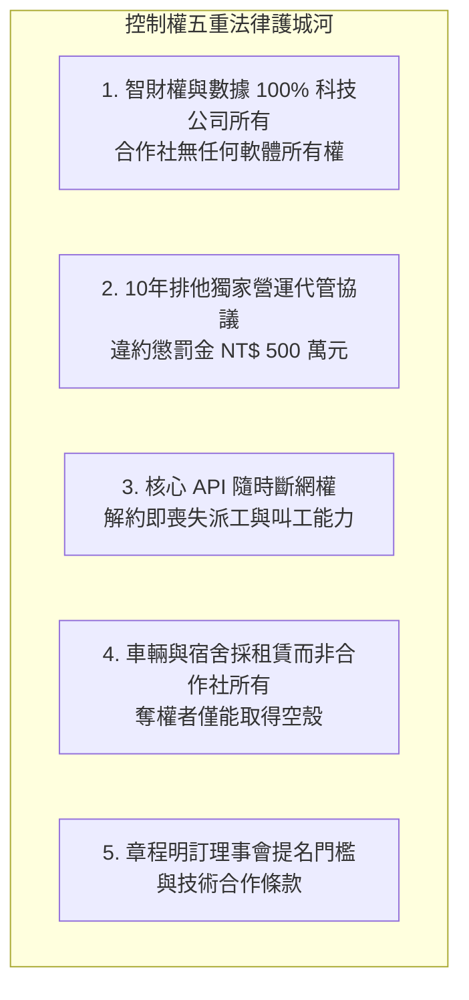

# 智農派工 (AgriDispatch) 法律顧問合規與控制權護城河意見書

> **受文者**：智農派工科技股份有限公司 創辦人暨董事會、有限責任智農農業勞務生產合作社 理事會  
> **出具單位**：專案法律顧問組  
> **核心主旨**：就「智農科技與農業合作社雙軌運作架構」、「合作社一人一票防奪權機制」、「就業服務法外展農務合規紅線」、「職業災害與高溫熱危害三方責任」、「以及營業秘密與個資法合規」出具深度法律審查意見與實務防禦策略。

---

## 壹、 雙軌組織架構之法律基礎與創業者控制權護城河

### 1. 雙軌架構之法定必然性
* **法律限制**：依據《就業服務法》第 43 條、第 46 條及勞動部現行外展外國人聘僱法規，**一般民營人力派遣公司、人力仲介公司嚴禁以「派遣名義」招募並轉派藍領移工至第三方工作**，違者雙方均面臨重大行政罰鍰及廢止許可。
* **唯一法定通道**：勞動部與農業部依據《外展農務試辦計畫》，特許**農會、漁會、農業合作社**等非營利或公法人機構，擔任外展移工之「法定雇主」，並得派工至要派農場或產銷班從事農務。
* **雙軌合規設計**：
  * **特許機構**：有限責任智農農業勞務生產合作社（具備非營利外展特許身分，承擔法定雇主責任）。
  * **營利實體**：智農科技股份有限公司（創辦團隊 100% 股權控股，擁有派工大腦軟體專利、LINE OA 平台、車隊調度資產、享有實質超額利潤）。

---

### 2. 破解《合作社法》「一人一票制」奪權風險之五大法律防護鎖

依《合作社法》第 24 條規定，合作社社員不論出資多寡，**「一人有一表決權」**。若創辦人僅以社員身分參與，存在遭在地社員（農民）於社員大會聯手改選奪權、侵占營運成果之實質風險。法律顧問為此設計「五重防護鎖」：

1. **資產與智財權絕對切割（軟體與數據所有權）**：
   * 所有調度演算法、LINE 預約系統軟體原始碼、外展工單專利、小農會員大數據、移工人才庫，智慧財產權與所有權均 **100% 登記於「智農科技公司」名下**。
   * 合作社僅取得「非專屬、不可轉讓、合約期間內之使用權」。若合作社終止協議，其軟體使用權立即失效。
2. **簽署 10 年期《營運委託暨技術代管協議》（含高額懲罰金）**：
   * 協議中明定「排他獨家代管條款」：合作社不得自行開發類似軟體，亦不得委任第三方。
   * **違約懲罰性賠償金 500 萬元**：若合作社社員大會片面解約或違約，合作社必須立即賠償科技公司新台幣 500 萬元整，此金額遠超合作社之資本額，在民事法上構成強大威懾。
3. **雲端 API 斷網控制權（實質操作控制）**：
   * 派工大腦部署於科技公司掌控之 AWS / GCP 雲端伺服器。科技公司保留「技術斷網權」，一旦合作社發生奪權爭議，科技公司可立即中斷小農叫工與移工工單推播，使奪權者接手後瞬間陷入癱瘓。
4. **輕資產配置（合作社不留重資產）**：
   * 派工專車係由科技公司特約租賃、集中宿舍由科技公司簽署二房東租約。合作社帳上僅有法定移工流動資金，無任何高價值重資產，奪權者無法透過奪取合作社獲得實體資產。
5. **合作社章程條款防禦**：
   * 於合作社章程第 6 條明訂「本社為落實數位化營運，得與農事科技機構簽署長期委託代管協議」。
   * 於理監事選舉辦法中，設定「理事主席或經理人候選人須具備科技物流或農業調度專案經驗」，確保創辦團隊在治理層面的排他優勢。

---

## 貳、 《就業服務法》合規紅線與防跳單法律機制

### 1. 嚴格防範就服法「非法容留」與「未經許可指派」

| 違法樣態 | 觸犯法條 | 法律後果 | 智農派工防禦機制與合規條款 |
| :--- | :--- | :--- | :--- |
| **小農私自扣留移工留宿或工作** | 《就業服務法》第 57 條第 1 款、第 63 條 | 處雇主及非法容留者 **15 萬 ~ 75 萬元罰鍰**；5 年內再犯處 3 年以下有期徒刑。 | 1. 專車每日定時接送，嚴禁移工夜宿農場。 2. 要派契約增訂「私聘懲罰金 50 萬元」條款。 3. 移工端實施 GPS 離場打卡監控。 |
| **小農私將移工借給鄰居親戚** | 《就業服務法》第 57 條第 2 款 | 處 15 萬 ~ 75 萬元罰鍰；合作社可能被扣減移工配額。 | 1. 派工單嚴格綁定地號與小農身分。 2. 每日指派本土農業師傅帶班巡檢。 3. 發現非約定農地立即勒令停工並通報。 |
| **移工私自兼差或私接黑工** | 《就業服務法》第 73 條第 1 款 | 廢止聘僱許可，限令出境，永久不得再入境工作。 | 1. 雙語勞動契約明訂禁止私自接案兼差。 2. 移工享每月 $8,800 就業獎勵，私接黑工立即喪失領取資格並通報主管機關。 |

### 2. 農地派遣軌跡合規存證制度
* 為杜絕勞檢或移民署查核時產生「非法轉派」之嫌疑，平台後台建置**「四位一體數位證據鏈」**：
  1. **農業部審核通過之外展農務服務計畫書**（載明合作社社員及契作果園名冊）。
  2. **小農線上叫工合約與電子工單**（載明工作日期、作業地號、作物類別）。
  3. **出勤專車 GPS 車隊行車紀錄**（證明專車統一接送抵達與離開）。
  4. **移工手機 Web App GPS 打卡與小農每日驗收電子簽名**。

---

## 參、 勞動基準法、職災保險與高溫熱危害法律責任劃分

### 1. 合作社與要派小農之責任歸屬（《職業安全衛生法》與《勞基法》第 63 條之 1）
* **雇主責任歸屬**：外展農工之法定雇主為**合作社**，合作社負有 100% 依法投保勞保、健保、職保及發放法定工資之責任。
* **要派單位共同責任**：
  * 依《勞動基準法》第 63 條之 1，要派單位（小農/契作商）使用派遣勞工時，就勞動場所之安全衛生設施，應與派遣事業單位（合作社）負**連帶補償責任**。
  * **契約防禦條款**：在《外展要派服務契約》中明確規範，小農必須提供合格安全之田間作業通道、遮陽休息設施、符合飲用水標準之安全飲用水，並禁止要求移工從事非指派之高危險作業（如無防護攀爬高壓電線旁樹木）。

### 2. 高溫熱危害防護之雇主法定照護義務
* **法令依據**：勞動部《高氣溫戶外作業勞工熱危害預防指引》。
* **法律風險**：若勞工於戶外作業因中暑、熱衰竭導致休克或死亡，雇主及現場負責人可能面臨《刑法》第 276 條過失致死罪及職安法重大罰則。
* **SOP 合規防禦措施**：
  1. 系統自動抓取中央氣象署 WBGT 熱指數，達橘色/紅色燈號時，強制執行「降溫休息」與「調整工時（提早出工、避開正午）」。
  2. 現場本土農業師傅兼任「職安管理員」，每小時強制吹哨要求移工至遮蔭處喝水休息 10~15 分鐘。
  3. 備妥急救降溫包（冷敷袋、電解質水）。

---

## 肆、 營業秘密與個資法合規防線

### 1. 嚴禁非法網路爬蟲侵害個資
* **紅線警示**：嚴禁以爬蟲程式爬取 104、1111、Facebook 社團之個人電話與求職履歷，此舉直接違反《個人資料保護法》第 19 條、第 20 條，並涉犯《刑法》第 358 條妨害電腦使用罪。
* **合規解方**：智農派工私域人才庫全面採用「自願自主登錄制」，求職者於登錄時必須勾選《個人資料蒐集處理利用告知同意書》，取得明確同意（Opt-in），並符合個資法特定目的（農業勞務媒合）。

### 2. 小農客戶名冊與定價演算法之《營業秘密法》保護
* 依《營業秘密法》第 2 條，小農聯絡資訊、契作合約價格、調度避險演算法若具備「秘密性、經濟價值及合理保密措施」，即受法律嚴格保護。
* **保密措施落實**：
  * 所有調度幹部、雙語舍監入職時簽署《員工保密與競業限制協議》。
  * 合作社與科技公司簽訂之協議中，明定商業秘密侵害之「懲罰性賠償額為實際損害額之三倍」。

---

## 伍、 法律顧問結論與行動建議

1. **章程與協議同步簽署**：在合作社向主管機關正式送件申請立案時，同步將《農事科技公司與合作社營運委託暨技術代管協議》作為理事會首案通過簽署，確保創辦團隊對合作社之實質控制權在第一天即完全鎖死。
2. **三方法律契約閉環到位**：嚴格落實「移工雙語勞動契約」、「小農要派服務契約」與「科技代管協議」，將天候避險、私聘違約罰則與職災責任徹底書面化，確保營運無法律死角。
