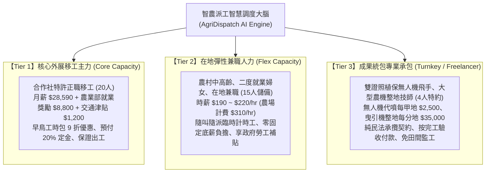
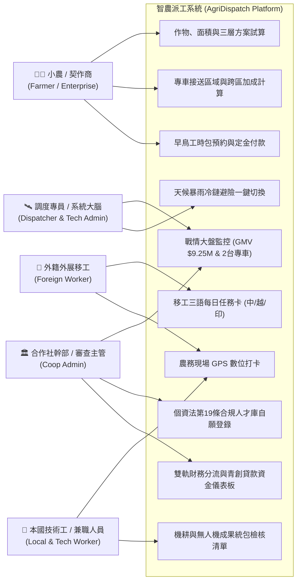
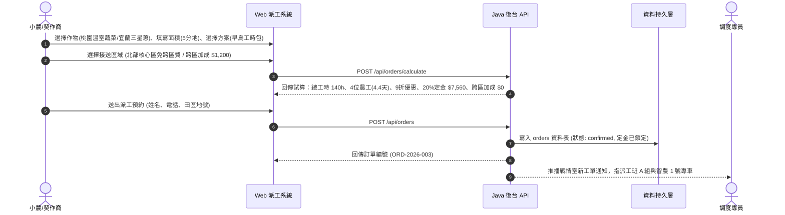
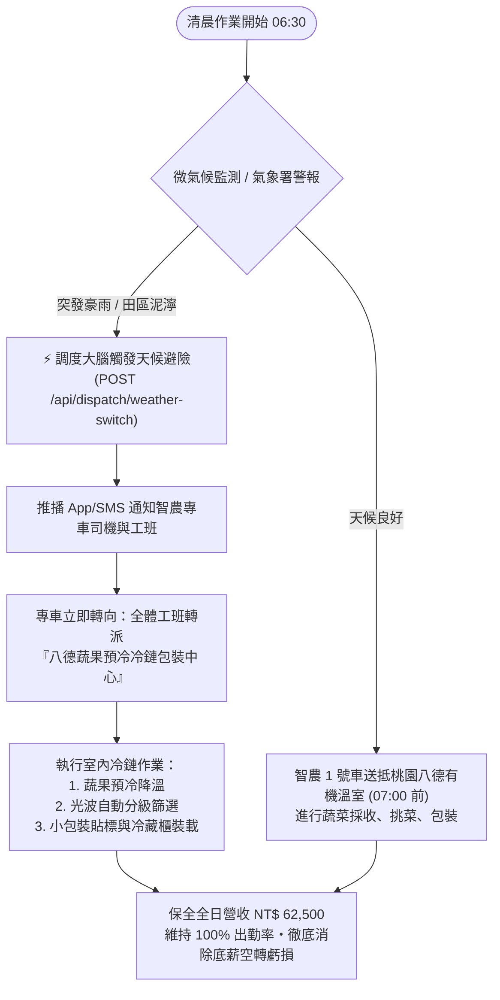

# 智農派工 (AgriDispatch) - 系統分析與架構設計規格書

> **文件編號**：AD-SA-202609-V2  
> **系統名稱**：智農派工（AgriDispatch）——台灣合法外展農務移工調度與智慧農事派遣平台  
> **文件版本**：v2.0.0（北部產區樞紐 ╳ 三層混合模型 ╳ 專車物流精算升級版）  
> **發布日期**：2026-09-20  
> **適用對象**：系統架構師、前後端工程師、Android 開發者、合作社營運團隊、青創貸款審查委員與專案投資人  

---

## 壹、 專案緣起與系統目標

### 1.1 產業背景與北部產區樞紐升級
1. **農村人口斷崖式老化**：台灣農業從業人員平均年齡高達 64.4 歲，產季爬梯剪果、繁重搬運面臨生理極限。北部產區（如桃園八德溫室蔬菜、宜蘭三星青蔥、新竹茶園與柑橘）雖鄰近都會消費地，但面臨工廠與服務業爭搶人力的雙重夾擊，缺工情況尤為嚴峻。
2. **產季撞期與黑工重罰**：傳統農村點工常被鄰近果園臨時加價搶走；小農冒險任用地下非法黑工，面臨《就業服務法》每案 **15 至 75 萬元重罰**，且大型通路（全聯、家樂福、好市多）一旦查獲即取消契作資格並求償高額違約金。
3. **北部常態溫室與跨區產季調度**：以「桃園八德/大溪設施有機蔬菜」為全年 365 天常態基本盤，平抑外展農工月薪固定成本；產季尖峰時則透過「9人座接送專車」跨區支援宜蘭三星蔥、新竹手採茶及新埔柑橘，實現「淡季常態保底、旺季跨區溢價」的調度韌性。
4. **天候停工之底薪赤字與冷鏈避險**：傳統外展雇主每月需支付法定基本底薪（$28,590 元），若遇北部梅雨或颱風豪雨導致田間無法作業，易造成嚴重空轉虧損。本系統建置「天候避險調度大腦」，豪雨時一鍵將工班轉派至「室內冷鏈蔬果預冷分級集貨場」，維持 100% 出勤率。
5. **合規發票與 ESG 供應鏈審查**：傳統地下工頭無法提供合法發票以扣抵產銷班或農企業營業稅，更無從通過現代 ESG 永續供應鏈審查。本系統透過特許合作社開立合規發票，並結合農業部每月最高 $8,800 元就業獎勵津貼，打造透明合法之派遣體系。

### 1.2 系統核心使命
運用數位科技建構**「合法外展調度大腦」**，透過雙軌合規架構（科技公司 ╳ 特許合作社）、三層混合勞工調度模型（Tier 1 外展移工主力、Tier 2 本土兼職彈性、Tier 3 成果統包 Freelancer）、專車跨區路網精算，以及三語移工任務卡，提供契約化、高確定性、零法律風險的智慧農事派遣服務。

---

## 貳、 三層混合勞工調度模型 (Three-Tier Hybrid Labor Model)

系統架構於調度演算法與計費引擎中，全面實作三層混合派工模型：



### 2.1 三層模型營運與計費規則

| 維度 | Tier 1：核心外展移工 | Tier 2：在地彈性兼職 | Tier 3：成果統包 Freelancer |
| :--- | :--- | :--- | :--- |
| **法律契約性質** | 定期勞動契約（特許外展） | 部分工時勞動契約（Part-time） | 純民法承攬契約（Civil Turnkey） |
| **勞工薪資待遇** | 月薪底薪 $28,590 + 就業獎勵 $8,800 | 時薪 $190 ~ $220 元 / 小時 | 按成果結算（代噴 $2,500/甲；整地 $35,000/分） |
| **小農付費牌價** | 標準 $290 ~ $320/hr；早鳥 9 折優惠 | 標準 $310 元 / 小時（隨叫隨派） | 成果統包驗收價（含機具油料與專業技師） |
| **定金與結算** | 預付 20% 鎖約定金，產季保證出工 | 完工結算，無前置定金 | 預付 30% 備料定金，驗收合格結清尾款 |
| **適用農務情境** | 溫室採收包裝、拔蔥洗蔥、果樹疏果 | 臨時採收挑揀、尖峰緊急救火支援 | 無人機大面積微粒噴霧、重型農機翻土整地 |

---

## 參、 交通物流與專車專線精算架構 (Transportation & Routing)

### 3.1 專車物流配置
系統規劃租賃 **2 台 9 人座廂型車**，建立北部雙專線調度路網：
- **智農 1 號車（桃園八德專線）**：常態接送 8~9 位農工往返八德宿舍與八德/大溪設施有機蔬菜溫室（單程 15km 內）。
- **智農 2 號車（跨區支援專線）**：支援宜蘭三星青蔥、新竹峨眉/北埔茶園、新埔柑橘，單程 45~75km。

### 3.2 交通計費與補貼規則
1. **北部核心生活圈（35km 範圍內）**：
   - 包含桃園全區、雙北平地蔬菜區及新竹平地產區。
   - **免收專車跨區費**，交通成本由每工時牌價與農業部每月 $1,200 元交通補助攤提吸收。
2. **跨區專車專線（宜蘭三星、新竹尖石五峰山區）**：
   - 每次跨區派工加收 **NT$ 1,200 元 / 車次** 專車跨區津貼（由要派農場分攤，平均每位農工每小時僅增加約 $25 元）。
3. **交通精算自洽性**：
   - 每台專車每月租金 $24,000 元 + 帶隊司機津貼 $10,000 元 + 油資與 ETC $9,500 元 = 單車月成本 $43,500 元。
   - 農業部交通補助（8人 ╳ $1,200 = $9,600 元）+ 跨區專車加成（15趟 ╳ $1,200 = $18,000 元）+ 基礎工時牌價內含（$15,900 元），交通收支完全平衡。

---

## 肆、 使用者角色與用例分析 (Actor & Use Case)



### 4.1 角色職責定義

| 角色名稱 | 權限範圍 | 核心使用功能 |
| :--- | :--- | :--- |
| **小農／契作商 (Farmer)** | 前台小農專區 | 作物面積試算、三層派工方案選擇（早鳥/兼職/統包）、專車接送區域計算、早鳥定金支付、派工履約查詢、合規發票下載 |
| **調度專員／工頭 (Dispatcher)** | 戰情管理後台 | 20 名在籍移工配額監控、4 個工班與 2 台專車動態調配、**一鍵觸發天候暴雨冷鏈避險**、專車跨區調度 |
| **外籍移工 (Foreign Worker)** | Android App / 行動網頁 | 三語切換（繁中／越／印）、今日出勤集合時間、接送專車與司機電話、田區/冷鏈導航、現場 GPS 打卡、底薪與 $8,800 就業獎勵透明化儀表板 |
| **本國技術工 (Local Tech Worker)** | 本國工專屬入口 | 無人機代噴與曳引機整地工單、設備維護檢核清單、成果統包分紅與勞退提繳紀錄、GPS 現場打卡 |
| **合作社與財務主管 (Admin)** | 營運與財務後台 | 全台產曆維護、勞健退納保名冊匯出、科技公司 18% 技術代管費與 82% 合作社平移款核算、農業部 $8,800 津貼核銷、青創貸款 $1,000,000 資金還款監控 |

---

## 伍、 核心業務邏輯與流程 (Business Workflows)

### 5.1 智慧派工下單與專車計費流程


### 5.2 殺手級天候避險調度邏輯（降雨零閒置虧損）


---

## 陸、 LINE Bot 智慧農務派遣助理子系統

### 6.1 為什麼選擇 LINE Bot 作為殺手級落地管道
在台灣農村場域中，60 歲以上老農與外籍移工高達 98% 具備每日使用 LINE 的生活習慣。傳統要求農民下載專屬 App 往往面臨「忘記 Apple ID / Google 密碼」、「手機容量不足」、「操作介面陌生」等高摩擦阻力。智農派工官方助理（LINE Official Account）提供「零下載、免密碼、掃碼即用」之落地體驗：
- **農場主**：免開網頁，直接在 LINE 點選六宮格圖文選單試算並預約早鳥工時包、收取派工單、查看司機電話。
- **外籍移工**：三語（繁中 / 🇻🇳 越語 / 🇮🇩 印尼語）每日出勤卡推播、集合時間提醒、留蒂 0.5cm 採收圖解與 8,800 元就業獎勵入帳明細。
- **突發暴雨避險**：科技公司調度大腦觸發暴雨轉移時，小於 3 秒內透過 LINE Messaging API 全區廣播至工班與農場主。

### 6.2 六宮格 Rich Menu (圖文選單) 架構
| 選單位置 | 功能名稱 | 關鍵字指令 | 對應動作與 Flex Message |
| :---: | :--- | :--- | :--- |
| **左上 (1)** | 📋 今日派工卡 | `今日派工` | 依登入角色動態回傳出工單或移工每日任務卡，含出勤時間、車號與司機電話。 |
| **中上 (2)** | 🌧️ 暴雨天候避險 | `天候避險` | 即時通報暴雨避險狀態，顯示全體工班專車轉移至室內冷鏈預冷包裝線進度。 |
| **右上 (3)** | ⚡ 早鳥工時包 | `早鳥工時包` | 推播產季早鳥 9 折保證出工卡，含 20% 定金線上試算與專車接送承諾。 |
| **左下 (4)** | 🌐 多語工單切換 | `切換語言` | 快速切換繁體中文、🇻🇳 Tiếng Việt、🇮🇩 Bahasa Indonesia 介面。 |
| **中下 (5)** | 🚜 農機代噴預約 | `機耕代噴` | 提供大疆 T50 植保機雙證照代噴與久保田 80 馬力曳引機代耕排班卡。 |
| **右下 (6)** | 👤 帳號綁定 | `帳號綁定` | 引導使用者綁定智農派工帳號，啟動個人化出工推播與薪資明細查詢。 |

### 6.3 LINE Messaging API 安全與簽章驗證 (HMAC-SHA256)
後端完全採用 Java 26 原生 `javax.crypto.Mac` 類別庫實現 `X-Line-Signature` 簽章防偽驗證，確保來自 LINE 官方伺服器的請求未遭竄改或重放：
1. LINE 伺服器向 `POST /api/line/webhook` 發送 HTTP 請求，Header 附帶 `X-Line-Signature`。
2. 後端使用 Channel Secret 作為密鑰，對 Request Body 計算 HMAC-SHA256 雜湊並轉 Base64 編碼。
3. 比對雜湊值，若一致則核准請求並派發至 `LineBotService` 進行事件解析；不一致則回傳 403 Forbidden。
4. **零第三方依賴**：完全免除安裝 Maven 或 Gradle 套件之維護成本。

---

## 柒、 系統整體技術架構

```mermaid
flowchart TB
    subgraph ClientLayer ["客戶端展示層 (Client Layer)"]
        BrowserDesktop["桌面瀏覽器 (Chrome / Edge / Firefox)"]
        BrowserMobile["手機 / 平板行動瀏覽器 (RWD)"]
        NativeAndroid["Android 行動應用程式 (Java Native + WebView)"]
        PureDemo["純 HTML 離線展示原型 (Demo/ - 零相依雙擊即開)"]
        LineBotClient["LINE 官方帳號 (LINE Messaging API / LIFF)"]
    end

    subgraph GatewayLayer ["通訊與閘道層 (Gateway Layer)"]
        HttpServer["Java HttpServer (com.sun.net.httpserver) :3000"]
        CorsFilter["CORS 跨域安全過濾器"]
        Router["RESTful 路由分發引擎 (ApiHandler)"]
        StaticServer["靜態資源託管引擎 (StaticFileHandler)"]
    end

    subgraph ServiceLayer ["商業邏輯層 (Service / Business Layer)"]
        OrderService["三層派工訂單與早鳥計算服務"]
        TransportEngine["專車物流與跨區路網調度引擎"]
        DispatchEngine["產曆排程與天候避險調度引擎"]
        WorkerService["外展移工名冊與三語工單服務"]
        ClockInService["GPS 打卡與軌跡驗證服務"]
        TalentService["個資合規人才庫服務 (PDPA 19)"]
        FinancialService["雙軌利潤分流與青創貸款資金服務"]
    end

    subgraph DataLayer ["資料持久層 (Data Persistence Layer)"]
        JsonDB[("檔案持久化資料庫<br/>(agridispatch.json)")]
        LocalCache[("Android 本地緩存<br/>(SharedPreferences)")]
    end

    ClientLayer <-->|HTTP / JSON (RESTful)| HttpServer
    HttpServer --> CorsFilter --> Router & StaticServer
    Router --> ServiceLayer
    ServiceLayer <--> DataLayer
    NativeAndroid -.->|離線讀寫| LocalCache
```

---

## 柒、 財務模型與政府資金對齊

依據最新《04_財務計畫報表3_北部產區三層混合模型與完整交通費精算》與《05_青年創業及啟動金貸款_創業貸款計畫書》，全系統資料庫與大盤圖表數據嚴格對齊如下：

1. **第一年平台總交易額 (GMV)**：**NT$ 9,257,000 元**
   - 核心外展移工工時收費（12~20 人）：NT$ 5,688,000 元
   - 本土兼職彈性工時收費：NT$ 1,736,000 元
   - 成果統包代耕代噴收費：NT$ 1,833,000 元
2. **科技公司技術服務費淨收**：**NT$ 2,077,200 元**
   - 18% 技術代管費（Take Rate）+ 專車跨區調度加成收費
3. **營運淨利 / EBITDA**：**NT$ 994,800 元**（含政策性研發與勞工補貼）
4. **損益平衡點 (Break-Even Point)**：**11.3 位外展農工**（12 人灘頭堡即可實現全年度獲利）
5. **青年創業及啟動金貸款**：**NT$ 1,000,000 元**
   - 經濟部 2 年利息全額補貼（年息 0%），中小企業信保基金 100% 信用保證。
   - 償債備付率（DSCR）高達 **41.8 倍**，具備極強本息清償實力。

---

## 捌、 非功能性需求 (Non-Functional Requirements)

### 8.1 效能與相容性
- **零外部依賴 (Zero External Dependencies)**：Java 後台僅採用標準 JDK 核心類別庫，無須額外安裝 Maven 或 Gradle，編譯時間 ≤ 3 秒，啟動時間 ≤ 1 秒。
- **輕量化運行**：記憶體佔用小於 64MB，可於低階雲端主機（如 1 vCPU / 512MB RAM）或樹莓派順暢運行。
- **全裝置自適應 (RWD)**：介面在 320px（小螢幕手機）至 2560px（4K 寬螢幕）均能自動調適版面，無破版現象。

### 8.2 法律法規紅線與資安防護
1. **《個人資料保護法第 19 條》合規性**：
   - 嚴禁以任何網路爬蟲抓取 104、1111 或 Cake 等人力銀行履歷。
   - 人才庫全數採用「當事人主動自願登錄制」，表單內建強制勾選之特定目的告知暨授權條款，完整記錄登錄時間戳。
2. **就業服務法特許界線**：
   - 系統架構嚴格切分「特許合作社（法定雇主、納保主體）」與「民營科技公司（技術代管、演算法專利）」，杜絕非法派遣疑慮。
3. **離線可用性 (Offline Availability)**：
   - Android App 內建 `assets/www/` 靜態資產，山區果園或溫室無 4G/5G 網路訊號時仍可正常開機瀏覽當日工單與安全指南。
4. **格式嚴謹性規範**：
   - 全系統文字、UI、日誌與報表全面杜絕 LaTeX 逃脫符號，統一採用標準純文字與 Unicode 數學符號（如 ≥, ≤, ÷, ×, ≈, $）。
