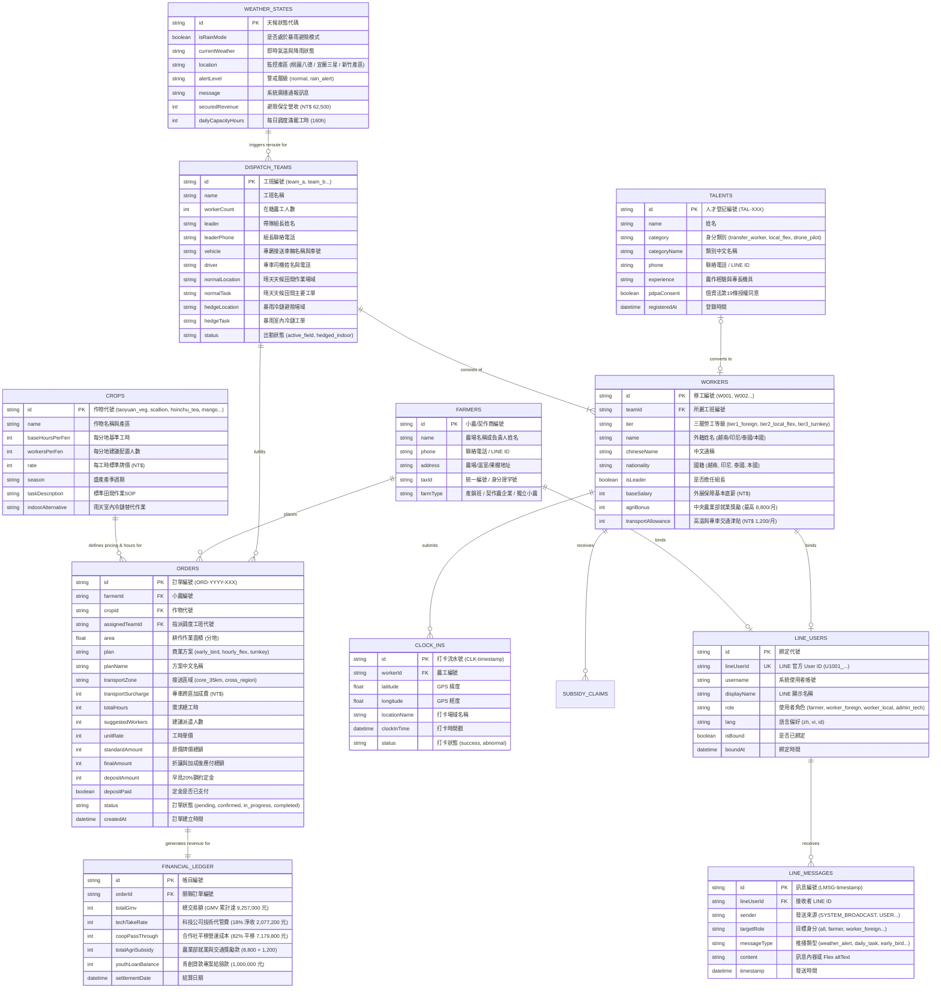

# 智農派工 (AgriDispatch) - 資料庫實體關聯圖與資料字典 (ERD)

> **文件編號**：AD-DB-202609-V2  
> **系統名稱**：智農派工（AgriDispatch）——資料庫架構規格書  
> **文件版本**：v2.0.0（北部產區樞紐 ╳ 三層混合模型 ╳ 專車物流精算版）  
> **發布日期**：2026-09-20  
> **資料庫形式**：檔案持久化結構 (JSON/SQLite 相容結構)  

---

## 壹、 資料庫實體關聯圖 (Mermaid ER Diagram)

---

## 貳、 資料字典 (Data Dictionary)

### 2.1 作物基準表 (`crops`)
- **說明**：存放北部與中南部各主要農作物作業係數、工時需求與牌價標準。

| 欄位名稱 (Column) | 資料型別 (Type) | 鍵值約束 (Key) | 允許為空 (Null) | 欄位說明與商業意義 | 範例值 (Example) |
| :--- | :--- | :---: | :---: | :--- | :--- |
| `id` | `VARCHAR(32)` | **PK** | 否 | 作物唯一識別代碼 | `"taoyuan_veg"` |
| `name` | `VARCHAR(100)`| - | 否 | 作物全稱及主要產區 | `"桃園溫室有機蔬菜 (八德/大溪)"` |
| `baseHoursPerFen` | `INTEGER` | - | 否 | 每分地標準標準作業工時 | `20` |
| `workersPerFen` | `INTEGER` | - | 否 | 每分地建議標準派遣人數 | `3` |
| `rate` | `INTEGER` | - | 否 | 每工時牌價費率 (NT$) | `290` |
| `season` | `VARCHAR(50)` | - | 否 | 盛產作業產季週期 | `"全年365天溫室採收"` |
| `taskDescription` | `TEXT` | - | 否 | 外銷級田間作業標準 SOP | `"採收、精緻挑菜、秤重包裝"` |
| `indoorAlternative`| `TEXT` | - | 否 | 暴雨室內冷鏈集貨備援場 | `"八德蔬果預冷冷鏈包裝中心"` |

---

### 2.2 派工訂單表 (`orders`)
- **說明**：記錄小農／契作商提交之預約訂單、三層方案折扣、專車加成、定金與履約狀態。

| 欄位名稱 (Column) | 資料型別 (Type) | 鍵值約束 (Key) | 允許為空 (Null) | 欄位說明與商業意義 | 範例值 (Example) |
| :--- | :--- | :---: | :---: | :--- | :--- |
| `id` | `VARCHAR(32)` | **PK** | 否 | 訂單流水號 | `"ORD-2026-001"` |
| `farmerName` | `VARCHAR(100)`| - | 否 | 小農姓名或產銷班名稱 | `"陳建龍 (阿龍班長)"` |
| `phone` | `VARCHAR(30)` | - | 否 | 聯絡手機 / LINE ID | `"0912-345-678"` |
| `farmLocation` | `VARCHAR(255)`| - | 否 | 田區作業地號或導航座標 | `"桃園市八德區興豐路有機蔬菜專區"` |
| `cropId` | `VARCHAR(32)` | **FK** | 否 | 關聯作物代碼 (`crops.id`) | `"taoyuan_veg"` |
| `cropName` | `VARCHAR(100)`| - | 否 | 作物名稱快照 | `"桃園溫室有機蔬菜 (八德)"` |
| `area` | `FLOAT` | - | 否 | 耕作面積（分地） | `5.0` |
| `plan` | `VARCHAR(30)` | - | 否 | 商業方案 (`early_bird`/`hourly_flex`/`turnkey`) | `"early_bird"` |
| `planName` | `VARCHAR(100)`| - | 否 | 方案名稱快照 | `"產季早鳥工時包 (9折保證出工)"` |
| `transportZone` | `VARCHAR(30)` | - | 否 | 接送區域 (`core_35km`/`cross_region`) | `"core_35km"` |
| `transportSurcharge`| `INTEGER` | - | 否 | 專車跨區加成費用 (NT$) | `0` |
| `totalHours` | `INTEGER` | - | 否 | 系統試算總需求工時 | `100` |
| `suggestedWorkers` | `INTEGER` | - | 否 | 建議派遣人數配置 | `3` |
| `unitRate` | `INTEGER` | - | 否 | 工時單價 | `290` |
| `standardAmount` | `INTEGER` | - | 否 | 原牌價金額 (NT$) | `29000` |
| `finalAmount` | `INTEGER` | - | 否 | 折扣與加成後應收總額 (NT$) | `26100` |
| `depositAmount` | `INTEGER` | - | 否 | 早鳥 20% 定金金額 | `5220` |
| `depositPaid` | `BOOLEAN` | - | 否 | 20% 定金是否已繳納 | `true` |
| `status` | `VARCHAR(30)` | - | 否 | 訂單狀態 (`confirmed`/`in_progress`/`completed`) | `"confirmed"` |
| `assignedTeamId` | `VARCHAR(32)` | **FK** | 是 | 指派調度工班 (`dispatch_teams.id`) | `"team_a"` |
| `createdAt` | `DATETIME` | - | 否 | 訂單建立時間 | `"2026-09-20T08:30:00Z"` |

---

### 2.3 調度工班與專車表 (`dispatch_teams`)
- **說明**：管理 4 個調度工班、2 台 9 人座專車與晴雨場域切換路由。

| 欄位名稱 (Column) | 資料型別 (Type) | 鍵值約束 (Key) | 允許為空 (Null) | 欄位說明與商業意義 | 範例值 (Example) |
| :--- | :--- | :---: | :---: | :--- | :--- |
| `id` | `VARCHAR(32)` | **PK** | 否 | 工班代碼 | `"team_a"` |
| `name` | `VARCHAR(50)` | - | 否 | 工班名稱 | `"工班 A 組 (桃園溫室蔬菜組)"` |
| `workerCount` | `INTEGER` | - | 否 | 工班所屬移工人數 | `5` |
| `leader` | `VARCHAR(50)` | - | 否 | 帶隊組長姓名 | `"阮文雄 (Nguyễn Văn Hùng)"` |
| `leaderPhone` | `VARCHAR(30)` | - | 否 | 組長聯絡手機 | `"0988-111-222"` |
| `vehicle` | `VARCHAR(100)`| - | 否 | 專車名稱與車牌號碼 | `"智農 1 號專車 (RBF-8899)"` |
| `driver` | `VARCHAR(50)` | - | 否 | 專車司機姓名與手機 | `"張大哥 (0912-111-333)"` |
| `normalLocation` | `VARCHAR(255)`| - | 否 | 晴天天候田間作業地點 | `"🌾 八德有機蔬菜專銷班 溫室第 3 區"` |
| `normalTask` | `VARCHAR(255)`| - | 否 | 晴天天候田間作業項目 | `"有機葉菜採收、修葉分級、包裝"` |
| `hedgeLocation` | `VARCHAR(255)`| - | 否 | 暴雨避險室內冷鏈集貨場 | `"🏢 八德蔬果預冷冷鏈包裝中心 (室內B棟)"` |
| `hedgeTask` | `VARCHAR(255)`| - | 否 | 暴雨避險室內作業項目 | `"蔬果預冷降溫、自動光波秤重、外銷包裝"` |
| `status` | `VARCHAR(30)` | - | 否 | 出勤狀態 (`active_field`/`hedged_indoor`) | `"active_field"` |

---

### 2.4 在籍外展移工與三層人力表 (`workers`)
- **說明**：農業部核准特許在籍之 20 位外展移工與儲備本土人力基本資料。

| 欄位名稱 (Column) | 資料型別 (Type) | 鍵值約束 (Key) | 允許為空 (Null) | 欄位說明與商業意義 | 範例值 (Example) |
| :--- | :--- | :---: | :---: | :--- | :--- |
| `id` | `VARCHAR(32)` | **PK** | 否 | 人員編號 | `"W001"` |
| `teamId` | `VARCHAR(32)` | **FK** | 否 | 所屬工班代碼 (`dispatch_teams.id`) | `"team_a"` |
| `tier` | `VARCHAR(32)` | - | 否 | 勞工分層 (`tier1_foreign`/`tier2_local_flex`/`tier3_turnkey`) | `"tier1_foreign"` |
| `name` | `VARCHAR(100)`| - | 否 | 原籍國全名 | `"Nguyễn Văn Hùng"` |
| `chineseName` | `VARCHAR(50)` | - | 否 | 中文通稱 | `"阮文雄"` |
| `nationality` | `VARCHAR(50)` | - | 否 | 國籍 (`越南`/`印尼`/`泰國`/`本國`) | `"越南"` |
| `isLeader` | `BOOLEAN` | - | 否 | 是否擔任工班幹部 | `true` |
| `baseSalary` | `INTEGER` | - | 否 | 外展保障法定月薪 (NT$) | `28590` |
| `agriBonus` | `INTEGER` | - | 否 | 農業部外展就業獎勵 (NT$) | `8800` |
| `transportAllowance`| `INTEGER`| - | 否 | 專車交通津貼 (NT$) | `1200` |

---

### 2.5 LINE 使用者綁定表 (`line_users`)
- **說明**：儲存農場主、移工、機耕師與後台人員之 LINE 帳號綁定資訊、多語偏好與推播授權狀態。

| 欄位名稱 (Column) | 資料型別 (Type) | 鍵值約束 (Key) | 允許為空 (Null) | 欄位說明與商業意義 | 範例值 (Example) |
| :--- | :--- | :---: | :---: | :--- | :--- |
| `id` | `VARCHAR(32)` | **PK** | 否 | 內部綁定紀錄代號 | `"LU-001"` |
| `lineUserId` | `VARCHAR(64)` | **UK** | 否 | LINE 平台唯一識別碼 | `"U1001_FARMER"` |
| `username` | `VARCHAR(32)` | **FK** | 否 | 智農派工系統使用者帳號 | `"farmer"` |
| `displayName` | `VARCHAR(100)`| - | 否 | LINE 暱稱快照 | `"陳建龍 (阿龍班長)"` |
| `role` | `VARCHAR(32)` | - | 否 | 系統角色 (`farmer`/`worker_foreign`/`worker_local`/`admin_tech`) | `"farmer"` |
| `lang` | `VARCHAR(10)` | - | 否 | LINE 介面偏好語言 (`zh`/`vi`/`id`) | `"zh"` |
| `isBound` | `BOOLEAN` | - | 否 | 是否已完成綁定驗證 | `true` |
| `boundAt` | `DATETIME` | - | 否 | 首次綁定成功時間戳 | `"2026-09-20T10:00:00Z"` |

---

### 2.6 LINE 訊息推播歷程表 (`line_messages`)
- **說明**：記錄由系統後台或 Webhook 觸發之所有 LINE 訊息、Flex Message 與推播狀態日誌。

| 欄位名稱 (Column) | 資料型別 (Type) | 鍵值約束 (Key) | 允許為空 (Null) | 欄位說明與商業意義 | 範例值 (Example) |
| :--- | :--- | :---: | :---: | :--- | :--- |
| `id` | `VARCHAR(64)` | **PK** | 否 | 訊息流水號 | `"LMSG-1726826610000"` |
| `lineUserId` | `VARCHAR(64)` | **FK** | 是 | 接收者 LINE ID (廣播時可為空) | `"U1001_FARMER"` |
| `sender` | `VARCHAR(64)` | - | 否 | 訊息來源 (`SYSTEM_BROADCAST`/`USER`/`ADMIN`) | `"SYSTEM_BROADCAST"` |
| `targetRole` | `VARCHAR(32)` | - | 否 | 目標身分範圍 (`all`/`farmer`/`worker_foreign`) | `"all"` |
| `messageType` | `VARCHAR(32)` | - | 否 | 推播類型 (`weather_alert`/`daily_task`/`early_bird`) | `"weather_alert"` |
| `content` | `TEXT` | - | 否 | 訊息內文或 Flex Message 替代文字 (altText) | `"🌧️ 突發暴雨避險快訊 - 全體轉移室內冷鏈"` |
| `timestamp` | `DATETIME` | - | 否 | 訊息發送時間戳 | `"2026-09-20T10:03:30Z"` |

---

## 參、 商業完整性規則與關聯性約束

1. **三層混合調度優先級約束**：
   - 訂單產生時，系統優先指派 Tier 1 核心外展移工以填滿早鳥保底工時；遇產季高峰溢出時，自動啟動 Tier 2 本土兼職人力（隨叫隨派）；遇大面積整地或代噴作業，直接媒合 Tier 3 統包飛手或機耕師。
2. **交通費精算與跨區加成約束**：
   - 若訂單之 `farmLocation` 位於北部核心 35km 範圍外（如宜蘭三星、新竹尖石五峰山區），系統自動設定 `transportZone = "cross_region"` 並加收 `transportSurcharge = 1200`。
3. **天候避險狀態聯動**：
   - 當 `weather_states.isRainMode` 切換為 `true` 時，系統自動將全體田間工班轉派至 `hedgeLocation`（如八德蔬果預冷冷鏈包裝中心），保全營收並維持 100% 出勤率。
4. **雙軌財務與青創貸款閉環**：
   - 訂單總額（GMV）中 18% 分流為科技公司技術代管費（Year 1 估計 NT$ 2,077,200），82% 平移合作社人事法定成本。
   - 青年創業貸款 NT$ 1,000,000 元作為前期周轉資金，由營運現金流支應，償債備付率高達 41.8 倍。
