# 智農派工 (AgriDispatch) - 資料庫實體關聯圖與資料字典 (ERD)

> **文件版本**：v3.4.0（2026-10-01，依 `Software/backend/src/main/java/com/agridispatch/entity/*.java` 實際 JPA 實體更新：新增 `team_ratings`、`insurance_records`、`skill_reviews`、`clock_ins.orderId` 與領班評核欄位、`orders.crewWorkerIds`、`orders.startDate`／`endDate`，補列 `farmers`、`financial_ledger`、`line_users`、`line_messages`；v3.0.0 為 2026-09-23）
> **資料庫**：H2 檔案資料庫（`Software/backend/data/agridispatch_db`），Hibernate `ddl-auto: update` 自動建表
> **Visio 圖檔**：同資料夾的 `.vdx` / `.vsdx` 為 v2.0 舊版，**以本文件的 Mermaid 圖為準**

> 本系統**不使用** JPA 關聯註解（`@ManyToOne` 等），實體之間以字串欄位做邏輯關聯，資料庫層**沒有外鍵約束**。下圖的關聯線表示程式中的邏輯關聯與檢查位置。

---

## 壹、 實體關聯圖 (Mermaid ER Diagram)

```mermaid
erDiagram
    users {
        string username PK
        string password "PBKDF2 雜湊・不輸出"
        string name
        string role "admin_tech / farmer / worker_foreign / worker_local"
        string refId "對應 workers.id 或農場主編號"
        string roleDesc
    }
    workers {
        string id PK
        string name
        string chineseName
        string nationality
        string teamId
        boolean isLeader
        string tier "tier1_foreign / tier2_local_flex / tier3_turnkey"
        int baseSalary
        int agriBonus
        int transportAllowance
        string arcNumber "敏感・輸出遮罩"
        string passportNumber "敏感・輸出遮罩"
        string permitExpiry
        string insuranceStatus
        string currentTask
        string dispatchStatus "dispatched_field / hedged_indoor / standby"
        string phone
        string passwordHash "不輸出"
    }
    dispatch_teams {
        string id PK
        string name
        int workerCount
        string leader
        string leaderPhone
        string vehicle
        string driver
        string normalLocation
        string normalTask
        string hedgeLocation
        string hedgeTask
        string status "active_field / hedged_indoor"
    }
    crops {
        string id PK
        string name
        int baseHoursPerFen
        int workersPerFen
        int rate
        string season
        string taskDescription
        string indoorAlternative
    }
    orders {
        string id PK
        string farmerId "→ users.refId（農場主）"
        string farmerName
        string phone
        string farmLocation
        string cropId "→ crops.id"
        string cropName
        double area
        string plan "early_bird / hourly_flex / turnkey"
        string dispatchCategory
        string transportZone "core_35km / cross_region"
        int transportSurcharge
        int totalHours
        int suggestedWorkers
        int unitRate
        int standardAmount
        int finalAmount
        int depositAmount
        boolean depositPaid
        string status "pending / confirmed / in_progress / completed / cancelled"
        string assignedTeamId "→ dispatch_teams.id"
        string crewWorkerIds "出工名單（工號逗號分隔）"
        date startDate "預定開工日（含當日）"
        date endDate "預定完工日（含當日）"
        string foremanName
        string foremanPhone
        string foremanNotes
        string createdAt
    }
    payment_transactions {
        string id PK "綠界 MerchantTradeNo（≤20 碼）"
        string orderId "→ orders.id"
        int amount
        string provider "mock / ecpay"
        string paymentMethod
        string status "PENDING / PAID / FAILED"
        string payerName
        string gatewayTradeNo
        string authCode
        string invoiceNo
        datetime createdAt
        datetime paidAt
    }
    clock_ins {
        long id PK "自動遞增"
        string workerId "→ workers.id"
        string orderId "→ orders.id（可為 null）"
        date workDate
        datetime clockInTime
        datetime clockOutTime "null＝尚未下班"
        string location
        double gpsAccuracyMeters
        string status "working / completed / absent / hedged"
        double actualHours
        double normalHours
        double overtimeHours
        string foremanSignature
        string foremanRating "excellent / ok / needs_improvement"
        string foremanRatedBy "評核者（領班工號或 admin）"
        datetime foremanRatedAt
        datetime createdAt
    }
    talents {
        string id PK
        string name
        string category
        string categoryName
        string phone "僅 admin 可讀"
        string experience
        boolean pdpaConsent "個資告知同意"
        string registeredAt
    }
    weather_states {
        string id PK
        string scenarioId
        string scenarioName
        string isRainMode "Y / N"
        string currentWeather
        string alertLevel "normal / info / warning / danger"
        string message
        int securedRevenue
        int dailyCapacityHrs
        text regionalJson
        datetime updatedAt
    }
    brochures {
        string id PK
        string title
        string crop
        string region
        int originalPrice
        int discountPrice
        int depositRate
        int depositAmount
        text featuresJson
        text comparisonJson
        text testimonialQuote "須標示「預期效益示意」"
        string status "active / draft"
    }
    team_ratings {
        string id PK "RAT-<訂單編號>"
        string orderId "→ orders.id（一對一）"
        string teamId "→ dispatch_teams.id"
        string farmerId "評分者 token.ref"
        int score "1～5"
        string tags "逗號分隔，限 6 種標籤"
        string comment "欄位名 rating_comment，≤300 字"
        datetime createdAt
        datetime updatedAt
    }
    insurance_records {
        string id PK "INS-<工號>-<險種>-<加保日>"
        string workerId "→ workers.id"
        string type "labor / employment / occupational / health"
        int insuredSalary "月投保薪資"
        date enrollDate
        date withdrawDate "null＝仍在保"
        string withdrawReason
        string filingRef "勞保局／健保署受理編號"
        datetime createdAt
        datetime updatedAt
    }
    skill_reviews {
        long id PK "自動遞增（Oracle identity）"
        string workerId "→ workers.id"
        string skillKey "harvest / pruning / tillage / packing"
        datetime clearedAt "管理員複核時間"
        string clearedBy
        string note
    }
    farmers {
        string id PK "保留實體・程式未使用"
        string name
        string phone
        string address
        string taxId
        string farmType
        datetime createdAt
    }
    financial_ledger {
        string id PK "保留實體・程式未使用"
        string orderId
        long totalGmv
        long techTakeRate
        long coopPassThrough
        long totalAgriSubsidy
        datetime settlementDate
    }
    line_users {
        string id PK "保留實體・程式未使用"
        string lineUserId
        string username
        string displayName
        string role
        string lang
        string isBound "Y / N"
        datetime boundAt
    }
    line_messages {
        string id PK "保留實體・程式未使用"
        string lineUserId
        string sender
        string targetRole
        string messageType
        string content
        datetime createdAt
    }

    users ||..o| workers : "refId（工人帳號）"
    users ||..o{ orders : "refId = farmerId（農場主）"
    crops ||..o{ orders : "cropId"
    dispatch_teams ||..o{ orders : "assignedTeamId"
    dispatch_teams ||..o{ workers : "teamId"
    orders ||..o{ payment_transactions : "orderId"
    workers ||..o{ clock_ins : "workerId"
    orders ||..o{ clock_ins : "orderId"
    orders ||..o| team_ratings : "orderId"
    dispatch_teams ||..o{ team_ratings : "teamId"
    workers ||..o{ insurance_records : "workerId"
    workers ||..o{ skill_reviews : "workerId"
```

---

## 貳、 資料字典 (Data Dictionary)

欄位型別為 Java 型別（H2 由 Hibernate 對應）。**敏感**＝個資或憑證，輸出時遮罩或不輸出。

### 2.1 使用者帳號 `users`
| 欄位 | 型別 | 說明 | 敏感 |
| :--- | :--- | :--- | :---: |
| `username` (PK) | String | 登入帳號 | |
| `password` | String | PBKDF2 雜湊（格式 `pbkdf2$<iter>$<salt>$<hash>`）；啟動時自動把舊明碼升級 | ✅ 不輸出 |
| `name` | String | 顯示名稱 | |
| `role` | String | `admin_tech` / `farmer` / `worker_foreign` / `worker_local` | |
| `refId` | String | 對應工人編號（`workers.id`）或農場主編號（如 `F001`） | |
| `roleDesc` | String | 角色說明 | |

### 2.2 農工 `workers`
| 欄位 | 型別 | 說明 | 敏感 |
| :--- | :--- | :--- | :---: |
| `id` (PK) | String | 工號（如 `W001`） | |
| `name` / `chineseName` | String | 姓名 / 中文名 | |
| `nationality` | String | 國籍 | |
| `teamId` | String | 所屬工班 → `dispatch_teams.id` | |
| `isLeader` | boolean | 是否為組長 | |
| `tier` | String | `tier1_foreign`（外展移工）/ `tier2_local_flex`（本土部分工時）/ `tier3_turnkey`（機耕統包） | |
| `baseSalary` | int | 底薪（種子資料依 2026 最低工資 29,500） | |
| `agriBonus` | int | 就業獎勵（8,800【待確認：適用對象】） | |
| `transportAllowance` | int | 交通津貼 | |
| `arcNumber` | String | 居留證號；本國工為 null | ✅ 遮罩 |
| `passportNumber` | String | 護照號碼 | ✅ 遮罩 |
| `permitExpiry` | String | 聘僱許可效期 | |
| `insuranceStatus` | String | 納保狀態 | |
| `currentTask` | String | 目前派遣作業 | |
| `dispatchStatus` | String | `dispatched_field` / `hedged_indoor` / `standby` | |
| `phone` | String | 電話 | |
| `passwordHash` | String | 工人登入密碼雜湊 | ✅ 不輸出 |

> 遮罩規則：前 2 碼 + `****` + 末 2 碼（例 `AD****51`）。只有 admin 呼叫 `GET /api/workers/{id}` 時回傳完整值。

### 2.3 工班 `dispatch_teams`
| 欄位 | 型別 | 說明 |
| :--- | :--- | :--- |
| `id` (PK) | String | 工班代號（如 `team_a`） |
| `name` | String | 工班名稱 |
| `workerCount` | int | 人數 |
| `leader` / `leaderPhone` | String | 帶班師傅與電話 |
| `vehicle` / `driver` | String | 專車與司機 |
| `normalLocation` / `normalTask` | String | 晴天作業地點與內容 |
| `hedgeLocation` / `hedgeTask` | String | 天候避險轉派地點與內容 |
| `status` | String | `active_field`（田間）/ `hedged_indoor`（已轉派室內） |

### 2.4 作物基準 `crops`
| 欄位 | 型別 | 說明 |
| :--- | :--- | :--- |
| `id` (PK) | String | 作物代號（如 `mango`、`taoyuan_veg`；共 16 種） |
| `name` | String | 作物與產區 |
| `baseHoursPerFen` | int | 每分地基準工時（試算總工時 = 面積 × 此值） |
| `workersPerFen` | int | 每分地建議人數 |
| `rate` | int | 每工時牌價（元） |
| `season` | String | 產季 |
| `taskDescription` | String | 作業內容 |
| `indoorAlternative` | String | 天候避險時的室內替代作業 |

> 鳳梨、蓮霧、高山茶、文旦、水稻、高接梨 6 種為 2026-09-23 補入以對應農場主預約表單，工時與費率為示範參考值，正式營運前需依產區校正。

### 2.5 派工訂單 `orders`
| 欄位 | 型別 | 說明 |
| :--- | :--- | :--- |
| `id` (PK) | String | 訂單編號，由後端產生（不接受前端指定） |
| `farmerId` | String | 下單農場主 → `users.refId`；用於擁有者權限檢查 |
| `farmerName` / `phone` / `farmLocation` | String | 農場主與田區資料 |
| `cropId` / `cropName` | String | → `crops.id`；不存在時回 400 |
| `area` | double | 面積（分地），須 > 0 |
| `plan` / `planName` | String | `early_bird`（315 元/hr 不打折、20% 定金）/ `hourly_flex`（310 元/hr、無定金）/ `turnkey`（95 折、30% 定金） |
| `dispatchCategory` / `categoryName` | String | `harvest_grading` / `tillage_planting` / `pruning_bagging` / `drone_pest_control` / `cold_chain_pack` / `typhoon_emergency` |
| `transportZone` | String | `core_35km`（不加價）/ `cross_region`（+1,200 元） |
| `transportSurcharge` | int | 交通加價 |
| `totalHours` / `suggestedWorkers` / `unitRate` | int | 由後端試算 |
| `standardAmount` / `finalAmount` / `depositAmount` | int | 原價 / 折扣後總額 / 定金；由後端計算，客戶端不可直接修改 |
| `depositPaid` | boolean | 定金是否已付；只能經金流流程設為 true |
| `status` | String | 訂單狀態（見第參章） |
| `assignedTeamId` | String | → `dispatch_teams.id` |
| `startDate` / `endDate` | LocalDate | 預定開工／完工日（皆含當日）；須同時有值或同時為 null，完工不可早於開工，最長一年（Oracle 以 `chk_orders_period` 約束） |
| `crewWorkerIds` | String(400) | 出工名單（工號以逗號分隔），只能由派工媒合 API 設定，`POST`／`PUT /api/orders` 不接受此欄位；null 表示未指定名單（以整個工班計） |
| `foremanName` / `foremanPhone` / `foremanNotes` | String | 現場小工頭與交辦事項 |
| `createdAt` | String | 建立時間 |

### 2.6 金流交易 `payment_transactions`
| 欄位 | 型別 | 說明 |
| :--- | :--- | :--- |
| `id` (PK) | String(20) | 交易序號，格式 `AG` + `yyMMddHHmmss` + 6 碼隨機英數；同時作為綠界 `MerchantTradeNo` |
| `orderId` | String(40) | → `orders.id`（必填） |
| `amount` | int | 金額（依訂單定金，必填） |
| `provider` | String(16) | `mock` / `ecpay` |
| `paymentMethod` | String(32) | `credit_card` / `line_pay`（尚未串接）/ `atm_virtual` |
| `status` | String(16) | `PENDING` / `PAID` / `FAILED`（`PAID`、`FAILED` 為終態） |
| `payerName` | String | 付款人 |
| `gatewayTradeNo` | String(40) | 綠界交易編號 |
| `authCode` / `invoiceNo` | String(20) | 授權碼 / 發票號碼 |
| `createdAt` / `paidAt` | LocalDateTime | 建立 / 付款時間 |

### 2.7 出勤打卡 `clock_ins`（實體 `Attendance`）
| 欄位 | 型別 | 說明 |
| :--- | :--- | :--- |
| `id` (PK) | Long | 自動遞增 |
| `worker_id` | String(20) | → `workers.id`（必填） |
| `order_id` | String(40) | → `orders.id`；本次出勤所屬訂單（可為 null，見第參章打卡規則）。合法用工證明依此彙整出勤 |
| `work_date` | LocalDate | 上班日（必填） |
| `clock_in_time` | LocalDateTime | 上班時間（必填） |
| `clockOutTime` | LocalDateTime | 下班時間；null 表示尚未下班 |
| `location` | String(200) | 打卡地點 |
| `gpsAccuracyMeters` | Double | GPS 精度（0~100,000） |
| `status` | String(20) | `working` / `completed` / `absent` / `hedged` |
| `actualHours` / `normalHours` / `overtimeHours` | Double | 實際工時（0.1 小時）/ 正常工時（上限 8）/ 加班工時 |
| `foremanSignature` | String(50) | 帶班簽核 |
| `foreman_rating` | String(20) | 領班逐人評核：`excellent` 優 / `ok` 可 / `needs_improvement` 需加強；null 表示未評 |
| `foreman_rated_by` | String(32) | 評核者（同工班領班工號或 admin） |
| `foreman_rated_at` | LocalDateTime | 評核時間 |
| `createdAt` | LocalDateTime | 建立時間（不可更新） |

### 2.8 人才庫 `talents`
| 欄位 | 型別 | 說明 | 敏感 |
| :--- | :--- | :--- | :---: |
| `id` (PK) | String | 登錄編號 | |
| `name` | String | 姓名 | ✅ |
| `category` / `categoryName` | String | 人才類別 | |
| `phone` | String | 電話（僅 admin 可讀取人才庫） | ✅ |
| `experience` | String | 經歷 | |
| `pdpaConsent` | boolean | 個資蒐集告知同意（公開登錄時須為 true） | |
| `registeredAt` | String | 登錄時間 | |

### 2.9 天候狀態 `weather_states`
| 欄位 | 型別 | 說明 |
| :--- | :--- | :--- |
| `id` (PK) | String(64) | 狀態紀錄編號 |
| `scenario_id` / `scenarioName` | String | 天候情境 |
| `is_rain_mode` | String(1) | `Y` / `N` |
| `current_weather` | String(100) | 目前天候描述 |
| `alert_level` | String(50) | `normal` / `info` / `warning` / `danger` |
| `message` | String(500) | 調度說明 |
| `securedRevenue` / `dailyCapacityHrs` | Integer | 避險後保全營收 / 日產能工時（展示用） |
| `regionalJson` | TEXT | 各產區天候 JSON |
| `updatedAt` | LocalDateTime | 更新時間；後端啟動時讀回最新一筆 |

### 2.10 產品文宣 `brochures`
主要欄位：`id` (PK)、`title`、`subtitle`、`category`、`crop`、`region`、`targetAudience`、`badge`、`icon`、`themeColor`、`coverImage`（TEXT）、`originalPrice`、`discountPrice`、`depositRate`、`depositAmount`、`hours`、`workers`、`days`、`description`（TEXT）、`featuresJson`（TEXT）、`comparisonJson`（TEXT）、`testimonialName`、`testimonialTitle`、`testimonialQuote`（TEXT）、`phone`、`serviceOffice`、`status`（`active` / `draft`）、`createdAt`。

> 服務尚未營運，`testimonialQuote` 一律標示「預期效益示意，非實際客戶見證」。4 大標準 DM（固定 ID）可由 `POST /api/brochures/seed` 重置為目前範本。

### 2.11 工班評價 `team_ratings`（實體 `TeamRating`）
| 欄位 | 型別 | 說明 |
| :--- | :--- | :--- |
| `id` (PK) | String(50) | `RAT-<訂單編號>`，與訂單一對一，可重複修改 |
| `order_id` | String(40) | → `orders.id`（必填、唯一） |
| `team_id` | String(32) | → `dispatch_teams.id`（取自訂單的 `assignedTeamId`） |
| `farmer_id` | String(40) | 評分者 `token.ref`；admin 代評時為 admin 的 ref |
| `score` | int | 整體評分 1～5 |
| `tags` | String(200) | 逗號分隔，限：準時到場、做工細心、效率高、溝通順暢、遵守安全規範、需加強訓練 |
| `rating_comment` | String(300) | 留言（避開 Oracle 保留字 `COMMENT`） |
| `createdAt` / `updatedAt` | LocalDateTime | 建立 / 更新時間 |

> 只評到「工班」層級、不評個別工人，避免個資與報復性評分疑慮。API：`/api/ratings`。

### 2.12 加退保紀錄 `insurance_records`（實體 `InsuranceRecord`）
| 欄位 | 型別 | 說明 |
| :--- | :--- | :--- |
| `id` (PK) | String(60) | `INS-<工號>-<險種>-<加保日 yyyyMMdd>` |
| `worker_id` | String(32) | → `workers.id`（必填） |
| `insurance_type` | String(16) | `labor` 勞保 / `employment` 就保 / `occupational` 職保 / `health` 健保 |
| `insured_salary` | int | 月投保薪資（健保為投保金額） |
| `enroll_date` | LocalDate | 加保日（當天起承保） |
| `withdraw_date` | LocalDate | 退保日（當天起不再承保）；null 表示仍在保 |
| `withdraw_reason` | String(100) | 退保原因 |
| `filing_ref` | String(40) | 勞保局／健保署申報受理編號（選填） |
| `createdAt` / `updatedAt` | LocalDateTime | 建立 / 更新時間 |

> 每一段投保期間一筆，歷史紀錄保留不覆蓋。實際申報由合作社於勞保局／健保署系統辦理，本表記錄申報結果。加退保後同步更新 `workers.insuranceStatus` 文字欄位。API：`/api/insurance`（加退保限 admin）。

### 2.13 熟手標籤複核 `skill_reviews`（實體 `SkillReview`）
| 欄位 | 型別 | 說明 |
| :--- | :--- | :--- |
| `id` (PK) | Long | 自動遞增（Oracle 為 `GENERATED BY DEFAULT AS IDENTITY`，需 12c 以上） |
| `worker_id` | String(32) | → `workers.id`（必填） |
| `skill_key` | String(16) | `harvest` 採收 / `pruning` 修剪套袋 / `tillage` 整地定植 / `packing` 包裝 |
| `cleared_at` | LocalDateTime | 管理員複核、恢復標籤的時間（必填） |
| `cleared_by` | String(32) | 複核者 |
| `note` | String(200) | 複核說明 |

> 熟手標籤本身**不存表**，每次依出勤、評價、領班評核即時計算（見第參章）；本表只記錄暫停後的人工複核，複核時間點之前的評價與評核不再觸發暫停。API：`/api/skills`、`/api/evaluations`。

### 2.14 保留實體（程式尚未使用）
`farmers`、`financial_ledger`、`line_users`、`line_messages` 為對應 Oracle 早期設計的 JPA 實體（2026-09-29 加入），目前沒有任何 Service／Controller 讀寫，H2 會因 `ddl-auto: update` 自動建立空表。農場主目前以 `users`（role=`farmer`）加 `orders.farmerId` 表示；雙軌分帳尚未落地成帳本資料。

---

## 參、 商業完整性規則（程式實作）

1. **訂單狀態機**（`OrderService.TRANSITIONS`）：`pending → confirmed → in_progress → completed`；`pending` / `confirmed` / `in_progress` 可轉 `cancelled`；`completed`、`cancelled` 為終態。需定金的新訂單從 `pending` 開始，免定金方案直接 `confirmed`。狀態只能經 `PUT /api/orders/{id}/status` 變更（一般更新 `PUT /api/orders/{id}` 不處理狀態）。對外顯示用語：待付定金／已排定／履約中／已完工／已取消（`OrderService.statusLabel`，前台、科技後台、LINE 卡片一致）。
2. **派工前加保檢查**：轉為 `in_progress` 時，已分派工班的每位成員（訂單有出工名單時只看名單成員）須於當天完整在保，否則回 409 並列出缺保人員與險種。外籍移工應保：勞保、職保、健保；本國工另加就保。
3. **定金付款**：金額由後端依訂單計算；已付款訂單再次付款回傳既有結果（冪等）；已取消或已完工訂單拒絕付款；定金為 0 的方案不建立交易。付款成功時 `depositPaid=true`，若原為 `pending` 則轉 `confirmed`。
4. **綠界通知**：先驗證 CheckMacValue 與金額才入帳；`RtnCode≠1` 標記 `FAILED`；重複通知冪等回 `1|OK`。
5. **打卡**：同一工人同時最多一筆未下班紀錄（重複上班打卡回 409）；下班打卡取最近一筆未下班紀錄，可跨日。上班打卡可帶 `orderId`：指定時須為履約中訂單且工人屬於該訂單的工班（否則 400／409）；未指定時，工人所屬工班恰有一張履約中訂單才自動連結，零張或多張則不連結。
6. **領班逐人評核**：每一班下班簽核後，由受評者同工班的領班（`isLeader`）或 admin 評「優／可／需加強」；不可評自己；領班只能評 7 天內的班次（admin 不限），可修改。
7. **熟手標籤**（不存表，`SkillService` 即時計算；門檻常數集中於該類別）：只看最近 24 個月、已下班且已連結訂單的出勤，依訂單派工類別歸入技能（`harvest_grading`、`typhoon_emergency`→採收；`pruning_bagging`→修剪套袋；`tillage_planting`→整地定植；`cold_chain_pack`→包裝；無人機植保須證照，不給經驗標籤）。
   - 熟手：時數 ≥ 80、訂單 ≥ 2、有評價訂單的工班平均 ≥ 4.0（皆未評價亦可）、領班「需加強」≤ 20%。
   - 資深熟手：時數 ≥ 240、訂單 ≥ 4、至少 2 張有評價且平均 ≥ 4.3、領班已評核 ≥ 5 班且「優」≥ 50%、「需加強」≤ 20%。
   - 暫停（任一，只看最近一次複核之後）：最近 3 張有評價訂單平均 < 3.0；工班評價標記「需加強訓練」≥ 2 張；最近 5 次領班評核中「需加強」≥ 2 次。須由 admin 複核恢復（寫入 `skill_reviews`）。
   - 履歷認證徽章：工作許可有效（本國籍免）、今日完整加保、沒有暫停中的標籤、近 6 個月未曾經暫停複核。
   - 標籤只用於派工媒合優先順序，不得作為扣薪或解僱依據【待確認】；規則不使用國籍、性別、年齡。農場主端只看得到工班的標籤人數，看不到個人。
8. **工期**：開工、完工日須同時提供，完工不可早於開工，單張訂單最長一年；兩者皆未提供視為尚未排定。已完工或已取消的訂單不可修改工期；農場主只能在「待付定金」時修改，之後由 admin 調整。
9. **派工媒合**（`MatchingService`，管理員確認後才寫入 `assignedTeamId`、`crewWorkerIds`；訂單須為待付定金／已排定／履約中）：
   - 工班排序：先過硬性條件（成員皆完整加保、人數足夠），再依該派工類別有效熟手人數 → 資深熟手人數 → 工班評價平均 → 目前施工中訂單數（少者優先）→ 該類別預設工班。
   - 出工名單建議：先過硬性條件（外籍工作許可有效、今日完整加保），必含一位領班，其餘依 資深＞熟手＞培養中 → 領班「需加強」比例低 → 「優」比例高 → 該類別時數多；名單 ≥ 4 人時保留至少 1 個培養中名額，標籤暫停中的人不能佔用。
   - 工期撞期：已排入其他工期重疊（且未完工、未取消）訂單出工名單的工人，不列入名單、也不計入工班合格人數；工班負載在訂單有工期時改看「同期間訂單數」，未排工期時看施工中訂單數。
   - 儲存名單時，每人須為該工班成員（否則 400）且符合硬性條件（否則 409 並列出原因）。
   - 有出工名單時，轉履約中的加保檢查只看名單成員；同工班有多張履約中訂單時，打卡依名單決定連結哪一張，指定的訂單不在名單上回 400；名單仍無法判定時，改取今天落在工期內的那一張（恰一張才連結）。
   - 排序不使用國籍、性別、年齡；標籤只影響優先順序、不排除合格工人【待確認】。
10. **合法用工證明**（不另建資料表，即時計算）：訂單須為履約中或已完工且有出勤紀錄；逐日核對每位出勤工人「外籍者聘僱許可在效期內（含當日；本國籍免）」與「應保險種當天皆在保」，全部符合才可開立（`issuable`），否則列出問題。證明編號 `LEC-<訂單編號>`，查驗碼由 `AGRI_TOKEN_SECRET` 對證明內容簽出（取 12 碼），內容變動或密鑰改變後舊查驗碼即失效。
11. **編號產生**：訂單、農工、人才等 ID 由後端產生且不覆寫既有資料（不再使用 `count()+1`）。
12. **工班評價**：限訂單擁有者或 admin；訂單須為 `in_progress` 或 `completed` 且已分派工班；`score` 1～5、標籤限白名單、留言 ≤300 字。
13. **種子資料**：`SeedService` 依 ID 補缺，只新增不存在的資料、不覆蓋既有內容；本國工 `arcNumber` 為 null。
14. **權限**：農場主只能讀寫自己的訂單（`farmerId = token.ref`）；工人只能存取自己的出勤與薪資；詳見規格書第肆、捌章。

---

## 肆、 Oracle 部署 schema（`Software/database/01_agridispatch_oracle_schema.sql`）

現行系統以 **H2 + JPA 實體**為準。Oracle 腳本已於 2026-10-01 依 JPA 實體對齊（補齊 `workers`、`orders`、`clock_ins` 缺少的欄位，新增 `brochures`、`payment_transactions`、`users`），並在本機 Oracle 26ai Free 以臨時 schema 實測建表與兩套種子皆 0 錯誤（詳見 `Software/database/README_ORACLE_SETUP.md`）。之後新增的 `team_ratings`、`insurance_records`、`skill_reviews`、`clock_ins` 的訂單與領班評核欄位、`orders.crew_worker_ids` 與工期欄位（含 `chk_orders_period`），已於同日再次實測：17 張表建立 0 錯誤、17 個實體欄位全數對應，並驗證險種 CHECK、退保日不早於加保日、評價每訂單唯一、打卡訂單外鍵、領班評核值與技能代碼 CHECK、`skill_reviews` identity 主鍵、工期須同時有值且完工不早於開工等限制皆有效。本機 `FREEPDB1` 的 `AGRIDISPATCH` schema 已於同日用此腳本建表並匯入 02 完整種子重建（原為 9/21 的 11 張表示範資料）。

仍存在的差異：

| 類別 | 內容 |
| :--- | :--- |
| 外鍵 | Oracle 腳本有外鍵約束；JPA 實體沒有關聯註解，H2 不建外鍵 |
| 布林欄位 | Oracle 以 `CHAR(1)`（`Y`/`N`）表示，程式為 boolean，改用 Oracle 時需轉換器 |
| 主鍵型別 | `clock_ins.id`：Oracle 為 VARCHAR2，程式為自動遞增 Long |
| 時間欄位 | `orders.created_at`、`talents.registered_at`：Oracle 為 TIMESTAMP，程式為字串 |
| 後端驅動 | `pom.xml` 未加入 Oracle JDBC 驅動，後端目前只能連 H2 |

**建議**：正式上線若改用 Oracle 或其他資料庫，以 JPA 實體為準重新產生 schema，並導入 migration 工具（建議 Flyway）管理結構變更；`ddl-auto: update` 只會新增欄位，不會刪除或改名。
