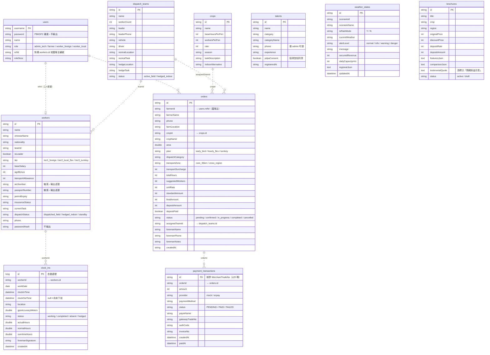

# 智農派工 (AgriDispatch) - 資料庫實體關聯圖與資料字典 (ERD)

> **文件版本**：v3.0.0（2026-09-23，依 `Software/backend/src/main/java/com/agridispatch/entity/*.java` 實際 JPA 實體改寫）
> **資料庫**：H2 檔案資料庫（`Software/backend/data/agridispatch_db`），Hibernate `ddl-auto: update` 自動建表
> **Visio 圖檔**：同資料夾的 `.vdx` / `.vsdx` 為 v2.0 舊版，**以本文件的 Mermaid 圖為準**

> 本系統**不使用** JPA 關聯註解（`@ManyToOne` 等），實體之間以字串欄位做邏輯關聯，資料庫層**沒有外鍵約束**。下圖的關聯線表示程式中的邏輯關聯與檢查位置。

---

## 壹、 實體關聯圖 (Mermaid ER Diagram)

---

## 貳、 資料字典 (Data Dictionary)

欄位型別為 Java 型別（H2 由 Hibernate 對應）。**敏感**＝個資或憑證，輸出時遮罩或不輸出。

### 2.1 使用者帳號 `users`
| 欄位 | 型別 | 說明 | 敏感 |
| :--- | :--- | :--- | :---: |
| `username` (PK) | String | 登入帳號 | |
| `password` | String | PBKDF2 雜湊（格式 `pbkdf2$<iter>$<salt>$<hash>`）；啟動時自動把舊明碼升級 | ✅ 不輸出 |
| `name` | String | 顯示名稱 | |
| `role` | String | `admin_tech` / `farmer` / `worker_foreign` / `worker_local` | |
| `refId` | String | 對應工人編號（`workers.id`）或農場主編號（如 `F001`） | |
| `roleDesc` | String | 角色說明 | |

### 2.2 農工 `workers`
| 欄位 | 型別 | 說明 | 敏感 |
| :--- | :--- | :--- | :---: |
| `id` (PK) | String | 工號（如 `W001`） | |
| `name` / `chineseName` | String | 姓名 / 中文名 | |
| `nationality` | String | 國籍 | |
| `teamId` | String | 所屬工班 → `dispatch_teams.id` | |
| `isLeader` | boolean | 是否為組長 | |
| `tier` | String | `tier1_foreign`（外展移工）/ `tier2_local_flex`（本土部分工時）/ `tier3_turnkey`（機耕統包） | |
| `baseSalary` | int | 底薪（種子資料依 2026 最低工資 29,500） | |
| `agriBonus` | int | 就業獎勵（8,800【待確認：適用對象】） | |
| `transportAllowance` | int | 交通津貼 | |
| `arcNumber` | String | 居留證號；本國工為 null | ✅ 遮罩 |
| `passportNumber` | String | 護照號碼 | ✅ 遮罩 |
| `permitExpiry` | String | 聘僱許可效期 | |
| `insuranceStatus` | String | 納保狀態 | |
| `currentTask` | String | 目前派遣作業 | |
| `dispatchStatus` | String | `dispatched_field` / `hedged_indoor` / `standby` | |
| `phone` | String | 電話 | |
| `passwordHash` | String | 工人登入密碼雜湊 | ✅ 不輸出 |

> 遮罩規則：前 2 碼 + `****` + 末 2 碼（例 `AD****51`）。只有 admin 呼叫 `GET /api/workers/{id}` 時回傳完整值。

### 2.3 工班 `dispatch_teams`
| 欄位 | 型別 | 說明 |
| :--- | :--- | :--- |
| `id` (PK) | String | 工班代號（如 `team_a`） |
| `name` | String | 工班名稱 |
| `workerCount` | int | 人數 |
| `leader` / `leaderPhone` | String | 帶班師傅與電話 |
| `vehicle` / `driver` | String | 專車與司機 |
| `normalLocation` / `normalTask` | String | 晴天作業地點與內容 |
| `hedgeLocation` / `hedgeTask` | String | 天候避險轉派地點與內容 |
| `status` | String | `active_field`（田間）/ `hedged_indoor`（已轉派室內） |

### 2.4 作物基準 `crops`
| 欄位 | 型別 | 說明 |
| :--- | :--- | :--- |
| `id` (PK) | String | 作物代號（如 `mango`、`taoyuan_veg`；共 16 種） |
| `name` | String | 作物與產區 |
| `baseHoursPerFen` | int | 每分地基準工時（試算總工時 = 面積 × 此值） |
| `workersPerFen` | int | 每分地建議人數 |
| `rate` | int | 每工時牌價（元） |
| `season` | String | 產季 |
| `taskDescription` | String | 作業內容 |
| `indoorAlternative` | String | 天候避險時的室內替代作業 |

> 鳳梨、蓮霧、高山茶、文旦、水稻、高接梨 6 種為 2026-09-23 補入以對應農場主預約表單，工時與費率為示範參考值，正式營運前需依產區校正。

### 2.5 派工訂單 `orders`
| 欄位 | 型別 | 說明 |
| :--- | :--- | :--- |
| `id` (PK) | String | 訂單編號，由後端產生（不接受前端指定） |
| `farmerId` | String | 下單農場主 → `users.refId`；用於擁有者權限檢查 |
| `farmerName` / `phone` / `farmLocation` | String | 農場主與田區資料 |
| `cropId` / `cropName` | String | → `crops.id`；不存在時回 400 |
| `area` | double | 面積（分地），須 > 0 |
| `plan` / `planName` | String | `early_bird`（9 折、20% 定金）/ `hourly_flex`（310 元/hr、無定金）/ `turnkey`（95 折、30% 定金） |
| `dispatchCategory` / `categoryName` | String | `harvest_grading` / `tillage_planting` / `pruning_bagging` / `drone_pest_control` / `cold_chain_pack` / `typhoon_emergency` |
| `transportZone` | String | `core_35km`（不加價）/ `cross_region`（+1,200 元） |
| `transportSurcharge` | int | 交通加價 |
| `totalHours` / `suggestedWorkers` / `unitRate` | int | 由後端試算 |
| `standardAmount` / `finalAmount` / `depositAmount` | int | 原價 / 折扣後總額 / 定金；由後端計算，客戶端不可直接修改 |
| `depositPaid` | boolean | 定金是否已付；只能經金流流程設為 true |
| `status` | String | 訂單狀態（見第參章） |
| `assignedTeamId` | String | → `dispatch_teams.id` |
| `foremanName` / `foremanPhone` / `foremanNotes` | String | 現場小工頭與交辦事項 |
| `createdAt` | String | 建立時間 |

### 2.6 金流交易 `payment_transactions`
| 欄位 | 型別 | 說明 |
| :--- | :--- | :--- |
| `id` (PK) | String(20) | 交易序號，格式 `AG` + `yyMMddHHmmss` + 6 碼隨機英數；同時作為綠界 `MerchantTradeNo` |
| `orderId` | String(40) | → `orders.id`（必填） |
| `amount` | int | 金額（依訂單定金，必填） |
| `provider` | String(16) | `mock` / `ecpay` |
| `paymentMethod` | String(32) | `credit_card` / `line_pay`（尚未串接）/ `atm_virtual` |
| `status` | String(16) | `PENDING` / `PAID` / `FAILED`（`PAID`、`FAILED` 為終態） |
| `payerName` | String | 付款人 |
| `gatewayTradeNo` | String(40) | 綠界交易編號 |
| `authCode` / `invoiceNo` | String(20) | 授權碼 / 發票號碼 |
| `createdAt` / `paidAt` | LocalDateTime | 建立 / 付款時間 |

### 2.7 出勤打卡 `clock_ins`（實體 `Attendance`）
| 欄位 | 型別 | 說明 |
| :--- | :--- | :--- |
| `id` (PK) | Long | 自動遞增 |
| `worker_id` | String(20) | → `workers.id`（必填） |
| `work_date` | LocalDate | 上班日（必填） |
| `clock_in_time` | LocalDateTime | 上班時間（必填） |
| `clockOutTime` | LocalDateTime | 下班時間；null 表示尚未下班 |
| `location` | String(200) | 打卡地點 |
| `gpsAccuracyMeters` | Double | GPS 精度（0~100,000） |
| `status` | String(20) | `working` / `completed` / `absent` / `hedged` |
| `actualHours` / `normalHours` / `overtimeHours` | Double | 實際工時（0.1 小時）/ 正常工時（上限 8）/ 加班工時 |
| `foremanSignature` | String(50) | 帶班簽核 |
| `createdAt` | LocalDateTime | 建立時間（不可更新） |

### 2.8 人才庫 `talents`
| 欄位 | 型別 | 說明 | 敏感 |
| :--- | :--- | :--- | :---: |
| `id` (PK) | String | 登錄編號 | |
| `name` | String | 姓名 | ✅ |
| `category` / `categoryName` | String | 人才類別 | |
| `phone` | String | 電話（僅 admin 可讀取人才庫） | ✅ |
| `experience` | String | 經歷 | |
| `pdpaConsent` | boolean | 個資蒐集告知同意（公開登錄時須為 true） | |
| `registeredAt` | String | 登錄時間 | |

### 2.9 天候狀態 `weather_states`
| 欄位 | 型別 | 說明 |
| :--- | :--- | :--- |
| `id` (PK) | String(64) | 狀態紀錄編號 |
| `scenario_id` / `scenarioName` | String | 天候情境 |
| `is_rain_mode` | String(1) | `Y` / `N` |
| `current_weather` | String(100) | 目前天候描述 |
| `alert_level` | String(50) | `normal` / `info` / `warning` / `danger` |
| `message` | String(500) | 調度說明 |
| `securedRevenue` / `dailyCapacityHrs` | Integer | 避險後保全營收 / 日產能工時（展示用） |
| `regionalJson` | TEXT | 各產區天候 JSON |
| `updatedAt` | LocalDateTime | 更新時間；後端啟動時讀回最新一筆 |

### 2.10 產品文宣 `brochures`
主要欄位：`id` (PK)、`title`、`subtitle`、`category`、`crop`、`region`、`targetAudience`、`badge`、`icon`、`themeColor`、`coverImage`（TEXT）、`originalPrice`、`discountPrice`、`depositRate`、`depositAmount`、`hours`、`workers`、`days`、`description`（TEXT）、`featuresJson`（TEXT）、`comparisonJson`（TEXT）、`testimonialName`、`testimonialTitle`、`testimonialQuote`（TEXT）、`phone`、`serviceOffice`、`status`（`active` / `draft`）、`createdAt`。

> 服務尚未營運，`testimonialQuote` 一律標示「預期效益示意，非實際客戶見證」。4 大標準 DM（固定 ID）可由 `POST /api/brochures/seed` 重置為目前範本。

---

## 參、 商業完整性規則（程式實作）

1. **訂單狀態機**（`OrderService.TRANSITIONS`）：`pending → confirmed → in_progress → completed`；`pending` / `confirmed` / `in_progress` 可轉 `cancelled`；`completed`、`cancelled` 為終態。需定金的新訂單從 `pending` 開始，免定金方案直接 `confirmed`。
2. **定金付款**：金額由後端依訂單計算；已付款訂單再次付款回傳既有結果（冪等）；已取消或已完工訂單拒絕付款；定金為 0 的方案不建立交易。付款成功時 `depositPaid=true`，若原為 `pending` 則轉 `confirmed`。
3. **綠界通知**：先驗證 CheckMacValue 與金額才入帳；`RtnCode≠1` 標記 `FAILED`；重複通知冪等回 `1|OK`。
4. **打卡**：同一工人同時最多一筆未下班紀錄（重複上班打卡回 409）；下班打卡取最近一筆未下班紀錄，可跨日。
5. **編號產生**：訂單、農工、人才等 ID 由後端產生且不覆寫既有資料（不再使用 `count()+1`）。
6. **種子資料**：`SeedService` 依 ID 補缺，只新增不存在的資料、不覆蓋既有內容；本國工 `arcNumber` 為 null。
7. **權限**：農場主只能讀寫自己的訂單（`farmerId = token.ref`）；工人只能存取自己的出勤與薪資；詳見規格書第肆、捌章。

---

## 肆、 與舊 Oracle 設計（`Software/database/01_agridispatch_oracle_schema.sql`）的差異

現行系統以 **H2 + JPA 實體**為準，`Software/database/` 的 Oracle schema 與種子 SQL 為早期設計，**與程式不一致**：

| 類別 | 內容 |
| :--- | :--- |
| Oracle 有、程式沒有的表 | `farmers`（農場主改由 `users` + `orders.farmerId` 表示）、`financial_ledger`（雙軌分帳帳本）、`line_users`、`line_messages` |
| 程式有、Oracle 沒有的表 | `users`、`brochures`、`payment_transactions` |
| 兩邊都有但結構不同 | `clock_ins`：Oracle 為 VARCHAR2 主鍵加經緯度欄位，程式為自動遞增主鍵加工時欄位；`orders`：Oracle 有 `farmer_id NOT NULL` 外鍵，程式另有派工類別、小工頭、交通區等欄位，`created_at` 在 Oracle 為 TIMESTAMP、程式為字串；`workers`：Oracle 缺 tier、證件、電話等欄位；`crops.base_hours_per_fen`：Oracle 為 NUMBER(6,1)、程式為 int |
| 布林欄位 | Oracle 以 `CHAR(1)` 表示，程式為 boolean，改用 Oracle 時需轉換器 |

**建議**：正式上線若改用 Oracle 或其他資料庫，以 JPA 實體為準重新產生 schema，並導入 migration 工具（建議 Flyway）管理結構變更；`ddl-auto: update` 只會新增欄位，不會刪除或改名。
