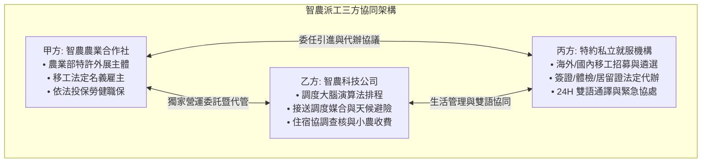

# 外展農業合作社與私立就業服務機構（外勞仲介）業務合作暨引進代辦協議書

> **文件戰略定位**：  
> 本協議為「有限責任智農農業勞務生產合作社（法定特許外展雇主）」、「智農科技股份有限公司（調度大腦與代管方）」與「特約合法私立就業服務機構（外勞仲介公司）」三方建立長期戰略夥伴關係之**核心商務暨法律合約**。  
> **核心目的**：
> 1. 明確界定合作社之「特許外展派工權」與仲介機構之「境外招募、簽證體檢與生活輔導代辦權」，杜絕越權非法派工。
> 2. 嚴格鎖定《就業服務法》收費紅線，杜絕「地下買工費」、「非法回扣」，確保 100% 合規。
> 3. 建立「3 個月試用期失聯逃逸無償替補條款」與「24H 雙語緊急協調機制」，確保外展農工人事穩定度。

---

**立協議書人：**

* **甲方（特許外展主體）**：有限責任智農農業勞務生產合作社  
  * 法定代表人（理事主席）：【姓名】  
  * 統一編號：【XXXXXXXX】  
  * 登記地址：【某縣市某鄉鎮某路段某號】  

* **乙方（科技營運代管方）**：智農科技股份有限公司  
  * 法定代表人（董事長）：【創辦人姓名】  
  * 統一編號：【XXXXXXXX】  
  * 登記地址：【某縣市某鄉鎮某路段某號】  

* **丙方（私立就業服務機構／特約仲介）**：【某某國際人力資源仲介有限公司】  
  * 法定代表人（董事長/總經理）：【姓名】  
  * 私立就業服務機構許可證字號：【勞動部私就業字第 XXXX 號】  
  * 統一編號：【XXXXXXXX】  
  * 營業地址：【某縣市某路段某號】  

三方茲就甲方獲准經營之農業部外展農務計畫，委託丙方辦理外展移工引進、文件申辦及雙語管理協助事宜，本於專業分工與誠信原則，協議訂定條款如下：

---

### 第一條 合作模式與三方權責劃分

1. **甲方（合作社）權責**：
   * 依法向農業部及勞動部申請外展農務機構資格與外展移工配額。
   * 擔任外展農工之法定雇主，依法投保勞工保險、全民健康保險、勞工職業災害保險，並按月提繳退休金與發放工資。
   * 開立外展勞務發票予要派小農與契作農場。
2. **乙方（科技公司）權責**：
   * 負責派工調度大腦、小農 LINE 官方帳號與移工 Web App 之系統維運。
   * 排定出勤接送時段（由要派農戶接送或甲方特約車行按趟接送，乙方不配置專車）、全台作物產曆平滑化排程及突發梅雨冷鏈轉移避險。
   * 協助甲方查核特約農場、產銷班或冷鏈集貨場提供之移工住宿（甲乙雙方均不承租宿舍、甲方不代扣膳宿費），以及現場本土農業師傅之帶班督導。【待確認：雇主住宿義務得否由第三方提供住宿履行，須請律師／勞動部確認。】
3. **丙方（仲介機構）權責**：
   * **招募與遴選**：依甲方與乙方提出之農技需求（果樹剪枝、蔬菜挑選、體能耐熱），透過合法海外合作夥伴或國內轉換雇主平台辦理人員招募與背景審查。
   * **法定證照與規費代辦**：代辦初次招募許可、入國引進簽證、居留證核發與展延、定期法定體檢通報、重入國許可及期滿續聘申辦。
   * **雙語服務與生活輔導**：配置越南語、印尼語合格雙語就服輔導專員，配合乙方舍監，定期實施生活關懷、法令宣導與勞資溝通。

---

### 第二條 引進管道、人員素質與期程要求

1. **引進管道**：
   * **管道 A（境內轉聘優先）**：丙方應優先透過勞動部轉聘平台承接在台期滿轉出、或因原雇主關廠歇業之合法移工。具備基礎中文溝通能力、持有台灣機車駕照或具農務經驗者優先。
   * **管道 B（海外直聘/引進）**：
     * **越南籍**：以具備果樹栽培、嫁接剪枝、套袋經驗之熟手為主。
     * **印尼籍**：以具備溫室設施栽培、耐高溫與細心度高者為主。
2. **遴選標準與健康保證**：
   * 年齡介於 20 至 40 歲，身心健康，無任何不良犯罪前科。
   * 抵台前必須通過中華民國衛生福利部指定之合格醫院體檢（含胸部 X 光、梅毒、漢生病、阿米巴痢疾等各項檢查合格）。
3. **作業期程承諾**：
   * 境內轉聘案件：丙方應於接獲甲方需求通知後 **21 日內** 完成承接面試與核准送件。
   * 海外引進案件：丙方應於取得勞動部引進許可函後 **45 日內** 完成移工抵台入境報到。

---

### 第三條 服務費用、規費標準與嚴禁超收紅線（就服法合規天條）

1. **甲方委任代辦服務費**：
   * 依勞動部《私立就業服務機構收費項目及金額標準》，甲方向丙方支付移工引進代辦登記費與介紹費，每名新台幣 **【XXXX 元】整**，於移工合法入境（或轉聘生效）且體檢合格取得聘僱許可後一次結清。
2. **移工端法定服務費規範**：
   * 丙方依勞動部規定，得按月向移工收取法定服務費（第一年每月最高 $1,800 元、第二年每月最高 $1,700 元、第三年每月最高 $1,500 元）。
   * **嚴禁超收與違法買工費**：丙方切結保證**絕不向移工收取任何名目之「買工費」、「茶水費」或超額貸款**，亦絕不向要派小農收取任何非合約載明之非法仲介費。若有違反，丙方應自負全額法律責任，並賠償甲方及乙方因此所受之一切信譽與實質損害。
3. **代收轉付之行政規費**：
   * 居留證規費（每年 $1,000 元）、半年一次法定體檢費（每次約 $1,500 ~ $2,000 元），由丙方檢據向甲方請款，由甲方依雙語勞動契約約定於移工薪資中依法代扣繳納。【待確認：上述費用是否得依法自移工薪資代扣，與財務計畫（F1）將體檢/居留證費用列為雇主成本之編列方式不一致，須請執業律師與會計師確認何者費用得由移工負擔、何者應列為雇主成本，並統一各文件記載。】

---

### 第四條 逃逸防範、失聯通報與無償替補保證

1. **入職 3 個月失聯無償替補保證**：
   * 移工抵台入境或承接生效之日起 **90 日內**，若發生非可歸責於甲方或乙方之事由（如體檢不合格遣返、重大違規遭廢聘、或無故曠職失聯逃逸）：
   * **丙方應承擔無償替補責任**：丙方承諾於主管機關核發遞補許可後，**免費為甲方引進或承接同等素質之新移工，不再收取任何代辦介紹費用**。
2. **失聯協尋與法定通報責任**：
   * 移工若發生無故曠職連續達 3 日失去聯繫之情事，丙方應配合甲方於 3 日內依法向勞動部、移民署專勤隊及地方勞工局完成《就業服務法》第 56 條之法定通報。
   * 丙方應啟動海外合作仲介及在台同鄉網絡協尋，積極配合治安機關查緝。

---

### 第五條 雙語生活輔導與緊急狀況協處機制

1. **雙語通譯支援**：
   * 丙方應指派專責之越南語、印尼語就業服務人員，每季至少前往移工住宿處所進行 1 次移工訪視與生活心理關懷，並作成訪視紀錄備查。
   * 移工若因急病、工傷意外需就醫診治，丙方雙語人員應於接獲乙方通知後 **2 小時內**（重大緊急事故 1 小時內）抵達醫院提供醫療通譯支援。
2. **勞資爭議協調**：
   * 移工與甲方、要派小農因語言隔閡或文化差異產生摩擦時，丙方有義務指派雙語人員召開三方協調會，排解糾紛，維持現場作業和諧。

---

### 第六條 嚴禁越權非法派遣（派工權限獨家保留）

1. **調度權限排他性**：外展農工之每日派工、作業農地安排、車輛動線與工時核銷，**100% 專屬於甲方與乙方之調度大腦指揮權限**。
2. **禁止擅自調派**：丙方僅為行政代辦與生活輔導委任方，**丙方絕對無權自行將移工調派至任何農場、工廠或營造工地作業**。若丙方私自居間媒介轉派移工，視為重大違約，甲方有權立即解除本協議，並要求丙方承擔新台幣 **【壹佰萬元整】** 之懲罰性違約金，並追究就服法刑責。

---

### 第七條 合約期間、終止與管轄法院

1. **有效期間**：本協議自三方用印簽署之日起生效，有效期間為 **三年**。期滿前兩個月三方如無書面終止通知，自動展延一年。
2. **爭議管轄**：因本協議所生之一切爭議，三方合意以臺灣【某縣市】地方法院為第一審管轄法院。

---

**立協議書人簽署：**

* **甲方（特許主體）**：有限責任智農農業勞務生產合作社  
  法定代表人（理事主席）：__________________________（簽章）  
  統一編號：  
  地址：  

* **乙方（科技營運代管方）**：智農科技股份有限公司  
  法定代表人（董事長）：__________________________（簽章）  
  統一編號：  
  地址：  

* **丙方（特約私立就服機構）**：【某某國際人力資源仲介有限公司】  
  法定代表人：__________________________（簽章）  
  私立就業服務機構許可證字號：  
  統一編號：  
  地址：  

**簽署日期：中華民國 ______ 年 ______ 月 ______ 日**
