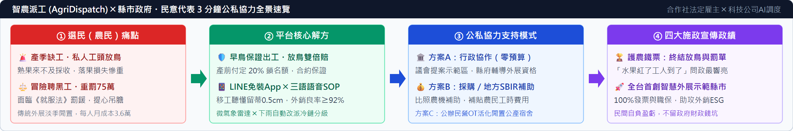

<!-- layout: one-page -->
# 【三分鐘一頁提案】智農派工 (AgriDispatch) 縣市政府 ╳ 民意代表公私協力專案

> **核心定位**：「農業勞務生產合作社（法定雇主）╳ 智農科技（調度大腦）」雙軌架構｜終結產季放鳥與黑工重罰・建立智慧農業與外銷 ESG 標竿政績（財務基準依 F2 v2.4 定版；2026 最低工資月薪 29,500 元／時薪 196 元）

## 壹、農民（選民）與移工結構性痛點 ╳ 平台功能與效益解方（第 1～2 分鐘）

| ① 農場／農民（選民）與移工核心痛點 | ② 智農派工平台技術解方與量化成效 |
| :--- | :--- |
| **【產季搶工被放鳥・落果損失慘重】** 傳統農村仰賴地下牛頭口頭叫工，產季常遭臨時放鳥，熟果無法及時採收造成嚴重農損【待補來源】；外展機構單一雇主制僵化，雇主每月法定成本達 **36,312 元/人**（底薪 1.231 倍），淡季閒置負擔沉重。 | **【早鳥 120H 工時包 ╳ 遲到放鳥賠償機制】** 產前 45 天預售工時包（$315/hr【待確認：C2 定價待驗證】），合作社預收 20% 定金鎖定配額；合約明定**「遲到免單、放鳥雙倍賠」**；結合跨產曆 AI 調度（芒果➔文旦➔茶葉➔蓮霧）創造年稼動率 **92%**。 |
| **【極端氣候停工・外展現金流斷鏈】** 梅雨豪雨果園泥濘無法下田，傳統外展照付全額月薪，小農承受停工損失；雨停後臨時工已被其他果園加價搶走；高齡農民（均齡 64 歲【待補來源】）不會用複雜 App，越／印移工語言不通蹭掉果粉被退貨。 | **【微氣象冷鏈備援 ╳ LINE 免裝 App 三語語音】** 串接氣象預報，降雨超標自動切換至特約冷鏈廠進行室內分級包裝（合作社 **7 名移工**即損益平衡）；農民用 **LINE 官方帳號一鍵叫工**；移工端語音播報越／印圖解 SOP（芒果留蒂 0.5cm），外銷良率 **≥92%**。 |
| **【誤聘黑工 75 萬重罰・無合法發票】** 缺工鋌而走險聘用失聯黑工，面臨《就服法》**15～75 萬元重罰**【待確認】；黑工無勞健保職災自負，私人工頭開立白單無法報帳，難以通過全聯、好市多及外銷通路之 ESG 查核。 | **【合作社 100% 投保 ╳ 合法憑證助攻外銷】** 合作社擔任法定雇主合法引進外展移工，**100% 投保勞健職保並開立合法憑證**，科技公司收取 16% 系統代管費【待確認：須經合作社依章程決議】；**農民 0 罰鍰風險**，契作果園直攻高價外銷通路。 |

## 貳、需要民意代表與縣市政府支持模式 ╳ 施政政績與量化效益（第 2～3 分鐘）

| ③ 公私協力支持模式（行政協作／採購／OT 活化） | ④ 施政宣傳政績亮點與三年量化推演 |
| :--- | :--- |
| **【方案 A｜政策示範區與行政協作（零預算最快落地）】** ・**民意代表**：議會質詢提案設立「智慧外展農務示範基地」，服務處與農會協辦產銷班工時說明會。 ・**縣市政府**：農業處輔導合作社取得外展資格與配額；勞工處對接中高齡缺工就業獎勵招募第二層本土兼職【待確認：現行要點】。 | **【護農鐵票問政有感：「水果紅了、工人到了」】** ・民代以「制度化解決選區缺工痛點」樹立專業問政口碑，直接守護農民整年心血。 ・以合法合規派遣徹底杜絕選區黑工查緝恐慌與重罰民怨，深受產銷班與農會基層肯定。 |
| **【方案 B｜政府勞務採購與工時補貼（小額預算立竿見影）】** ・**縣府採購**：農業處編列智慧調度示範採購案，或透過「地方型 SBIR（上限 100 萬）」補助數位系統【待確認】。 ・**選民補貼**：比照農機補助，對首批預約工時包之契作戶提供定額工時補貼（每小時補貼 $30～$50），降低試用門檻。 | **【全台首創智慧外展示範縣市・立竿見影】** ・地方首長獲全國性施政亮點，展現數位治理與智慧農業創新高度，成中央部會觀摩典範。 ・首年以小額預算帶動 12 移工＋12 兼職創造 **2.9 萬工時**與 **983.3 萬元 GMV**（F2 v2.4）。 |
| **【方案 C｜公辦民營 OT 委託營運（活化閒置公產取代傳統 BOT）】** ・縣府盤點**閒置舊校舍、公有集貨場**，採 **OT（委託營運）**交由合作社營運【待確認：公有財產法規】。 ・**一館雙用**：樓上作合法移工宿舍、樓下作梅雨季冷鏈分級包裝基地；免去 BOT 3～5 年興建期與重資本風險。 | **【外銷 ESG 農業標竿・民間自負盈虧零財政錢坑】** ・產銷班 100% 合法用工與安全住宿，符合日韓超市外銷供應鏈 ESG 查核，推升外銷單價。 ・採「合作社＋科技公司」民間自償運營，損益打平僅需 7～8 人，**不留政府財政負擔**。 |

> **財務與法規揭露**：數據依《財務計畫報表 2》（F2 v2.4 定版，方案 C2，不含政府補助）。早鳥均價 $315/hr、師徒制 1:10 及 16% 代管費待市場與章程驗證；第一年合作社淨利率約 2.3%（緩衝薄，利用率降 5% 或提繳勞退 6% 即轉虧）。法規、補貼與公產委營標註【待確認】者均依主管機關最新要點及律師審查為準。
