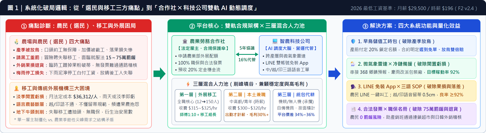
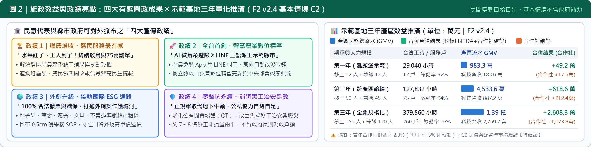

<!-- layout: one-page -->
# 【三分鐘一頁式提案】智農派工 (AgriDispatch) 縣市政府 ╳ 民意代表公私協力專案

> **核心定位**：「農業勞務生產合作社（法定雇主）╳ 智農科技（AI 調度大腦）」雙軌架構｜終結農村產季放鳥與黑工重罰・打造智慧農業與外銷 ESG 標竿政績（財務基準依《財務計畫報表 2》F2 v2.4 定版；2026 最低工資月薪 29,500 元／時薪 196 元）

## 壹、農場／農民（選民）與移工之結構性痛點 vs. 平台系統化解方（第 1～2 分鐘）

| 關鍵維度 | 1. 目前農場與農民（選民）、移工／外展之痛點 | 2. 智農派工 (AgriDispatch) 平台功能與解決機制 | 量化效益與合規保障 |
| :--- | :--- | :--- | :--- |
| **出工履約與淡季稼動** | **【農民】**產季搶工，私人工頭口頭約定臨時放鳥，熟果落果損失慘重【待補來源】。 **【移工/外展】**單一雇主制僵化，雇主月法定成本約 **36,312 元/人**（底薪 1.231 倍），淡季無工派即虧損。 | **早鳥保證工時包 ╳ 跨產曆 AI 排程**：產前預售 120H 工時包（$315/hr，總價 $37,800，合作社預收 20% 定金鎖定名額【待確認：C2 定價待驗證】）；串聯芒果➔文旦➔茶➔蓮霧蜜棗跨區接力。 | 合約明定**遲到免單、放鳥雙倍賠償**；首年目標稼動率 **92%**（年計費 1,800H）。 |
| **極端天候與停工避險** | **【農民】**看天吃飯，梅雨果園泥濘停工仍須承擔閒置成本，放晴後臨時工失聯。 **【移工/外展】**雨天無法下田，傳統外展機構照付全額月薪，現金流斷鏈。 | **微氣象雷達戰情室 ╳ 雨天冷鏈備援路由**：即時串接中央氣象署 368 鄉鎮預報，降雨超標自動改派工班至已簽約之室內冷鏈包裝廠進行清洗分級；搭配本土兼職（出勤才計薪）削峰填谷。 | 降低雨天閒置損失；合作社約 **7 名移工**、科技公司約 **8 名移工**即達損益平衡（F2 v2.4）。 |
| **農藝品質與數位落差** | **【農民】**臨時工粗魯採收蹭掉果粉、破蒂流膠遭外銷降級；高齡農民（均齡約 64 歲【待補來源】）不會用複雜 App。 **【移工】**越／印語言不通，不熟悉外銷果品採收規範頻受責難。 | **LINE 雙官方帳號 ╳ 中/越/印三語語音 SOP 工單**：農民免裝 App，直接以 LINE 官方帳號一鍵叫工與驗收；移工端支援越／印語音播報與圖解 SOP（配發定距剪、愛文芒果留蒂 0.5cm 護果粉）。 | 農民 **0 學習門檻**；目標外銷採收合格率 **≥ 92%**（以包裝場驗收紀錄衡量）。 |
| **法規風險與通路稽核** | **【農民】**冒險聘失聯移工面臨《就服法》**15～75 萬元罰鍰**【待確認】；白單無法報帳，難過連鎖超市與外銷稽核。 **【移工】**黑市牛頭非法抽頭、無職災保險與醫療保障，衍生地方治安黑數。 | **「合作社 ╳ 科技公司」雙軌合規架構**：由合作社擔任法定雇主（申請外展配額、100% 投保勞健職保、開立合法憑證），科技公司提供系統代管（收取 16% 代管費【待確認：須經合作社依章程決議】）。 | 農民 **0 罰鍰風險**；助契作戶通過全聯、好市多及日韓外銷 ESG 勞動合規查核。 |

## 貳、需要民意代表或縣市政府如何提供支持？（政府採購／公辦民營 OT／行政協作比較｜第 2～2.5 分鐘）

| 公私協力 (PPP) 模式 | 具體支持方式（民意代表 ╳ 縣市政府分工） | 財政與法規特性（為何優於傳統 BOT？） | 啟動時程與適用階段 |
| :--- | :--- | :--- | :--- |
| **方案 A｜政策示範區與跨局處行政協作** （零預算・最快落地） | **【民意代表】**議會質詢提案設立「智慧外展農務示範基地」，服務處與地區農會協辦產銷班媒合說明會。 **【縣市政府】**農業處輔導在地合作社向農業部申請「外展農務機構」資格與移工配額；勞工處對接銀髮人才中心與中高齡缺工就業獎勵（招募第二層本土人力）【待確認：各計畫現行要點】。 | **政府 0 新增財政支出**；由民代與縣府出面建立公信力，協助產銷班與合作社跨過中央外展審查與農民信任門檻。 | **最快（1～3 個月）** 首期灘頭堡（12 名移工＋12 名本土兼職）立即啟動。 |
| **方案 B｜政府勞務採購與小農數位／工時補貼** （小額預算・立竿見影） | **【政府採購／研發補助】**縣府農業處編列「智慧農業外展調度示範採購案」，或透過縣市「地方型 SBIR（每案上限約 100 萬元）」、數位部「台灣雲市集」補助系統導入【待確認：當年度要點】。 **【選民有感補貼】**比照農機補助，對首次預購「早鳥保證工時包」之選區契作農戶提供定額工時補貼或農貸利息補貼【待確認：補助法源】。 | **小額預算槓桿近千萬產值**：平台基本財務（F2 v2.4）不依賴政府補助即可自給；政府採購與補貼全數轉化為選區小農減負與擴散誘因。 | **中短期（3～6 個月）** 配合產季前 45 天早鳥預售期，快速擴大選區受惠農戶數。 |
| **方案 C｜公辦民營（OT 委託營運・活化閒置公產）** （取代高風險傳統 BOT） | **【盤點公有場館委託營運】**由縣府或農會提供既有**閒置公有房舍、舊校舍或農產集貨包裝場**，採 **OT（Operate-Transfer 委託營運）**交由「合作社 ╳ 智農科技」管理【待確認：公有財產委託經營或租賃法規】：① 作為移工合法「生活照顧住宿基地」；② 作為梅雨季「室內冷鏈分級備援中心」。 | **免除傳統 BOT 3～5 年興建期與重資本風險**；一館雙用直接解決外展機構「找合法宿舍」與「雨天停工」兩大痛點，活化蚊子館並收權利金。 | **中長期（6～12 個月）** 支撐第二、三年擴張至 50～150 名移工之跨產區規模。 |

## 參、施政上可帶來的四大宣傳政績與三年量化效益（第 2.5～3 分鐘）

> **合規與財務風險揭露（依專案規範如實記載）**：本提案財務數字引用《財務計畫報表 2》（F2 v2.4 定版，基本情境採方案 C2，不含政府補助；平台不配置專車與宿舍，住宿由特約場域提供、交通由用工農戶安排【待確認：雇主住宿義務與外展交通合規性】）。C2 之定價（第一層均價 $315～$325/hr）、人力配置（帶班師傅 1:10 搭配資深移工組長）與 16% 代管費（須經合作社依章程決議）尚待市場驗證【待確認】；第一年合作社損益率約 2.3%（緩衝極薄，利用率降 5 個百分點或須提繳勞退 6% 即轉虧）。文中涉及法規、補助要點與公有資產委託經營標註【待確認】者，均須依各主管機關最新公告與律師審閱結果為準。
