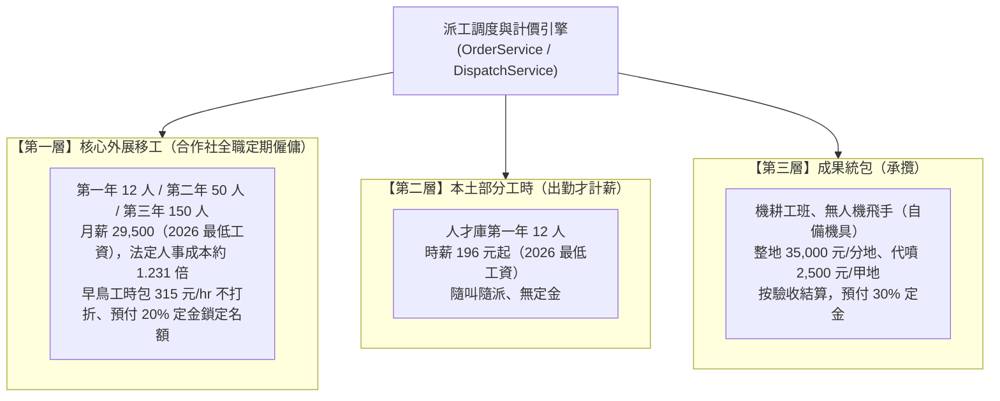
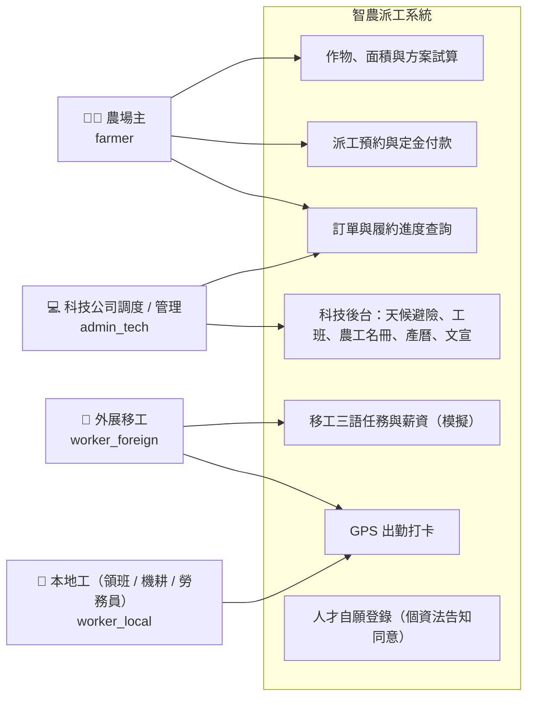
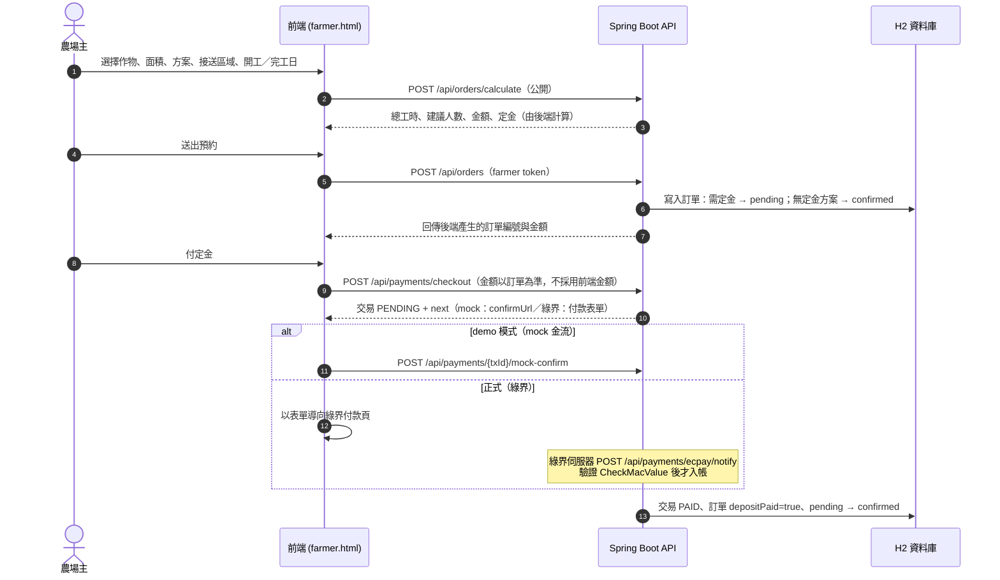
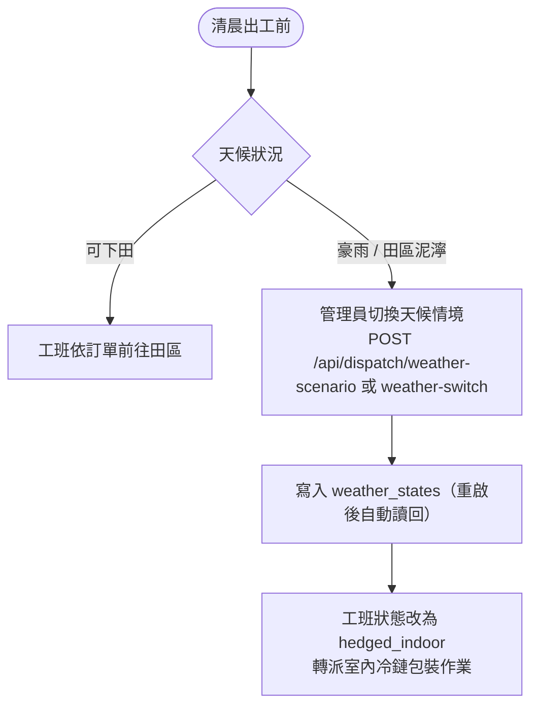
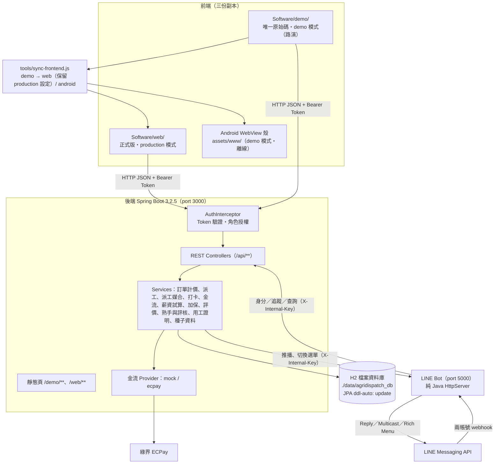

# 智農派工 (AgriDispatch) - 系統分析與架構設計規格書

> **文件編號**：AD-SA-202609-V3
> **系統名稱**：智農派工（AgriDispatch）——外展農務移工調度與農事派遣平台
> **文件版本**：v3.5.0（2026-10-02 更新：LINE 改為農場主／工作者雙帳號、帳號綁定、圖文選單、主動推播，見第陸章與 `05_LINE官方帳號拆分規格.md`）；v3.4.0（2026-10-01 更新：訂單工期、單體後端、前端三資料夾、加保檢查、工班評價、合法用工證明、熟手標籤與領班逐人評核、派工依標籤媒合、LINE Bot 轉發後端；v3.0.0 為 2026-09-23 依實際程式碼改寫；財務數字對齊 F2 v2.4）
> **發布日期**：2026-10-01
> **適用對象**：系統架構師、前後端工程師、Android 開發者、合作社營運團隊、審查委員與投資人

> **本版說明**：v2.0 描述的是已移除的舊版架構（Java HttpServer、`agridispatch.json`），且多處工資、財務數字與實際不符。本版以程式碼為唯一事實來源重寫技術章節，業務章節的數字改依 2026 年最低工資與財務定版 F2（現為 v2.4，基本情境採方案 C2）。法規疑點標【待確認】。

---

## 壹、 專案緣起與系統目標

### 1.1 產業背景
1. **農村人口老化與缺工**：產季採收、搬運等勞力密集作業人力不足；北部產區（桃園八德溫室蔬菜、宜蘭三星青蔥、新竹茶園與柑橘）另面臨工廠與服務業競爭人力【待補來源：農業從業人員平均年齡等統計】。
2. **非法用工風險**：小農任用非法外籍勞工，依《就業服務法》面臨罰鍰；契作通路查獲亦可能終止合作。
3. **天候停工與底薪成本**：外展移工為月薪制（2026 年最低工資每月 29,500 元），雨天無法下田時仍須給付工資。系統以「天候避險調度」將工班轉派室內冷鏈包裝作業，降低空轉【待確認：冷鏈包裝廠轉派是否屬外展農務許可範圍，須向農業部確認】。
4. **合規與透明**：由合作社（法定雇主）依法聘僱、納保並保存出勤與工資紀錄；系統提供派工、出勤與金流紀錄，供稽核與 ESG 供應鏈審查使用。

### 1.2 系統核心使命
以「科技公司（系統代管）＋ 農業勞務合作社（法定雇主）」雙法人架構，搭配三層混合人力模型（第一層外展移工、第二層本土部分工時、第三層成果統包），提供契約化、可預期的農事派工服務。合作社預計依外展農務制度申請服務資格（申請中，尚未取得）。

---

## 貳、 三層混合勞工調度模型 (Three-Tier Hybrid Labor Model)

### 2.1 三層模型營運與計費規則

| 維度 | 第一層：外展移工 | 第二層：本土部分工時 | 第三層：成果統包 |
| :--- | :--- | :--- | :--- |
| **法律性質** | 定期勞動契約（合作社為雇主） | 部分工時勞動契約 | 承攬契約【待確認：從屬性判斷，避免「假承攬、真僱傭」】 |
| **勞工待遇** | 月薪 29,500 元起 | 時薪 196 元起 | 按成果結算 |
| **對小農收費（F2）** | 315~325 元/hr（第一年均價 315） | 300~320 元/hr（第一年均價 300） | 35,000 元/分地、2,500 元/甲地 |
| **系統方案代碼** | `early_bird`：315 元/hr 不打折（防颱急單 360）、預付 20% 定金 | `hourly_flex`：310 元/hr、無定金 | `turnkey`：95 折、預付 30% 定金 |

> 程式與 F2 的差異：系統 `hourly_flex` 固定以 310 元/hr 計價，F2 第一年第二層均價為 300 元/hr。正式營運前須統一定價。
>
> 8,800 元就業獎勵：各文件曾將外展移工列為領取人，本規格不將其列入任何計價或成本【待確認：適用對象須向農業部確認】。

---

## 參、 交通物流

### 3.1 專車配置（F2）
F2 v2.2 起**平台不配置專車**：移工往返由用工農戶接送或自行安排，費用不計入 GMV、平台不抽成，合作社專車成本為 0【待確認：外展農務規範是否要求由外展單位統一接送】。（v2.1 曾規劃 9 人座專車 2／7／19 輛、單車月成本約 43,500 元，由合作社負擔，已刪除。）

### 3.2 交通計費規則（系統實作）
- `core_35km`（核心生活圈 35 公里內）：不加收交通費。
- `cross_region`（跨區派工）：每筆訂單加收 **1,200 元**。
- F2 基本情境不含專車費用；若須由合作社接送，F2 建議改採「交通費按趟實報實銷另向小農收取」（v2.1 之 B 槓桿）。系統 `cross_region` 固定加收 1,200 元與此不同，正式營運前須統一。

---

## 肆、 使用者角色與權限

### 4.1 角色與權限（以 `AuthInterceptor` 實作為準）

| 角色代碼 | 對象 | 可使用的資料與功能 |
| :--- | :--- | :--- |
| `farmer` | 農場主 | 建立訂單（自動綁定本人）、查詢 / 修改 / 取消**自己的**訂單、付定金、評價自己訂單的工班、取得自己訂單的合法用工證明 |
| `worker_foreign` | 外展移工 | **本人**的打卡、出勤紀錄、薪資試算；可讀取訂單清單 |
| `worker_local` | 本地工（`subRole`：`foreman` 領班 / `machinery` 機耕 / `labor` 勞務員） | 同上；工班領班（`isLeader`）可評核同工班成員 7 天內的班次 |
| `admin_tech` | 科技公司管理員 | 全部資料；作物、文宣、人才、農工名冊的新增修改刪除；訂單狀態變更；派工媒合（工班與出工名單）；工人加退保登錄；天候與工班調度；LINE 設定；通知發送 |

未登入只能使用公開端點（登入、試算、作物、產曆、文宣、付款方式、人才自願登錄、公開設定，見第捌章）。

---

## 伍、 核心業務流程

### 5.1 派工預約與定金付款

**工期**：訂單可帶 `startDate`／`endDate`（皆含當日），須同時提供、完工不可早於開工、最長一年。已完工或已取消不可修改；農場主只能在「待付定金」時修改工期，之後須由合作社（admin）調整，以免影響已排定的出工名單。

訂單狀態：`pending`（待付定金）→ `confirmed`（已排定）→ `in_progress`（履約中）→ `completed`（已完工）；未完工前皆可轉 `cancelled`（已取消）。轉換規則由 `OrderService.TRANSITIONS` 控管，只能經 `PUT /api/orders/{id}/status` 變更；轉為 `in_progress` 前會做派工前加保檢查（見 5.4）。對外顯示一律使用上述中文（`OrderService.statusLabel`；前台首頁、科技後台、LINE 訂單卡一致）。農場主取消訂單時保留紀錄（不刪除）。

### 5.2 天候避險調度

> 【待確認：室內冷鏈包裝作業是否屬外展農務許可範圍】。切到警戒等級時，系統會以 LINE 通知今天施工中訂單的農場主與出工名單（見 6.4）；App 推播尚未串接。

### 5.3 出勤打卡
- `POST /api/attendance/clock-in`：同一工人已有未下班紀錄時回 **409**；以同步鎖防止併發重複打卡。
- `POST /api/attendance/clock-out`：找該工人**最近一筆未下班**紀錄（可跨日）；沒有則回 **409**，不會捏造工時。
- 工時計算：實際工時（0.1 小時）、正常工時上限 8 小時、超過為加班工時；超過 16 小時附加「疑似忘記下班打卡」警告。
- 工人只能替自己打卡，管理員可代打。
- 上班打卡可帶 `orderId` 連結本次出勤所屬訂單：指定時須為履約中訂單且工人屬於該訂單的工班（有出工名單時須在名單上，否則 400）；未指定時，工班恰有一張履約中訂單才自動連結；有多張時先依出工名單判斷，仍無法判定再取今天落在工期內的那一張（恰一張才連結）。

### 5.4 加保登錄與派工前檢查
- 合作社於勞保局／健保署完成申報後，由管理員以 `POST /api/insurance/workers/{workerId}/enroll` 登錄（險種、月投保薪資、加保日、受理編號），退保以 `POST /api/insurance/records/{recordId}/withdraw` 登錄；每段投保期間一筆，歷史保留（`insurance_records`）。
- 應保險種：外籍移工為勞保、職保、健保；本國工另加就保。加保日當天起承保，退保日當天起不再承保。
- 訂單轉為 `in_progress` 時，已分派工班的每位成員（訂單有出工名單時只看名單成員，見 5.7）須在當天完整在保，否則回 **409**，訊息列出缺保人員與險種（例：「工班有成員尚未完整加保，不可出工：阮文雄（缺職保）」），科技後台編輯訂單時直接顯示此原因。
- 【待確認：投保薪資級距、部分工時人員加保方式，須經合作社與會計師確認】。

### 5.5 工班評價
- 農場主（或 admin 代評）以 `PUT /api/ratings/orders/{orderId}` 評價，訂單須為 `in_progress` 或 `completed` 且已分派工班；每張訂單一筆、可修改。
- 評分 1～5、標籤限白名單（準時到場、做工細心、效率高、溝通順暢、遵守安全規範、需加強訓練）、留言 ≤300 字；只評到工班層級，不評個別工人。

### 5.6 領班逐人評核與熟手標籤
- **領班逐人評核**：每一班下班簽核後，同工班領班（`isLeader`）或 admin 以 `PUT /api/evaluations/attendance/{attendanceId}` 評「優／可／需加強」；不可評自己，領班只能評 7 天內的班次（admin 不限）。領班以 `GET /api/evaluations/teams/{teamId}?date=` 查看工班當日出勤與評核狀態。前端：`AgriDispatch/worker-local-evaluation.html`。
- **熟手標籤**：依最近 24 個月、已連結訂單的出勤時數、訂單數、工班評價與領班評核即時計算「熟手／資深熟手」，技能分採收、修剪套袋、整地定植、包裝四類；門檻與暫停規則見 ERD 第參章，常數集中於 `SkillService`。標籤暫停後須 admin 以 `POST /api/skills/workers/{workerId}/{skill}/restore` 複核恢復。
- **履歷認證徽章**：工作許可有效、今日完整加保、無暫停中標籤、近 6 個月未經暫停複核，四項皆符合才顯示。
- **可見範圍**：工人看自己的進度（`worker-skills.html`），admin 看全部（`TechBackend/skills.html`），農場主只看得到工班的標籤人數，不列姓名。
- 【待確認：標籤只用於派工媒合優先順序，不得作為扣薪或解僱依據；評核與標籤規則須經合作社與律師確認符合勞動法令與個資規範】。

### 5.7 派工依標籤媒合
- 管理員在 `TechBackend/matching.html` 以 `GET /api/matching/orders/{orderId}` 取得工班排序與出工名單建議，可用 `GET /api/matching/orders/{orderId}/crew?teamId=` 查看其他工班的名單建議，確認後以 `PUT /api/matching/orders/{orderId}`（`{teamId, crew}`）寫入訂單的 `assignedTeamId` 與 `crewWorkerIds`。訂單須為待付定金、已排定或履約中。
- 工班排序：先排除有成員未完整加保或人數不足的工班，再依該派工類別的有效熟手人數、資深熟手人數、工班評價、負載（訂單有工期時為同期間訂單數，否則為施工中訂單數，少者優先）排序。
- 工期撞期：已排入其他工期重疊訂單出工名單的工人，不列入名單建議、也不計入工班合格人數，並顯示撞期的訂單與日期。
- 出工名單建議：只列工作許可有效且今日完整加保的人；必含一位領班；其餘依資深＞熟手＞培養中、領班評核表現、該類別時數排序；名單 ≥ 4 人時保留至少 1 個培養中名額（標籤暫停中的人不能佔用），避免熟手壟斷。
- 出工名單只能經媒合 API 設定；儲存時逐人檢查是否為該工班成員（否則 400）與是否符合出工資格（否則 409 並列出原因）。
- 設定名單後：轉履約中的加保檢查只看名單成員；同工班有多張履約中訂單時，打卡依名單決定連結哪一張訂單，指定的訂單不在名單上回 400。
- 【待確認：排序不使用國籍、性別、年齡，標籤只影響優先順序、不排除合格工人；此作法須經合作社與律師確認符合就業平等與個資規範】。

### 5.8 合法用工證明
- 農場主（或 admin）以 `GET /api/certificates/orders/{orderId}` 取得證明內容，前端頁面為 `AgriDispatch/farmer-certificate.html`；不另建資料表，依 `clock_ins`（以 `order_id` 歸屬訂單）、`workers.permitExpiry`、`insurance_records` 即時計算。
- 開立條件：訂單為履約中或已完工、有出勤紀錄，且每位出勤工人在每個出勤日都符合「外籍者聘僱許可在效期內（本國籍免）」與「應保險種皆在保」。不符合時仍回傳核對結果，但 `issuable=false` 並列出問題（例：某人某日未完整加保）。
- 證明編號 `LEC-<訂單編號>`，附 12 碼查驗碼（以 `AGRI_TOKEN_SECRET` 對證明內容簽章）。通路稽核人員在公開頁 `AgriDispatch/verify.html` 以 `GET /api/public/certificates/{no}?code=` 查驗，只回傳摘要（期間、人數、總工時等），不含工人姓名。
- 證明內容變動或伺服器密鑰改變後，舊查驗碼會失效；正式環境須固定 `AGRI_TOKEN_SECRET`。
- 【待確認：此證明能否作為產銷履歷或通路稽核的正式文件，開立名義與格式須經合作社、律師或主管機關確認】。

---

## 陸、 LINE 子系統

規格與決策紀錄見 `05_LINE官方帳號拆分規格.md`；帳號申請、設定與實機驗收步驟見 `07_LINE官方帳號上線與實機驗收手冊.md`。

### 6.1 兩個官方帳號
| 帳號 | 對象 | Webhook | 功能 |
| :--- | :--- | :--- | :--- |
| 智農派工（農場主） | 農場主 | `POST /callback/farmer` | 我的訂單、黑轉白、早鳥工時包、天候避險、機耕代噴預約、費率與產曆、帳號綁定、服務導覽 |
| 智農派工（工作者） | 本勞、外勞（中・越・印尼） | `POST /callback/worker` | 今日任務、上下班打卡、天候與集合、薪資、出勤紀錄、切換語言、帳號綁定、聯絡合作社 |

- LINE Bot（`Software/Line Bot`，port 5000）是唯一持有兩帳號 channel token 的元件，各帳號以自己的 secret 驗簽。國別不另開帳號，以語言與個人圖文選單區分。
- 在一個帳號問另一個帳號的功能，只回「請加入另一個帳號」引導。
- 身分、語言、追蹤狀態與綁定存後端 `line_users`（ERD 2.14）；LINE Bot 以內部金鑰（`AGRI_LINEBOT_INTERNAL_KEY`）呼叫後端 `/api/line/internal/identity`、`/follow-state`、`/query`。後端不可用時 LINE Bot 暫存記憶體並以本地卡片回覆。
- 舊版單一帳號的 `/callback`、`/webhook` 與後端 `POST /api/line/webhook` 過渡期保留（前者視同農場主帳號），之後移除。

### 6.2 帳號綁定
使用者在綁定頁 `AgriDispatch/line-bind.html`（LIFF，中・越・印尼語）登入平台帳號後呼叫 `POST /api/line/bind`。LINE userId 只取自後端向 LINE 驗證過的 ID token（`LINE_LOGIN_CHANNEL_ID`）；身分須與帳號相符，同一人在同一帳號只能綁一個 LINE 帳號。科技後台 `admin-line.html` 可查看綁定清單（LINE userId 遮罩）並強制解除。

### 6.3 圖文選單
兩帳號共 6 份（`farmer_guest`、`farmer_main`、`worker_guest`、`worker_main_zh／vi／id`），按鈕一律 postback。原始定義 `Software/Line Bot/tools/make_rich_menus.py`，`RichMenuUploader` 檢核與上傳；每次互動時依身分與語言確認個人選單，綁定、解除、改語言後立即切換。

### 6.4 主動推播
後端 `LineNotifyService` 決定收件人（已綁定、未封鎖的本人或出工名單），LINE Bot 依語言產生訊息並 multicast：訂單狀態更新、已收到定金、天候警戒（農場主）；明日出工（每日 18:00）、天候與集合（工作者）；農場主方案通知（科技後台手動）。工作者帳號不做 broadcast，只在 `AGRI_LINE_WORKER_HOURS`（預設 07:00-20:00【待確認】）內推播。

### 6.5 測試與驗收
- 後端：`LineBindingApiTest`、`LineBindingProductionTest`、`LineNotifyApiTest`、`LineNotifyQuietHoursTest`。
- LINE Bot：`java -cp bin com.agridispatch.linebot.TestSimulator --check`（對話、選單、推播訊息）、`RichMenuUploader --check`（選單檔）。
- 模擬環境驗收（規格第拾參章 15 條）：`python tools/acceptance_mock.py`（於 `Software/Line Bot`）。

---

## 柒、 系統整體技術架構

### 7.1 技術組成
| 層 | 技術 | 位置 |
| :--- | :--- | :--- |
| 前端 | Vue 3 global build、Tailwind（Play CDN 腳本）、Chart.js、Leaflet、Lucide，**皆已本地化**於 `js/vendor/`、`css/vendor/` | `Software/demo/{AgriDispatch,TechBackend,linebot}/` |
| 前端共用 | `app-config.js`（模式）、`api-client.js`（自動帶 token、demo 自動登入、production 401 導回登入頁）、`agri-docs.js`（收銀台、發票 / 薪資單範本、通知） | `Software/demo/*/js/` |
| 後端 | Spring Boot 3.2.5、Spring Data JPA、Bean Validation、H2（預設）／Oracle（`oracle` profile）；Java 17（本機以 JDK 26 執行） | `Software/backend/` |
| LINE Bot | 純 Java、零第三方套件（自製 `SimpleJson`） | `Software/Line Bot/` |
| Android | Java WebView 殼，compileSdk / targetSdk 35、minSdk 24、AGP 8.6.1、Gradle 8.7；分 `server`（科技後台，僅內部測試軌）與 `client`（農場主、本勞、外勞依國別）兩個 flavor，見 `06_Android雙端App規格書.md` | `Software/android/` |
| Oracle 部署腳本 | Oracle schema 與種子 SQL（20 張表，`skill_reviews`、`clock_ins` 使用 identity 欄位需 Oracle 12c 以上），2026-10-01 已依 JPA 實體對齊並於本機 Oracle 26ai 實測、重建 `AGRIDISPATCH`；已上線資料庫的結構變更另以 `migrations/` 增量腳本套用。2026-10-08 起後端已加入 Oracle 驅動（`pom.xml` 的 `ojdbc11` 23.5，runtime），以 `--spring.profiles.active=oracle`（`application-oracle.yml`，連線由環境變數 `AGRI_DB_URL`／`AGRI_DB_USERNAME`／`AGRI_DB_PASSWORD` 提供，`ddl-auto: none`）直接連 Oracle（見 ERD 文件第肆章） | `Software/database/` |

### 7.2 執行模式（詳見 `07_系統分析及文件/03_認證與API安全規格.md`）
| 模式 | 後端 | 前端 | 用途 |
| :--- | :--- | :--- | :--- |
| demo | `run.bat demo`（profile `demo`，`agri.demo.enabled=true`） | `mode: 'demo'` | 路演：demo-login 免密、示範帳號、mock 金流、H2 console（僅本機） |
| production | `run.bat`（預設） | `mode: 'production'` | 正式：真實帳密、無 demo 端點、H2 console 關閉 |

`start_all.bat` 以 demo 模式啟動後端（3000）與 LINE Bot（5000）。

---

## 捌、 API 端點清單

權限：**公開**＝免 token；**登入**＝任何有效 token；**本人**＝token 對應之本人或 admin；**admin**＝`admin_tech`（demo 模式下 demo token 視同 admin）。

| 模組 | Method | Path | 權限 | 用途 |
| :--- | :---: | :--- | :---: | :--- |
| 認證 | POST | `/api/auth/login` | 公開 | 帳號 / 工號 / 手機 / ARC / 護照 + 密碼登入 |
| 認證 | POST | `/api/auth/demo-login` | 公開（僅 demo） | 依角色取得示範 token；非 demo 回 404 |
| 認證 | GET | `/api/auth/me` | 登入 | 目前使用者 |
| 認證 | GET | `/api/auth/quick-profiles` | 公開（僅 demo） | 示範帳號清單（不含密碼與證件） |
| 認證 | POST | `/api/auth/change-password` | 本人 | 變更密碼 |
| 認證 | POST | `/api/auth/reset-password` | admin | 重設他人密碼 |
| 公開 | GET | `/api/public/config` | 公開 | `demoEnabled`、`paymentProvider` |
| 訂單 | GET | `/api/orders` | 登入 | admin / 工人看全部，農場主只看自己 |
| 訂單 | GET | `/api/orders/{id}` | 登入 | 單筆（農場主限本人） |
| 訂單 | GET | `/api/orders/categories` | 公開 | 派工類別 |
| 訂單 | POST | `/api/orders/calculate` | 公開 | 試算 |
| 訂單 | POST | `/api/orders` | farmer / admin | 建立訂單 |
| 訂單 | PUT | `/api/orders/{id}` | 本人 / admin | 修改（不可直接改狀態、付款旗標、金額、出工名單） |
| 訂單 | PUT | `/api/orders/{id}/status` | admin | 依狀態機變更狀態；轉 `in_progress` 時做加保檢查，不足回 409 |
| 訂單 | DELETE | `/api/orders/{id}` | 本人 / admin | 農場主為取消、admin 為刪除 |
| 金流 | GET | `/api/payments/methods` | 公開 | 付款方式 |
| 金流 | POST | `/api/payments/checkout` | 本人 / admin | 建立定金交易（冪等） |
| 金流 | POST | `/api/payments/{txId}/mock-confirm` | 登入（僅 demo） | 模擬付款完成 |
| 金流 | POST | `/api/payments/ecpay/notify` | 公開（驗 CheckMacValue） | 綠界付款通知，回 `1\|OK` |
| 金流 | GET | `/api/payments/{orderId}/status` | 本人 / admin | 付款狀態與交易紀錄 |
| 打卡 | POST | `/api/attendance/clock-in`、`/clock-out` | 本人 | 上下班打卡（上班可帶 `orderId`） |
| 打卡 | GET | `/api/attendance/history/{workerId}`、`/today/{workerId}` | 本人 | 出勤紀錄 |
| 打卡 | GET | `/api/attendance/summary/present-count` | 登入 | 今日出勤人數 |
| 農工 | GET | `/api/workers` | admin | 名冊（證件遮罩） |
| 農工 | GET | `/api/workers/{id}` | 本人 | 單筆（admin 可見完整證件號） |
| 農工 | POST / PUT / DELETE | `/api/workers`、`/api/workers/{id}` | admin | 名冊維護 |
| 農工 | POST | `/api/workers/{id}/clock-in`、`/clock-out` | 本人 | 打卡（委派 AttendanceService） |
| 農工 | GET | `/api/workers/{id}/attendance`、`/payroll` | 本人 | 月出勤、薪資試算（`simulated:true`） |
| 作物 | GET | `/api/crops`、`/api/crops/{id}` | 公開 | 作物基準 |
| 作物 | POST / PUT / DELETE | `/api/crops`、`/api/crops/{id}` | admin | 維護 |
| 人才 | POST | `/api/talents/register` | 公開 | 自願登錄（需個資同意） |
| 人才 | GET / POST / PUT / DELETE | `/api/talents`、`/api/talents/{id}` | admin | 人才庫（含電話，僅 admin） |
| 派工 | GET | `/api/dispatch/overview`、`/weather-state` | 公開 | 派工總覽、天候狀態 |
| 派工 | GET | `/api/dispatch/teams`、`/teams/{id}` | 登入 | 工班 |
| 派工 | POST / PUT | `/weather-scenario`、`/weather-switch`、`/weather-regions`、`/teams/{id}` | admin | 天候與工班調度 |
| 產曆 | GET | `/api/calendar`、`/harvests`、`/quarters`、`/months` | 公開 | 全台產曆 |
| 文宣 | GET | `/api/brochures`、`/api/brochures/{id}` | 公開 | 產品文宣 DM |
| 文宣 | POST / PUT / DELETE | `/api/brochures`、`/api/brochures/{id}` | admin | 維護 |
| 文宣 | POST | `/api/brochures/seed` | admin | 重置 4 大標準 DM（覆寫這 4 筆，自訂 DM 保留） |
| 加保 | GET | `/api/insurance/types` | 登入 | 險種清單 |
| 加保 | GET | `/api/insurance/workers` | admin | 全部工人在保摘要（可帶 `date`） |
| 加保 | GET | `/api/insurance/workers/{workerId}` | 本人 | 單一工人加退保紀錄與缺保險種 |
| 加保 | POST | `/api/insurance/workers/{workerId}/enroll` | admin | 登錄加保 |
| 加保 | POST | `/api/insurance/records/{recordId}/withdraw` | admin | 登錄退保 |
| 加保 | GET | `/api/insurance/teams/{teamId}` | 登入 | 工班在保覆蓋率與缺口 |
| 評價 | GET | `/api/ratings/tags` | 登入 | 可用標籤 |
| 評價 | GET | `/api/ratings/teams`、`/api/ratings/teams/{teamId}` | 登入 | 工班評價統計 |
| 評價 | GET / PUT | `/api/ratings/orders/{orderId}` | 本人 / admin | 查詢 / 新增或修改訂單評價 |
| 媒合 | GET | `/api/matching/orders/{orderId}` | admin | 工班排序與出工名單建議 |
| 媒合 | GET | `/api/matching/orders/{orderId}/crew?teamId=` | admin | 指定工班的出工名單建議 |
| 媒合 | PUT | `/api/matching/orders/{orderId}` | admin | 確認派工：寫入工班與出工名單 `{teamId, crew}` |
| 熟手 | GET | `/api/skills/workers` | admin | 全部工人技能進度與履歷認證摘要 |
| 熟手 | GET | `/api/skills/workers/{workerId}` | 本人 | 單一工人技能進度、升級差距與履歷認證 |
| 熟手 | POST | `/api/skills/workers/{workerId}/{skill}/restore` | admin | 複核恢復暫停中的標籤 |
| 熟手 | GET | `/api/skills/teams/{teamId}` | 登入 | 工班標籤人數（不列姓名） |
| 評核 | GET | `/api/evaluations/teams/{teamId}?date=` | 該工班領班 / admin | 工班某日出勤與評核狀態 |
| 評核 | PUT | `/api/evaluations/attendance/{attendanceId}` | 該工班領班 / admin | 評核單一班次（7 天內，不可評自己） |
| 證明 | GET | `/api/certificates/orders/{orderId}` | 本人 / admin | 合法用工證明內容與開立核對結果 |
| 證明 | GET | `/api/public/certificates/{no}?code=` | 公開 | 查驗證明真偽（僅摘要、不含姓名） |
| LINE | POST | `/api/line/internal/identity`、`/follow-state`、`/query` | LINE Bot（`X-Internal-Key`） | 身分、追蹤與語言、查詢（農場主只回本人訂單） |
| LINE | POST | `/api/line/bind` | 登入 | 綁定 LINE 帳號（LIFF ID token） |
| LINE | DELETE | `/api/line/bind/{channel}` | 本人 | 解除自己的綁定 |
| LINE | GET / DELETE | `/api/line/bindings`、`/api/line/bindings/{id}` | admin | 綁定清單（LINE userId 遮罩）、強制解除 |
| LINE | GET / POST | `/api/line/notify/status`、`/tomorrow`、`/farmer-broadcast` | admin | 推播時段、立即發送明日出工、農場主方案通知 |
| LINE | GET | `/api/line/config` | admin | 兩帳號設定狀態（含 LINE Bot 狀態，不回傳明文）；`POST`（執行中改金鑰）已於 2026-10-13 移除 |
| LINE | POST | `/api/line/webhook` | 公開（驗 X-Line-Signature） | 舊版單一帳號查詢入口（已停用，過渡期保留） |
| LINE | POST | `/api/line/simulate-push` | 登入 | 模擬推播 |
| 通知 | GET | `/api/notifications` | 登入 | 通知列表 |
| 通知 | POST | `/api/notifications/send` | admin | 發送通知 |
| 通知 | POST | `/api/notifications/fcm/register` | 本人 | 綁定 FCM token |
| 開發 | POST | `/api/dev/seed?cleanFirst=` | admin（僅 demo） | 重灌示範資料；非 demo 回 404 |

回應格式：成功 `{success:true, data|user|token...}`；錯誤 `{success:false, error}`（401 `UNAUTHORIZED`、403 `FORBIDDEN`、400 參數錯誤、409 狀態衝突），不回傳堆疊訊息。

---

## 玖、 資訊安全設計

| 項目 | 實作 | 位置 |
| :--- | :--- | :--- |
| Token | `base64url(payload).base64url(HMAC-SHA256)`，12 小時效期；production 拒絕 demo token | `security/TokenService` |
| 密碼 | PBKDF2-HMAC-SHA256、310,000 次、16 bytes salt；啟動時自動把舊明碼升級為雜湊；查無帳號時仍執行雜湊以降低時間差攻擊 | `security/PasswordHasher` |
| 授權 | `/api/**` 攔截器：公開清單、admin 清單、本人檢查；資源擁有者檢查在 Service 層 | `security/AuthInterceptor` |
| 個資遮罩 | 居留證號、護照號輸出為前 2 碼 + `****` + 末 2 碼；密碼雜湊不序列化 | `security/Masking`、`entity/Worker` |
| CORS | 白名單 `AGRI_CORS_ALLOWED_ORIGINS` | `config/WebConfig` |
| H2 console | production 關閉；demo 開啟但僅限本機 | `application*.yml` |
| 金流 | 金額由後端計算；付款冪等；取消 / 完工訂單拒絕付款；綠界通知驗 CheckMacValue 與金額 | `service/PaymentService`、`service/payment/` |
| LINE | 兩帳號各以自己的 secret 驗簽（constant-time）；LINE Bot 與後端之間以 `X-Internal-Key`；綁定只採信向 LINE 驗證過的 ID token；回覆與 log 不出現完整 LINE userId；工作者帳號禁止 broadcast | `Line Bot/WebhookHandler`、`InternalHandler`、`LineController`、`LineBindingService` |
| Android | WebView 僅信任內建 assets 與 `allowed_web_domain`，外部連結交給系統瀏覽器；停用檔案存取；明文流量僅限開發位址 | `MainActivity`、`network_security_config.xml` |
| 前端 | 正式版不含示範帳密；使用者輸入以 `AgriUtil.escapeHtml` 轉義 | `web/`、`js/api-client.js` |

### 9.1 環境變數
| 變數 | 用途 | 必要性 |
| :--- | :--- | :--- |
| `AGRI_TOKEN_SECRET` | Token 與合法用工證明查驗碼的簽章密鑰（未設定則每次啟動隨機，重啟後 token 與查驗碼都會失效） | production 必填 |
| `AGRI_ADMIN_PASSWORD` | admin 初始密碼（未設定且非 demo 時隨機產生，只在啟動 log 顯示一次） | production 必填 |
| `AGRI_CORS_ALLOWED_ORIGINS` | CORS 白名單 | 選填 |
| `AGRI_PAYMENT_PROVIDER` | `mock` / `ecpay` | 選填（預設 mock） |
| `ECPAY_MERCHANT_ID`、`ECPAY_HASH_KEY`、`ECPAY_HASH_IV`、`ECPAY_RETURN_URL` | 綠界特店設定（`ECPAY_ACTION_URL` 預設測試站、`ECPAY_CLIENT_BACK_URL` 選填） | 使用綠界時必填 |
| `AGRI_LINEBOT_INTERNAL_KEY` | 後端與 LINE Bot 互相呼叫內部端點的共用金鑰（兩邊相同；`start_all.bat` 未設定時自動產生） | 使用 LINE 時必填 |
| `LINE_LOGIN_CHANNEL_ID` | 後端驗證綁定頁 ID token | 正式綁定必填 |
| `AGRI_LINEBOT_BASE_URL`、`AGRI_LINE_WORKER_HOURS`、`AGRI_LINE_TOMORROW_CRON` | 後端呼叫 LINE Bot 的位址、工作者帳號推播時段、明日出工通知排程 | 選填 |
| `LINE_FARMER_CHANNEL_SECRET`／`_ACCESS_TOKEN`、`LINE_WORKER_CHANNEL_SECRET`／`_ACCESS_TOKEN` | LINE Bot：兩個官方帳號的金鑰（舊的 `LINE_CHANNEL_*` 過渡期視為農場主帳號） | 使用 LINE 時必填 |
| `LINE_FARMER_BASIC_ID`、`LINE_WORKER_BASIC_ID`、`LIFF_BIND_ID`、`WEB_BASE_URL`、`COOP_CONTACT_PHONE` | LINE Bot：加好友按鈕、綁定頁 LIFF、卡片連結網址、合作社專線 | 正式上線必填（專線選填） |
| `LINEBOT_ADMIN_KEY` | LINE Bot `/api/config` 管理金鑰（未設定則該端點停用） | 選填 |
| `PORT`、`BACKEND_API_BASE`、`CORS_ALLOWED_ORIGINS` | LINE Bot 埠號、後端位址（預設 `http://localhost:3000/api`）、CORS | 選填 |

---

## 拾、 財務模型對齊（F2 v2.4 基本情境 C2，不含補助、平台不承擔宿舍與專車）

| 項目 | 第一年 | 第二年 | 第三年 |
| :--- | ---: | ---: | ---: |
| 平台 GMV | 983.3 萬 | 4,533.6 萬 | 1 億 3,898 萬 |
| 科技公司營收 | 183.6 萬 | 887.2 萬 | 2,769.7 萬 |
| 科技公司 EBITDA | 31.7 萬 | 406.2 萬 | 1,534.7 萬 |
| 合作社本期損益 | +17.5 萬 | +212.4 萬 | +1,073.6 萬 |
| 合併營運結果 | +49.2 萬 | +618.6 萬 | +2,608.3 萬 |

- C2 主要假設：第一層均價 315／320／325 元/hr（早鳥不打折）、代管費率 16%（科技公司 16%／合作社 84%）、帶班師傅 1／6／15 人並 80% 工時計費、資深移工組長 1／2／5 人、第二層 6,000／27,000／75,000 小時，另含生活照顧與住宿預備金。
- 科技公司損益平衡約 8 名移工；合作社第一年損益平衡約 7 名移工（本模型 12 名）。合作社第一年結餘緩衝極薄，利用率降 5 個百分點即轉虧約 −15.7 萬元；C2 之定價與人力配置尚未經市場與現場驗證【待確認】，未通過時退回 F2 第玖章所列原定價情境或方案 C1。
- 青創貸款 100 萬元、6 年 72 期、寬限 1 年；第 25~72 期每月約 17,407 元。DSCR 第二年 16.5 倍、第三年 59.4 倍（不含補助與預收定金；前提是合作社能支付代管費）。
- 詳細數字與圖表見 `02_財務模型與政府補助/03_財務計畫報表2_…`。

---

## 拾壹、 非功能性需求與測試

### 11.1 可用性與相容性
- **離線可用**：前端函式庫全數本地化；Android 由 `assets/www/` 載入，無網路時可開啟頁面（外部 Unsplash 圖片 8 張除外）。後端離線時 demo 模式各頁以示範資料呈現。
- **RWD**：Tailwind 響應式版面，手機至桌面皆可使用。
- **資料庫**：H2 檔案模式同一時間只能被一個行程開啟；資料庫路徑為相對路徑 `./data`，須從 `Software/backend` 目錄啟動。

### 11.2 測試與檢查
| 項目 | 指令 | 目前結果 |
| :--- | :--- | :--- |
| 後端單元 / 整合測試 | `cd Software/backend && maven\apache-maven-3.9.6\bin\mvn.cmd -o test` | 68 個測試全數通過（2026-10-01） |
| 前端語法與連結 | `node Software/tools/check-frontend.js demo`（從專案根目錄執行） | 通過 |
| 三份前端一致性 | `node Software/tools/sync-frontend.js --check` | 通過 |
| Android 建置與單元測試 | `gradlew.bat assembleClientDebug assembleServerDebug testClientDebugUnitTest testServerDebugUnitTest`（見 `Software/android/README.md`） | 兩支 APK 建置成功、單元測試 5/5、lintVital 通過（2026-10-02），**尚未實機測試** |

### 11.3 法規與個資
1. **個資法**：人才庫採當事人自願登錄，須勾選個資告知同意（`pdpaConsent`）並記錄時間；不以爬蟲蒐集履歷。
2. **雙法人界線**：合作社為法定雇主與納保主體，科技公司提供系統代管；出勤與工資紀錄應由合作社保存【待確認：資料權屬與斷線移交條款，須律師審閱】。
3. **尚未取得的資格**：外展農務服務資格、移工配額皆為申請中，系統畫面與文件不得宣稱已核准。

### 11.4 已知限制
- 綠界串接依官方演算法實作並通過文件範例驗算，尚未對綠界沙盒實際交易。
- LINE Pay 列於付款方式但尚未串接。
- LINE 兩個官方帳號尚未申請，所有 LINE 功能只在模擬模式驗收（`tools/acceptance_mock.py` 15/15）；實機驗收見 `07_LINE官方帳號上線與實機驗收手冊.md`。工作者帳號的任務、天候、薪資卡片仍為固定範本，農場主訂單、費率、產曆為真實資料。
- 薪資試算為模擬（`simulated:true`），勞健保自付額為寫死數字【待確認：2026 投保級距】。
- Android 建置需以 `subst` 對應英文路徑，或 `android.overridePathCheck=true`。
- 後端已可連 Oracle（`oracle` profile；布林 `Y`/`N` 與字串時間已以 converter 轉換，`OracleIntegrationTest` 於本機臨時 schema 6/6 通過），但 schema 不由後端建立，結構變更靠 `Software/database/migrations/` 手動套用，尚未導入 migration 工具（建議 Flyway）。
- `financial_ledger`、`line_messages` 為保留實體，程式尚未讀寫（`financial_ledger` 只在重灌種子時清空）；雙軌分帳尚未落地成帳本資料。`farmers`（農場主註冊、農場資料、黑轉白清冊顯示名稱）與 `line_users`（LINE 綁定與身分）已有程式讀寫。
