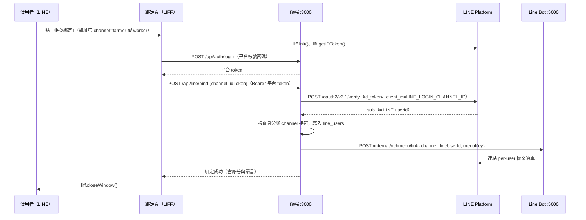
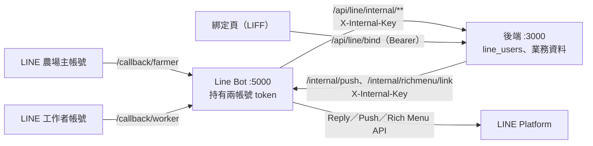

# 智農派工 LINE 官方帳號拆分規格（方案 B：農場主／工作者雙帳號）

> **文件版本**：v1.1.0（2026-10-13，「狀態」改為反映已實作現況；第柒章開頭、6.3 舊 webhook 說明同步）；v1.0.2（2026-10-02，草案；P1 實作後修正 6.2、拾.5 的 `/mock/chat` 規則；P2 實作後補 6.3 `langLocked`、6.5 `ref_id` 欄、5.3 demo 假 token）
> **實作進度**：P1 ✅（Line Bot 雙帳號骨架）、P2 ✅（後端 `line_users`、內部端點、綁定 API；LIFF 綁定頁屬 P4）、P3 ✅（6 份圖文選單、上傳工具、依身分自動連結；實機上傳待 P0 帳號）、P4 ✅（LIFF 綁定頁 `line-bind.html`、科技後台 `admin-line.html`、LINE 模擬器雙帳號）、P5 ✅（推播：訂單狀態、定金、天候、明日出工、農場主方案通知；薪資入帳待發薪功能）、P6 ⏳（模擬驗收 15/15 ✅、文件同步 ✅；實機驗收待 P0，步驟見 `07_LINE官方帳號上線與實機驗收手冊.md`）
> **適用範圍**：`Software/Line Bot/`（port 5000）、`Software/backend/`（port 3000）的 LINE 相關程式、`Software/demo/linebot/line.html` 模擬器、科技後台 LINE 設定頁
> **相關文件**：`01_系統分析與架構設計規格書.md` 第陸章（LINE 子系統現況）、`02_資料庫實體關聯圖與資料字典(ERD).md`（`line_users`）、`03_認證與API安全規格.md`（端點權限）、`Software/android/docs/角色與人力分類表.md`（身分與國別代碼）
> **功能下架（2026-10-12）**：外籍移工（外勞）功能暫時下架，平台先以本國勞工（正職、兼職、中高齡、打工、學生打工）為主。Line Bot 以功能開關 `FEATURE_FOREIGN_WORKERS`（環境變數；或 `config.properties` 的 `feature.foreign-workers`）處理、不刪程式，**預設 `false`**，與前端 `features.foreignWorkers` 一致。關閉時工作者帳號：綁定卡只有本國籍入口、不產生 `role=worker_foreign` 的綁定網址；不出語言選擇與三語歡迎、不辨識語言切換、不採用 LINE 介面語言，回覆與推播一律繁體中文；已綁定為 `worker_foreign` 的舊使用者只回「外籍工作者服務暫停中，請洽合作社或帶班師傅」與聯絡合作社卡，選單回帳號預設 `worker_guest`；舊選單送來 `a=lang`、`a=lang_help` 時回「目前僅提供繁體中文介面」或使用說明。圖文選單 `worker_guest` 改為中文功能格（今日任務、上下班打卡、薪資明細、帳號綁定、使用說明、聯絡合作社），`worker_main_zh` 的「語言・說明」改「使用說明」（`a=help`）。**恢復方式**：設 `FEATURE_FOREIGN_WORKERS=true`（或 `feature.foreign-workers=true`）重啟 Line Bot；圖文選單另把 `tools/make_rich_menus.py` 的 `FEATURE_FOREIGN_WORKERS` 改 `True`、重新產生並以 `RichMenuUploader` 上傳。下文第參、肆、捌、玖章所述多語與外籍流程為開關打開時的行為。後端 `worker_foreign` 角色與資料未變動。
> **狀態（2026-10-13 對照程式更新）**：P1～P5 已實作，並以 `TestSimulator --check` 與 `tools/acceptance_mock.py`（15/15）在模擬模式驗收；01、02、03 文件與 `Software/Line Bot/README.md` 已同步。已完成：Line Bot `/callback/farmer`、`/callback/worker` 雙 webhook 與 `FarmerDispatcher`／`WorkerDispatcher`（舊 `/callback`、`/webhook` 過渡路徑仍保留）；後端 `line_users`（6.5）、`LineBindingService`、內部端點 `/api/line/internal/identity`／`follow-state`／`query`、綁定 API（6.4）、LIFF ID token 驗證；Line Bot 內部端點 `/internal/richmenu/link`、`/internal/notify`、`/internal/push`；6 份圖文選單與上傳工具；LIFF 綁定頁、科技後台 `admin-line.html`、模擬器雙帳號；推播（第柒章 7.0）；工作者語音（5.5，預設關閉）；後端舊 `POST /api/line/webhook` 已停用（回 410）。
>
> **尚未完成**：(1) P0 兩個官方帳號與 LINE Login／LIFF 尚未申請，實機驗收（P6、`07_` 手冊）未做；(2) 農場主 F-01 我的訂單由後端回本人資料（後端離線或無綁定資料時退回範本），F-04 天候避險仍為固定範本；(3) 工作者 W-01 今日任務、W-03 天候集合、W-04 薪資已改為本人資料（2026-10-13：後端 `internal/query` 回 `data`，Line Bot `WorkerCards` 依語言組卡；正式模式查不到時請使用者開工人頁，只有 Mock 模式才退回示範卡片）；W-04 為試算（勞健保概估），8,800 元就業獎勵適用對象仍【待確認】；W-02 打卡、W-05 出勤以卡片連結開啟工人頁，不在聊天室內列出；(4) 薪資入帳推播待發薪功能；(5) ~~Flex 範本檔名改為 `<功能代碼>_<lang>.json`~~ 2026-10-13 已改（`F-01_zh`、`F-03_zh`、`F-04_zh`、`W-01_{zh,vi,id}`、`W-01-machinery_zh`、`W-04_zh`；現僅作 Mock 模式示範卡片）；(6) `line_messages` 未啟用。另：黑轉白（F-02）亦有功能開關 `FEATURE_LEGALIZE`（預設 `false`，關閉時回暫停說明）。第壹章 1.1 為拆分前的問題紀錄、第拾壹章為當時規劃的變更範圍，保留供追溯。

---

## 壹、 背景與目標

### 1.1 現況問題

目前只有 **1 個** LINE 官方帳號、1 個 webhook，農場主、本勞、外勞的功能全部混在 `LineBotDispatcher` 的關鍵字判斷裡。

| # | 問題 | 程式位置 | 影響 |
|---|---|---|---|
| 1 | 身分由「語言」推測：越語／印尼語視為外勞，其餘視為農場主 | `LineBotDispatcher.dispatch` 第 3 段 | 本勞說中文會收到「農場主派工單」，本勞沒有自己的流程 |
| 2 | 共用六宮格選單所有人都看得到 | `rich_menu/rich_menu.json` | 工人看到「早鳥工時包」（農場主的採購方案），農場主看到工人的薪資卡 |
| 3 | 「黑轉白」只從共用選單拿掉，任何人打關鍵字仍會收到卡片 | `LineBotDispatcher.dispatch` 第 2 段 | 敏感內容可能被移工看到 |
| 4 | 「機耕」把農場主的「預約代噴」和機耕師的「我的工單」混成一張卡 | `FlexMessageBuilder.getMachineryTaskFlex` | 兩種人看到同一張卡 |
| 5 | 帳號綁定卡只有農場主、外籍移工兩個按鈕 | `FlexMessageBuilder.getBindingFlex` | 本勞無法綁定 |
| 6 | 使用者語言存在記憶體 `ConcurrentHashMap` | `LineBotDispatcher.userLangs` | 伺服器重開後全部回到中文 |
| 7 | 只處理文字訊息，不處理 follow／unfollow／postback | `WebhookHandler.handleSingleEvent` | 加好友時無法詢問身分、設定語言；選單按鈕只能送出文字 |
| 8 | LINE Bot 轉發後端時以 channel secret 簽章 | `BackendQueryClient.sign` | 改成多帳號後，內部呼叫不能再借用某個帳號的 channel secret |
| 9 | 天候通知若用 broadcast，會推給所有好友 | `LineApiClient.broadcast` | 拆帳號後仍不得用 broadcast 推工作通知（見第柒章） |

### 1.2 目標

1. 依「對象性質」拆成 **農場主帳號** 與 **工作者帳號**。國別與本外勞**不另開帳號**，改以「每位使用者綁定不同的圖文選單（per-user rich menu）」區分。
2. 身分、語言、綁定狀態改存後端資料庫，不再以語言推測身分。
3. 每個功能明確歸屬於一個帳號；另一個帳號收到不屬於自己的關鍵字時，回覆引導訊息，不回覆該功能內容。
4. Line Bot 維持**單一程式、單一 port（5000）**，以不同 webhook 路徑區分帳號（不拆成微服務，見 CLAUDE.md）。

### 1.3 方案比較（決策紀錄）

| 方案 | 帳號數 | 結論 |
|---|---|---|
| A. 維持 1 個帳號 | 1 | 不採用：即現況問題 |
| **B. 農場主／工作者** | **2** | **採用** |
| C. 農場主／本勞／外勞 | 3 | 不採用：本勞與外勞功能幾乎相同，維護兩份 |
| D. 再依國別拆帳號 | 4～6 | 不採用：國別只差語言；每多一個帳號就多一份月費方案、推播額度、金鑰與 webhook，工人換帳號時綁定與對話紀錄也要跟著搬 |

---

## 貳、 帳號與 Channel 配置

### 2.1 申請清單

在 LINE Developers 建立 **1 個 Provider**，底下建立 3 個 channel：

| 代碼 | Channel 類型 | 顯示名稱（暫定） | 用途 |
|---|---|---|---|
| `farmer` | Messaging API | 智農派工（農場主） | 農場主：訂單、派工確認、方案採購、黑轉白、機耕預約 |
| `worker` | Messaging API | 智農派工（工作者） | 本勞與外勞：任務、出勤、天候集合通知、薪資；多語 |
| `login` | LINE Login（掛 LIFF） | 智農派工 帳號綁定 | 兩個帳號共用的身分綁定網頁 |

> ⚠️ **三個 channel 必須在同一個 Provider 底下。** LINE 的 userId 以 Provider 為單位：同一 Provider 下，同一個人在兩個官方帳號與 LINE Login 取得的 userId 相同，後端只需一套對照。若放在不同 Provider，同一個人會有不同 userId，綁定必須分開處理。

【待確認】帳號以合作社（法定雇主）或科技公司名義申請、兩帳號的顯示名稱、是否申請認證帳號（藍盾），屬營運與契約決定。

### 2.2 各 Messaging API channel 的後台設定

| 設定項 | 值 | 說明 |
|---|---|---|
| Webhook URL | 農場主：`https://<公開網域>/callback/farmer`；工作者：`https://<公開網域>/callback/worker` | 同一台 Line Bot，不同路徑 |
| Use webhook | 開啟 | |
| 自動回應訊息 | 關閉 | 由 Line Bot 回覆，避免重複 |
| 加入好友的歡迎訊息 | 關閉 | 由 Line Bot 處理 follow 事件，依身分與語言回覆 |
| 聊天（真人客服） | 依營運決定 | 若開啟，需定義 bot 與真人的切換方式【待確認】 |

### 2.3 金鑰與設定（只放環境變數或 `config.properties`，不得寫入程式或文件）

| 環境變數 | `config.properties` 鍵 | 使用元件 | 說明 |
|---|---|---|---|
| `LINE_FARMER_CHANNEL_SECRET` | `line.farmer.channel.secret` | Line Bot | 驗證 `/callback/farmer` 簽章 |
| `LINE_FARMER_CHANNEL_ACCESS_TOKEN` | `line.farmer.channel.access.token` | Line Bot | 農場主帳號回覆、推播、選單 |
| `LINE_WORKER_CHANNEL_SECRET` | `line.worker.channel.secret` | Line Bot | 驗證 `/callback/worker` 簽章 |
| `LINE_WORKER_CHANNEL_ACCESS_TOKEN` | `line.worker.channel.access.token` | Line Bot | 工作者帳號回覆、推播、選單 |
| `LINE_LOGIN_CHANNEL_ID` | `agri.line.login-channel-id` | 後端 | 驗證 LIFF 取得的 ID token（`aud`） |
| `LIFF_BIND_ID` | `liff.bind.id` | Line Bot、前端 | 綁定頁 LIFF ID，產生綁定按鈕連結 |
| `AGRI_LINEBOT_INTERNAL_KEY` | `agri.linebot.internal-key` ／ `internal.key` | 後端、Line Bot | Line Bot 與後端互相呼叫內部端點的共用金鑰（取代以 channel secret 簽章） |
| `LINEBOT_ADMIN_KEY` | `admin.key` | Line Bot | 沿用：保護 `/api/config` |
| `FEATURE_WORKER_VOICE` | `feature.worker-voice` | Line Bot | 工作者帳號語音訊息開關（5.5），預設 `false` |
| `OPENAI_API_KEY` | `stt.api.key` | Line Bot | 語音轉文字（Whisper）金鑰；未設定時語音功能停用 |
| `STT_API_URL`／`STT_MODEL` | `stt.api.url`／`stt.model` | Line Bot | 預設 `https://api.openai.com/v1/audio/transcriptions`、`whisper-1` |

- **只有 Line Bot 持有兩個帳號的 channel access token**；後端需要推播或切換選單時，呼叫 Line Bot 的內部端點（見 6.3），後端不再設定 channel token。
- **過渡相容**：若只設定舊的 `LINE_CHANNEL_SECRET`／`LINE_CHANNEL_ACCESS_TOKEN`，Line Bot 視為 `farmer` 帳號並在啟動 log 警告；工作者帳號維持 Mock 模式。
- 各帳號獨立判斷 Mock 模式：未設定某帳號的金鑰時，只有該帳號進入 Mock 模式。

---

## 參、 使用者身分模型

### 3.1 身分與帳號、選單的對應

身分代碼沿用後端 `users.role` 與 Android `ClientRole`／`LocalWorkerType`／`Nationality`（見 `角色與人力分類表.md`）。

| 平台身分 | 細分 | 使用帳號 | 綁定後圖文選單 | 預設語言 |
|---|---|---|---|---|
| `farmer` | — | 農場主 | `farmer_main` | zh |
| `worker_local` | `SENIOR` 中高齡、`RETURNING_WOMEN` 二度就業、`STUDENT` 大專生 | 工作者 | `worker_main_zh` | zh |
| `worker_local` | `FOREMAN` 本土帶班師傅 | 工作者 | `worker_main_zh` | zh |
| `worker_local` | `MACHINERY` 農機機耕師 | 工作者 | `worker_main_zh` | zh |
| `worker_foreign` | `VN` 越南 | 工作者 | `worker_main_vi` | vi |
| `worker_foreign` | `ID` 印尼 | 工作者 | `worker_main_id` | id |
| `worker_foreign` | `TH` 泰國、`PH` 菲律賓 | 工作者 | `worker_main_zh`（暫代） | zh |
| `admin_tech` | — | 不使用 LINE | — | — |

- 同一身分不同細分（如機耕師、帶班師傅）**共用同一份選單**，按鈕相同、回覆內容依細分不同（見 4.2）。這樣選單數量只隨「語言」增加，不隨「身分」增加。
- 泰國、菲律賓目前未開放（`Nationality.offered=false`）。開放時新增 `th`／`tl` 語系與對應選單即可，帳號不變。
- 同一個人可同時在兩個帳號各自綁定不同的平台帳號（例如本身是農場主，也在別處做工）；兩筆綁定彼此獨立。

### 3.2 語言決定順序

1. 使用者在 LINE 內**主動選擇**的語言（postback `a=lang`），一經選擇即固定，不被下列規則覆蓋。
2. 已綁定工人的國籍預設值：`VN→vi`、`ID→id`、本勞→`zh`。
3. LINE 使用者介面語言（Get Profile API 回傳的 `language`；使用者未同意 LINE 隱私政策時不會回傳）：`vi`、`id` 採用，其他一律 `zh`。
4. 以上皆無：`zh`。

農場主帳號只提供繁體中文，不顯示語言切換。

### 3.3 綁定狀態

| 狀態 | 條件 | 圖文選單 | 可用功能 |
|---|---|---|---|
| 未綁定 | 已加好友，`line_users` 無該帳號綁定紀錄或 `is_bound='N'` | `farmer_guest` ／ `worker_guest` | 公開資訊與綁定入口（見 4.1、4.2 標「公開」者） |
| 已綁定 | 經 LIFF 綁定成功（5.3） | 依 3.1 | 該身分全部功能 |
| 已封鎖 | 收到 unfollow 事件 | — | 不推播；紀錄保留，重新加好友時恢復 |

未綁定使用者觸發需身分的功能時，一律回覆「帳號綁定」卡。

---

## 肆、 功能配置

功能代碼：`F-` 農場主帳號、`W-` 工作者帳號。「公開」表示未綁定也可使用。

### 4.1 農場主帳號

| 代碼 | 功能 | 公開 | 觸發（選單 postback ／ 關鍵字） | 資料來源 | 現況對應 |
|---|---|---|---|---|---|
| F-01 | 我的訂單與派工確認單 | | `a=orders` ／ 派工、訂單、單號、ORD- | 後端：僅本人訂單 | ✅ 指定單號或作物的那筆，否則施工中＞已排定＞待確認；工期、工班名稱與每日人數、帶隊對口、金額與定金，附其餘訂單摘要：後端 `LineFarmerQueryService`、Line Bot `FarmerCards.orders`（不回工人個資；Mock 示範：`getFarmerOrderFlex`） |
| F-02 | 現有工班黑轉白 | | `a=legalize` ／ 黑轉白、黑工 | Line Bot 範本 | `getLegalizeFlex` |
| F-03 | 早鳥工時包 | ✅ | `a=early_bird` ／ 早鳥、預購 | Line Bot 範本 | `getEarlyBirdFlex` |
| F-04 | 天候避險（我的訂單受影響情形） | | `a=weather` ／ 避險、天氣、暴雨 | 後端：本人進行中訂單 × 天候狀態 | ✅ 目前天候＋本人施工中或 3 天內開工的訂單；依農場地址對應產區天氣（例「屏東縣枋山鄉」對「屏東枋山」），工班狀態 `hedged_indoor` 時標示今日改室內：`FarmerCards.weather`（不回後台天候訊息；Mock 示範：`getWeatherHedgeFlex`） |
| F-05 | 機耕代噴預約 | ✅ | `a=machinery_book` ／ 機耕、代噴、無人機 | Line Bot 範本 ＋ 預約網頁 | `getMachineryTaskFlex`（拆出預約部分） |
| F-06 | 費率試算與產曆 | ✅ | `a=rates`、`a=calendar` ／ 費率、價格、產曆、採收 | 後端 | 後端 `buildRateQueryFlex`、`buildCalendarQueryFlex` |
| F-07 | 帳號綁定 ／ 我的帳號 | ✅ | `a=account` ／ 綁定、帳號 | LIFF | `getBindingFlex`（只留農場主按鈕） |
| F-08 | 服務導覽 | ✅ | `a=help` ／ 無法辨識的訊息 | Line Bot 範本 | `getHelpMenuFlex`（只列農場主功能） |

### 4.2 工作者帳號

| 代碼 | 功能 | 公開 | 觸發 | 回覆內容依身分 | 現況對應 |
|---|---|---|---|---|---|
| W-01 | 今日任務 | | `a=task` ／ 任務、出勤、nhiệm vụ、tugas | 一般工人：任務卡；機耕師：機耕工單；帶班師傅與 `isLeader` 組長：任務卡附工班出勤摘要與評核連結 | ✅ 本人今日排班（無則附 14 天內下一筆）、組長附工班今日打卡人數與未打卡名單：後端 `LineWorkerQueryService`、Line Bot `WorkerCards.task`（Mock 示範：`getWorkerTaskFlex`、`getMachineryTaskFlex`） |
| W-02 | 上下班打卡 | | `a=clock` | 開啟既有打卡網頁（不在聊天室內直接打卡） | 新增（連到既有工人頁） |
| W-03 | 天候與集合通知 | | `a=weather` ／ 天氣、mưa、hujan | 本人當日出工名單的集合地點、接駁變更 | ✅ 目前天候＋本人今日各班次集合地點、作業、車號與司機；工班狀態 `hedged_indoor` 時改用避險地點：`WorkerCards.weather`（不回後台天候訊息，內含營收） |
| W-04 | 薪資與津貼明細 | | `a=salary` ／ 薪資、lương、gaji | 本人明細；8,800 元就業獎勵僅對適用身分顯示【待確認：適用對象】 | ✅ 本月薪資試算（`WorkerService.calculatePayroll`）：`WorkerCards.salary`；只列工人資料上登錄的農業津貼，8,800 適用對象確認前不另標示（Mock 示範：`getSalaryBonusFlex`） |
| W-05 | 我的出勤紀錄 | | `a=attendance` | 本人近 30 日出勤 | 新增（後端既有 `/api/attendance`） |
| W-06 | 切換語言 | ✅ | `a=lang&v=zh|vi|id` ／ 中文、越南、印尼 | — | 語言切換（改為 postback 並存資料庫） |
| W-07 | 帳號綁定 ／ 我的帳號 | ✅ | `a=account` ／ 綁定、帳號 | LIFF；畫面提供本勞、外勞兩種入口 | `getBindingFlex`（補本勞按鈕） |
| W-08 | 使用說明 | ✅ | `a=help` ／ 無法辨識的訊息 | 依語言 | `getHelpMenuFlex`（改為工人版、三語） |

> 外籍移工功能下架期間（`FEATURE_FOREIGN_WORKERS=false`，預設）：W-06 不提供（回「目前僅提供繁體中文介面」）、W-07 只有本國籍入口、W-08 不列「語言」；已綁定外籍工作者的所有功能回暫停說明與聯絡卡。詳見文件開頭「功能下架」說明。

### 4.3 跨帳號關鍵字處理

| 情境 | 回覆 |
|---|---|
| 工作者帳號收到「早鳥、黑轉白、黑工、費率、價格、訂單、預約、代噴」等農場主關鍵字 | 「此帳號提供工作人員使用。農場主請加入『智農派工（農場主）』」＋加好友按鈕；**不回覆該功能內容** |
| 農場主帳號收到「薪資、打卡、lương、gaji、nhiệm vụ、tugas」等工人關鍵字 | 「工作人員請加入『智農派工（工作者）』」＋加好友按鈕 |
| 已綁定身分與帳號不符（例如 farmer 身分出現在工作者帳號） | 綁定時即拒絕（5.3），不會出現此狀態 |

加好友按鈕使用 `https://line.me/R/ti/p/<Basic ID>`；Basic ID 由設定提供，不寫死在程式中。

### 4.4 移出 LINE 的內容

- 工班名冊（含工人姓名）：目前後端 LINE 查詢可回覆工班名冊（`buildCrewQueryFlex`）。拆分後**兩個帳號都不提供工人名冊**；農場主只看到派到自己訂單的工班名稱與人數，名冊僅在科技後台查詢（與 `03_認證與API安全規格.md` 的個資規則一致）。
- 司機資訊：僅在 W-03 集合通知中顯示「當日本人班次」的司機與車號，不提供查詢。

---

## 伍、 事件處理

### 5.1 事件與處理方式

| 事件 | 處理 |
|---|---|
| `follow`（加好友、解除封鎖） | 1. 呼叫後端 `follow-state` 記錄已追蹤；2. 依 3.2 決定語言；3. 已綁定 → 連結對應選單並回覆歡迎；未綁定 → 回覆身分說明與綁定按鈕（工作者帳號以三語同時呈現） |
| `unfollow`（封鎖） | 呼叫後端 `follow-state` 記錄已封鎖；不回覆（LINE 不允許） |
| `message`（文字） | 依 4.1／4.2 關鍵字表分派；不在表中 → 服務導覽或使用說明 |
| `message`（語音，工作者帳號且已啟用 5.5） | 背景辨識後回覆確認卡（5.5） |
| `message`（貼圖、圖片、位置等；農場主帳號的語音） | 回覆服務導覽或使用說明（目前直接略過，改為回覆） |
| `postback` | 解析 `data`（5.2）分派；圖文選單按鈕一律使用 postback，不再送出文字 |

所有回覆使用 **Reply API**（免費、不計推播則數）。Push 只用於第柒章的主動通知。

### 5.2 Postback 資料格式

```
a=<動作>[&<參數>=<值>...]
```

- 例：`a=task`、`a=lang&v=vi`、`a=legalize&t=runaway`（黑轉白身分選擇，取代現行送出「黑轉白：失聯移工」文字的作法）。
- 長度上限 300 字元（LINE 規定）；不得放入 userId、工號、證件號等個資。
- 未知的 `a` 值回覆服務導覽，並寫 log。

### 5.3 帳號綁定流程（LIFF）



規則：

1. **LINE userId 只從後端驗證過的 ID token 取得**；前端或網址傳入的 userId 一律不採信。
2. 身分與帳號必須相符：`channel=farmer` 只接受 `farmer`；`channel=worker` 只接受 `worker_local`、`worker_foreign`。不符回 409，訊息引導到正確帳號。
3. 一個 LINE userId 在同一帳號只能綁一個平台帳號；一個平台帳號在同一帳號只能綁一個 LINE userId。重複綁定回 409，須先解除。
4. 綁定頁沿用既有登入頁的錯誤訊息規則（不提示預設密碼）。綁定頁網址不得帶個資參數。
5. 工作者帳號的綁定頁依 3.2 語言顯示；外籍移工綁定前須顯示個資告知與同意（越語、印尼語版本）【待確認：告知文字與同意方式】。
- 綁定頁：`Software/demo/AgriDispatch/line-bind.html`（中、越、印尼語；網址參數 `channel`、`role`、`lang`）。LIFF ID 設在前端 `js/app-config.js` 的 `liffBindId`（demo、web、android 三份各自一份），LIFF endpoint 指向此頁；未設定時 demo 模式改用模擬 LINE 帳號，production 顯示「請從 LINE 開啟」。只有該帳號為 Mock 模式時，Line Bot 的綁定卡網址才附模擬用 `mockUid`（模擬器綁定後接得上同一個聊天使用者），正式模式網址不帶任何使用者識別。
6. 「同一個平台帳號」以「同身分且同 `ref_id`」判斷：同一位工人以工號（W001）或 users 帳號（worker_foreign → W001）登入視為同一人。
7. 未設定 `LINE_LOGIN_CHANNEL_ID` 時：production 回 503；demo 模式接受 `mock:U+32位十六進位` 假 token（路演與自動測試用），正式環境不得以此綁定。

### 5.4 解除綁定

- 本人：綁定頁「解除綁定」，或在 LINE 內 `a=account` → 解除。
- admin：科技後台可解除任一綁定（離職、帳號遭冒用時）。
- 解除後：`is_bound='N'`、選單改回 guest 選單；推播名單即時排除。

---

### 5.5 工作者帳號語音訊息

讓不方便打字的工作者用說的查詢。只在工作者帳號提供；`feature.worker-voice=true` 且設定 `OPENAI_API_KEY` 才啟用，否則語音照舊回「目前只看得懂文字訊息」。

1. webhook 收到 `message.type=audio`：先回 200，在背景執行緒處理（辨識要數秒）。
2. 已綁定外籍工作者且外籍功能下架 → 不送辨識，直接回暫停說明。
3. 語音超過 60 秒 → 不送辨識，回「語音請在 60 秒內說完」（控制費用）。
4. 顯示 LINE「處理中」動畫（`/v2/bot/chat/loading/start`），從 `api-data.line.me/v2/bot/message/{id}/content` 下載 m4a。
5. 呼叫 OpenAI Whisper（`/v1/audio/transcriptions`，模型 `whisper-1`）：`language` 為使用者語言（外籍下架時一律 `zh`），`prompt` 帶工作者常用詞（i18n `voice.prompt`）。中文結果把關鍵字常用簡體字轉繁體；結果含 4 個以上提示詞時視為靜音回聲、當作未辨識。
6. 辨識結果以 4.2 的關鍵字表判斷動作，**不直接執行**：回覆確認卡「我聽到：「…」」＋動作按鈕（postback，與圖文選單相同）＋「都不是，看使用說明」。判斷不出動作、辨識失敗時回說明與使用說明卡。
7. 以 reply token 回覆；回覆失敗（例如辨識太久、token 逾時）改用 Push。

- 音檔只在記憶體中轉送，不落地、不保存；log 與文字訊息相同，只記辨識文字與遮罩後的 userId。
- 使用說明卡在功能啟用時加一行「也可以直接傳語音」。
- 測試：`TestSimulator --check` 的「V」案例以本機假 Whisper 伺服器驗證上傳格式與回應解析；`/mock/chat` 可帶 `voice`（辨識結果）或 `voiceError`（`too_long`／`failed`）模擬。實際辨識準確度須以真實錄音驗收（`07_LINE官方帳號上線與實機驗收手冊.md`）。
- 台語、農場主帳號暫不提供：一般語音辨識對台語效果差，需另找模型並以實際錄音評估。

---

## 陸、 系統架構與介面

### 6.1 架構



### 6.2 Line Bot 對外路徑

| 路徑 | 說明 |
|---|---|
| `POST /callback/farmer` | 農場主帳號 webhook，以 `LINE_FARMER_CHANNEL_SECRET` 驗簽 |
| `POST /callback/worker` | 工作者帳號 webhook，以 `LINE_WORKER_CHANNEL_SECRET` 驗簽 |
| `POST /callback`、`POST /webhook` | 過渡期視同 `/callback/farmer`，log 警告；全部帳號改設新路徑後移除 |
| `POST /mock/chat` | 沿用（僅在所指定的帳號為 Mock 模式時回應，否則 403）；body 增加 `channel`（預設 `farmer`）、`userId`、`postback`、`event`（follow／unfollow）、`as`（示範身分）、`lineLanguage`、`multi`（回傳全部訊息）欄位以便模擬 |
| `GET /health` | 回傳兩個帳號各自的模式（MOCK／PRODUCTION） |

### 6.3 內部端點（皆需 `X-Internal-Key`，constant-time 比對；未設定金鑰時整組停用並回 403）

**後端提供（Line Bot 呼叫）**

| Method | Path | Body | 回應 |
|---|---|---|---|
| POST | `/api/line/internal/identity` | `{channel, lineUserId}` | `{bound, role, subRole, nationality, isLeader, lang, menuKey}`；未綁定回 `bound:false` 與已記錄的語言 |
| POST | `/api/line/internal/follow-state` | `{channel, lineUserId, followed?, lang?, langLocked?, displayName?}` | `{success, ...identity}`；語言選擇（W-06）帶 `langLocked:true`；加好友時的 LINE 介面語言不帶（未鎖定才採用） |
| POST | `/api/line/internal/query` | `{channel, lineUserId, action, text?}` | `{success, messages:[LINE 訊息物件], data?}`；後端依 channel 與身分限制可回答的 action（4.1、4.2），不符回 `messages:[]`、不帶 `data`。農場主帳號 `rates`／`calendar` 回 `messages`，`orders`／`weather` 回 `data`；工作者帳號 `task`／`weather`／`salary` 回 `data`（本人資料，由 Line Bot 組卡片，工作者帳號依使用者語言；與推播 7.0 同樣分工） |

**Line Bot 提供（後端呼叫）**

| Method | Path | Body | 說明 |
|---|---|---|---|
| POST | `/internal/richmenu/link` | `{channel, lineUserId, menuKey}` | `menuKey` 為第捌章代碼；`guest` 表示解除個人選單、回到預設 |
| POST | `/internal/push` | `{channel, to:[lineUserId...], messages:[...]}` | 1 人用 Push，多人用 Multicast（每次最多 500 人，Line Bot 自動分批）；**不提供 broadcast** |

- 舊 `POST /api/line/webhook`（以 channel secret 驗簽）已停用：一律回 410，不讀 body、不處理訊息（`03_認證與API安全規格.md` 已同步）。
- `/internal/richmenu/link` 回應 `result`：`linked`／`unlinked`（guest＝回到帳號預設）／`mock`／`missing`（尚未上傳該選單）／`failed`；`/internal/push` 於 P5 加入。
- 本機開發：`start_all.bat` 未設定 `AGRI_LINEBOT_INTERNAL_KEY` 時每次啟動產生一組，後端與 LINE Bot 共用；LINE Bot 未設定金鑰或後端離線時，身分改存記憶體（P1 行為）。
- 後端 `GET /api/line/config`（僅 admin_tech）顯示兩個帳號的設定狀態（向 Line Bot `/health` 取得），後端不再保存 channel token。原「執行中修改金鑰」的 `POST /api/line/config` 已於 2026-10-13 移除：金鑰只由環境變數或 LINE Bot `config.properties` 提供。LINE Bot 自己的 `/api/config`（`X-Admin-Key` 保護）不變。

### 6.4 後端對外端點（新增）

| Method | Path | 權限 | 說明 |
|---|---|---|---|
| POST | `/api/line/bind` | 需登入（本人） | `{channel, idToken}` → 綁定（5.3） |
| DELETE | `/api/line/bind/{channel}` | 需登入（本人） | 解除本人在該帳號的綁定 |
| GET | `/api/line/bindings` | 僅 admin_tech | 綁定清單；LINE userId 遮罩顯示 |
| DELETE | `/api/line/bindings/{id}` | 僅 admin_tech | 強制解除綁定 |

### 6.5 資料表 `line_users` 修改

此表原本沒有程式讀寫（ERD 舊版 2.14 保留實體），可直接調整（P2 已實作，ERD v3.5.0 2.14）：

| 欄位 | 型別 | 變更 | 說明 |
|---|---|---|---|
| `id` | String | 不變 | PK |
| `channel` | String(10) | **新增**，NOT NULL | `farmer` ／ `worker` |
| `line_user_id` | String(64) | 唯一約束改為 (`line_user_id`, `channel`) | |
| `username` | String(32) | 改為可空 | 未綁定時為空 |
| `ref_id` | String(32) | **新增** | 綁定時的 token.ref（F001、W001）；查本人訂單與判斷同一人（P2 實作時補） |
| `display_name` | String(100) | 改為可空 | 取自 LINE profile，僅供後台辨識 |
| `role` | String(32) | 改為可空 | 綁定時寫入平台身分 |
| `lang` | String(10) | 不變 | `zh` ／ `vi` ／ `id`（保留 `th`、`tl`） |
| `lang_locked` | String(1) | **新增** | `Y`＝使用者主動選擇過語言（3.2 第 1 點） |
| `is_bound` | String(1) | 預設改為 `N` | |
| `bound_at` | DateTime | 改為可空 | |
| `followed` | String(1) | **新增** | `Y` 追蹤中 ／ `N` 已封鎖 |
| `follow_changed_at` | DateTime | **新增** | 最近一次 follow／unfollow 時間 |

另加唯一約束 (`username`, `channel`)（`username` 非空時）。Oracle schema（`Software/database/01_agridispatch_oracle_schema.sql` 第 10 段）與 ERD 同步修改。

`line_messages` 本次不啟用。若日後要保存對話紀錄，需先定義保存期限與個資處理方式【待確認】。

---

## 柒、 推播規格

本章定義拆帳號後的推播歸屬，已於 P5 實作（見 7.0；薪資入帳除外）。

| 通知 | 帳號 | 對象 | 觸發 | 方式 |
|---|---|---|---|---|
| 訂單狀態變更（已排定、履約中、已完工、已取消） | 農場主 | 該訂單農場主 | `PUT /api/orders/{id}/status` 成功後 | Push |
| 定金付款成功 | 農場主 | 該訂單農場主 | 付款入帳後 | Push |
| 天候影響訂單 | 農場主 | 受影響訂單的農場主 | 科技後台發布天候狀態 | Multicast |
| 明日出工通知 | 工作者 | 隔日出工名單成員 | 每日排程【待確認：時間】 | Multicast，依語言分組，每組一則 |
| 天候集合／接駁變更 | 工作者 | 受影響訂單的出工名單成員 | 科技後台發布 | Multicast，依語言分組 |
| 薪資入帳 | 工作者 | 本人 | 發薪作業完成 | Push |
| 方案行銷（早鳥等） | 農場主 | 全部好友或分眾 | 科技後台手動 | Broadcast／Narrowcast，僅限農場主帳號 |

規則：

1. **工作者帳號禁止 broadcast**，工作通知只推給出工名單上的人。
2. 推播前排除 `is_bound='N'` 或 `followed='N'` 的使用者。
3. 推播內容依收件人語言產生；同一則通知不同語言分開送。
4. 下班時間推播工作通知，可能涉及工作時間認定【待確認：可推播時段與是否計入工時】。在確認前，工作者帳號的排程通知預設只在 07:00～20:00 發送。
5. 推播失敗（對方封鎖等）只記 log，不重試超過 1 次。

### 7.0 實作（P5）

- **分工**：後端 `LineNotifyService` 決定「推給誰」（已綁定、未封鎖、出工名單或訂單農場主），LINE Bot `/internal/notify` 決定「怎麼說」：`{channel, type, params, recipients:[{lineUserId, lang}]}`，依語言分組各產生一次訊息後 multicast（每批 500 人、失敗重試 1 次）。訊息範本在 `Software/Line Bot/.../NotifyMessages.java`，工作者帳號三語文字在 `i18n/worker_*.properties`。`/internal/push` 另收原始訊息，`broadcast` 只允許農場主帳號。
- **觸發點**：訂單狀態 `OrderService.changeStatus`（只在狀態真的改變時）；定金 `OrderService.markDepositPaid`；天候 `DispatchController`（切換到 `warning`／`danger` 等級且情境改變時才通知；今天在工期內的已排定／施工中訂單，加上沒填工期的施工中訂單；工人依所屬工班是否改到室內分兩批）；明日出工 `@Scheduled`（`agri.line.notify.tomorrow-cron`，預設每天 18:00，同一天只自動發一次），隔天在工期內的已排定／施工中訂單。出工名單沒有時以分派工班成員代替（與派工前加保檢查相同）。
- **時段**：`agri.line.notify.worker-hours`（預設 `07:00-20:00`，環境變數 `AGRI_LINE_WORKER_HOURS`）只限制工作者帳號，時段外略過、不補發，結果回報 `skippedQuietHours`；demo profile 設 `00:00-24:00` 方便路演。
- **後台**：`GET /api/line/notify/status`、`POST /api/line/notify/tomorrow`、`POST /api/line/notify/farmer-broadcast`（皆僅 admin），操作介面在 `TechBackend/admin-line.html`。
- **未做**：薪資入帳通知——系統目前沒有「發薪作業完成」事件，待發薪功能建立後掛上；推播紀錄不存表（`line_messages` 仍未啟用，見第拾肆章第 11 項）。
- 推播一律在背景執行，LINE Bot 離線或失敗不影響訂單、付款、天候操作本身。

### 7.1 推播則數估算

LINE 官方帳號依「每月主動推播則數」計費，**回覆訊息（Reply API）不計費**；兩個帳號**各自計算額度、各自選方案**。實際方案與單價以 LINE 台灣官方公告為準。

估算方式：`每月則數 ≈ 收件人數 × 每人每日則數 × 每月天數`

| 帳號 | 假設 | 估算 |
|---|---|---|
| 工作者 | 200 名在籍工人、每人每日 2 則（出工通知＋集合／天候）、每月 26 天 | 約 10,400 則／月 |
| 農場主 | 50 位農場主、每人每月約 10 則 | 約 500 則／月 |

工作者帳號是費用主體。設計上能用回覆就用回覆（例如使用者點「今日任務」才回覆任務卡），只把必要通知放在推播。

---

## 捌、 圖文選單規格

尺寸一律 2500 × 1686，圖檔 1MB 以內（JPEG）。原稿放 `Software/Line Bot/rich_menu/`，檔名＝選單代碼。

| 選單代碼 | 帳號 | 適用對象 | 語言 | 版型 | 設為帳號預設 |
|---|---|---|---|---|---|
| `farmer_guest` | 農場主 | 未綁定 | zh | 3 × 2 | ✅ |
| `farmer_main` | 農場主 | 已綁定農場主 | zh | 4 × 2 | |
| `worker_guest` | 工作者 | 未綁定 | 三語並列 | 3 × 2 | ✅ |
| `worker_main_zh` | 工作者 | 本勞、未開放國別 | zh | 3 × 2 | |
| `worker_main_vi` | 工作者 | 越南 | vi | 3 × 2 | |
| `worker_main_id` | 工作者 | 印尼 | id | 3 × 2 | |

日後開放泰國、菲律賓時新增 `worker_main_th`、`worker_main_tl`。

### 8.1 各選單按鈕

**`farmer_guest`**

| 早鳥工時包 F-03 | 費率試算 F-06 | 產曆查詢 F-06 |
|---|---|---|
| **機耕代噴預約 F-05** | **帳號綁定 F-07** | **服務導覽 F-08** |

**`farmer_main`**（取代現行 `rich_menu_farmer.json`；移除「切換語言」，改為「費率與產曆」）

| 我的訂單 F-01 | 黑轉白 F-02 | 早鳥工時包 F-03 | 天候避險 F-04 |
|---|---|---|---|
| **機耕代噴預約 F-05** | **費率與產曆 F-06** | **我的帳號 F-07** | **服務導覽 F-08** |

> 外籍移工功能下架期間（預設）：`worker_guest` 改為「今日任務 W-01｜上下班打卡 W-02｜薪資明細 W-04／帳號綁定 W-07｜使用說明 W-08｜聯絡合作社」（只有中文）；`worker_main_zh` 第 6 格改「使用說明 W-08」（`a=help`）；`worker_main_vi`／`_id` 照舊產生但不會連結給任何人。以下為開關打開時的版型。

**`worker_guest`**（每格同時標中文、越語、印尼語）

| 中文 W-06 | Tiếng Việt W-06 | Bahasa Indonesia W-06 |
|---|---|---|
| **帳號綁定 W-07** | **使用說明 W-08** | **聯絡合作社**（電話或客服頁連結） |

**`worker_main_{lang}`**（三種語言版型相同，只換圖面文字）

| 今日任務 W-01 | 上下班打卡 W-02 | 天候與集合 W-03 |
|---|---|---|
| **薪資明細 W-04** | **我的出勤 W-05** | **語言・說明 W-06／W-08** |

- 按鈕動作：**一律 `postback`**（5.2）。原規劃開網頁的按鈕（W-02 打卡、F-05 預約、綁定）也改為 postback，由回覆的卡片提供連結：打卡頁依本勞／外勞不同、綁定頁本勞外勞入口不同，選單是靜態圖無法依人變換網址（P3 實作時調整）。
- 新增動作：`farmer_main`「費率與產曆」＝`a=rates_calendar`（兩張卡一起回）；`worker_guest`「聯絡合作社」＝`a=contact`（帶班師傅、合作社專線 `COOP_CONTACT_PHONE`、勞動部 1955 專線）；`worker_main_*`「語言・說明」＝`a=lang_help`（語言卡＋說明卡）。
- 原始定義：`Software/Line Bot/tools/make_rich_menus.py` 同時產生 `rich_menu/<代碼>.json` 與 `.jpg`；`RichMenuUploader --check` 檢核。格子圖示用 lucide 線條圖示（`tools/lucide_icons.py`，與前端同一套）而非 emoji；`chatBarText`、Flex 文案、i18n 文字一律不含 emoji（2026-10-02 起，與 04_UI設計系統規範一致）。
- 連結時機：每次互動時依目前身分與語言確認個人選單（記憶體快取），後端綁定／解除時另呼叫 `/internal/richmenu/link` 立即切換；重新上傳選單後，使用者下一次互動時自動補連結。
- 現行共用六宮格 `rich_menu.json` 在拆分後移除。
- `RichMenuUploader` 改為一次上傳全部 6 份選單、記錄各選單 ID 與代碼的對照（`rich_menu/richmenu_ids.properties`，不進版控），並分別設定兩帳號的預設選單；舊選單預設保留，加 `--delete-old` 才刪。

---

## 玖、 多語系

| 語言 | 代碼 | 帳號 | 狀態 |
|---|---|---|---|
| 繁體中文 | `zh` | 兩帳號 | 開放 |
| 越南語 | `vi` | 工作者 | 開放 |
| 印尼語 | `id` | 工作者 | 開放 |
| 泰語 | `th` | 工作者 | 保留（國別未開放） |
| 他加祿語／英語 | `tl` | 工作者 | 保留（國別未開放） |

- 外籍移工功能下架期間（`FEATURE_FOREIGN_WORKERS=false`，預設）工作者帳號一律繁體中文，越語、印尼語資源檔保留、恢復開關後即可使用。
- 工作者帳號所有回覆文字、Flex 範本、選單圖面都要有三語版本；缺翻譯時退回 `zh`，並在 log 記錄缺漏的鍵值。
- Flex 範本檔名規則：`flex_templates/<功能代碼>_<lang>.json`（例 `W-01_vi.json`；同功能的變體以 `-` 接在代碼後，例 `W-01-machinery_zh.json`）；2026-10-13 已改名對齊。
- 固定文字集中為語系資源檔（`i18n/worker_zh.properties` 等，UTF-8），不再寫在 Java 字串中。
- 越語、印尼語文案上線前由母語人員校對【待確認：校對人選】。

---

## 拾、 安全與個資

1. 兩個 webhook 各用各自的 channel secret 驗簽；任一帳號金鑰外洩只需更換該帳號。
2. LINE userId 視為個資：log 只印前 6 碼＋遮罩；不得放入網址參數或 postback。
3. 工作者帳號不回覆任何費率、訂單金額或其他農場主資訊；農場主帳號不回覆工人個人資料（姓名僅限派到本人訂單的工班領班，是否顯示【待確認】）。
4. 黑轉白（F-02）只在農場主帳號且已綁定時回覆；卡片保留現行「※ 示範流程；標示【待確認】處以律師或主管機關意見為準」字樣。
5. `/mock/chat` 維持只在 Mock 模式開放：所指定的帳號為正式模式時回 403。
6. 內部端點金鑰 `AGRI_LINEBOT_INTERNAL_KEY` 不得與 `LINEBOT_ADMIN_KEY`、channel secret 相同；未設定時內部端點整組停用。
7. 語音訊息（5.5）會把工作者的聲音傳到 OpenAI（境外）辨識：啟用前須在個資告知中載明並取得同意【待確認】；音檔不保存。

---

## 拾壹、 程式變更範圍

| 元件 | 檔案 | 變更 |
|---|---|---|
| Line Bot | `Config.java` | 改為「帳號設定」集合（`farmer`、`worker`），各自 secret／token／Mock 判斷；新增內部金鑰、LIFF ID、兩帳號 Basic ID |
| Line Bot | `LineBotServer.java` | 註冊 `/callback/farmer`、`/callback/worker`、`/internal/push`、`/internal/richmenu/link`；舊路徑過渡 |
| Line Bot | `WebhookHandler.java` | 依路徑帶入 channel；處理 follow／unfollow／postback／非文字訊息 |
| Line Bot | `LineBotDispatcher.java` | 拆為 `FarmerDispatcher`、`WorkerDispatcher`，共用跨帳號關鍵字表（4.3）；移除記憶體語言表與「以語言推測身分」 |
| Line Bot | `BackendClient.java` | 改呼叫 `/api/line/internal/*`，以 `X-Internal-Key` 取代 channel secret 簽章 |
| Line Bot | `LineApiClient.java` | 依 channel 取 token；新增 multicast、per-user 選單連結；移除工作者帳號的 broadcast |
| Line Bot | `FlexMessageBuilder.java`、`flex_templates/` | 依 4.1／4.2 拆分卡片；工人卡片三語化；綁定卡分帳號 |
| Line Bot | `RichMenuUploader.java`、`rich_menu/` | 6 份選單（第捌章） |
| 後端 | `LineController.java` | 新增 6.3、6.4 端點；`/api/line/webhook` 停用（回 410）；`GET /config` 改顯示兩帳號狀態，`POST /config`（執行中改金鑰）已於 2026-10-13 移除 |
| 後端 | `LineUser.java`、`LineUserRepository.java` | 依 6.5 修改；新增 `LineBindingService` |
| 後端 | `AuthInterceptor` 等授權設定 | 內部端點改以內部金鑰驗證，綁定端點需登入 |
| 前端 | `Software/demo/linebot/line.html` | 模擬器上方切換「農場主帳號／工作者帳號」；工作者帳號可選身分與語言（P4 完成：手機頂部顯示目前帳號、細分身分、「示範身分／實際綁定」切換、真正的圖文選單、一次顯示全部回覆） |
| 前端 | `Software/demo/AgriDispatch/` 新增綁定頁 | LIFF 綁定頁（中、越、印尼語） |
| 前端 | `Software/demo/TechBackend/admin.html` | LINE 設定頁顯示兩帳號狀態；綁定清單與解除（P4 實作為獨立頁 `admin-line.html`，admin.html 表頭加入口；資料來自 `GET /api/line/config`（含 Line Bot `/health` 的模式、選單上傳、加好友按鈕、共用金鑰狀態）與 `/api/line/bindings`） |
| 資料庫 | `Software/database/01_agridispatch_oracle_schema.sql` | `line_users` 依 6.5 修改 |
| 文件 | 01、02、03 規格、`Line Bot/README.md` | 實作完成後同步 |

前端只改 `Software/demo/`，改完執行 `node Software/tools/sync-frontend.js` 與 `node Software/tools/check-frontend.js demo`。

---

## 拾貳、 實施階段

| 階段 | 內容 | 完成條件 |
|---|---|---|
| P0 | 營運：建立 Provider 與 3 個 channel、決定帳號名義與顯示名稱 | 取得兩組 channel secret／token、LINE Login channel ID、LIFF ID |
| P1 | Line Bot 多帳號骨架：設定、兩條 webhook、事件分派拆分、跨帳號引導；先在 Mock 模式運作 | `/mock/chat` 依 channel 回覆正確功能；舊 `/callback` 仍可用 |
| P2 | 後端：`line_users` 修改、內部端點、LIFF 綁定與解除；Line Bot 改走內部端點 | 綁定後身分、語言重啟不遺失；身分不符綁定回 409 |
| P3 | 6 份圖文選單（圖面三語）與上傳工具；per-user 連結 | 綁定、解除、改語言後選單即時切換 |
| P4 | 前端：LINE 模擬器雙帳號、綁定頁、科技後台 LINE 設定與綁定清單 | `check-frontend.js` 通過、瀏覽器主控台無錯誤 |
| P5 | 推播（第柒章） | 推播只到名單內、依語言分組；工作者帳號無 broadcast |
| P6 | 實機驗收、文件同步（01、02、03、README） | 第拾參章全部通過 |

每階段完成即 commit（限定路徑）。

---

## 拾參、 驗收標準

> 模擬環境以 `Software/Line Bot/tools/acceptance_mock.py` 自動跑下表 15 條（2026-10-02：15/15 通過）；手機上的實機驗收步驟與紀錄欄在 `07_LINE官方帳號上線與實機驗收手冊.md` 第肆章。

| # | 情境 | 預期結果 |
|---|---|---|
| 1 | 未綁定者加農場主帳號好友 | 收到歡迎訊息；選單為 `farmer_guest` |
| 2 | 未綁定者加工作者帳號好友，LINE 介面為越南語 | 歡迎訊息為越語；選單為 `worker_guest` |
| 3 | 越南籍工人完成綁定 | 選單切到 `worker_main_vi`；W-01 回越語任務卡 |
| 4 | 越南籍工人點「中文」 | 選單切到 `worker_main_zh`，`lang_locked=Y`；重啟 Line Bot 後仍為中文 |
| 5 | 本勞（中文）點「今日任務」 | 收到本勞任務卡，**不會**收到農場主派工單 |
| 6 | 機耕師點「今日任務」 | 收到機耕工單 |
| 7 | 工作者帳號輸入「黑轉白」「早鳥」「費率」 | 只收到「請加入農場主帳號」引導，無該功能內容 |
| 8 | 農場主帳號輸入「薪資」 | 只收到「請加入工作者帳號」引導 |
| 9 | 農場主身分在工作者帳號綁定 | 回 409，畫面引導至農場主帳號 |
| 10 | 前端竄改送出他人 userId 綁定 | 無效（userId 只取自 ID token） |
| 11 | 以農場主帳號 secret 簽章送到 `/callback/worker` | 403 |
| 12 | 未帶或錯誤 `X-Internal-Key` 呼叫內部端點 | 403 |
| 13 | 使用者封鎖工作者帳號後發布天候通知 | 該使用者不在推播名單 |
| 14 | 發布天候集合變更，名單含越、印、中三語工人 | 三則 multicast，各自為對應語言；未在名單的工人收不到 |
| 15 | 只設定舊 `LINE_CHANNEL_SECRET` 啟動 | 農場主帳號正式模式、工作者帳號 Mock 模式，log 有警告 |

---

## 拾肆、 待確認事項

| # | 事項 | 交由 |
|---|---|---|
| 1 | 兩個帳號以合作社或科技公司名義申請、顯示名稱、是否申請認證帳號 | 營運／契約 |
| 2 | 現有官方帳號若已有好友，要轉為農場主或工作者帳號，以及如何通知既有好友 | 營運 |
| 3 | 農業部 8,800 元就業獎勵的適用對象（是否限本國籍），決定 W-04 顯示範圍 | 主管機關 |
| 4 | 下班時間以 LINE 推播工作通知，是否涉及工作時間認定；可推播時段 | 律師／主管機關 |
| 5 | 外籍移工綁定時的個資告知與同意文字（越、印尼語）及同意方式 | 律師 |
| 6 | 農場主帳號是否可看到工班領班姓名 | 律師／營運 |
| 7 | 真人客服是否開啟，以及 bot 與真人的切換方式 | 營運 |
| 8 | 明日出工通知的發送時間 | 營運 |
| 9 | 越語、印尼語文案校對人選 | 營運 |
| 10 | 泰國、菲律賓開放時程（決定 `th`／`tl` 選單何時製作） | 主管機關 |
| 11 | 若啟用 `line_messages` 保存對話，保存期限與個資處理 | 律師 |
| 12 | 語音訊息送 OpenAI（境外）辨識的個資告知、同意方式與跨境傳輸是否合規（5.5） | 律師 |
