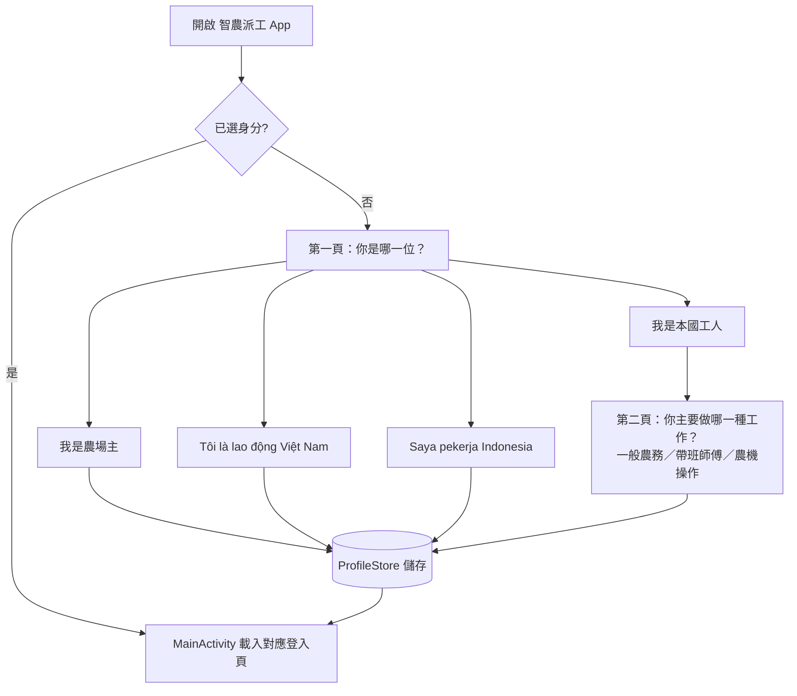

# 智農派工 Android 雙端 App 規格書（Server 端／客戶端）

> **文件版本**：v1.2.0（2026-10-02：身分選擇畫面依設計系統「不讓使用者思考」改版；v1.1.0 模擬器實測、修正滿版遮擋與重開仍詢問身分）
> **適用範圍**：`Software/android/`（Java WebView 殼）
> **相關文件**：`01_系統分析與架構設計規格書.md`（7.1 技術組成、11.2 測試）、`03_認證與API安全規格.md`（前後端認證）、`05_LINE官方帳號拆分規格.md`（同一套身分代碼）、`Software/android/docs/角色與人力分類表.md`（分類表開發者版）、`Software/android/README.md`（建置環境）
> **資料來源**：`其它/農場派遣人力成本分析/農場派遣人力成本分析_試算表.xlsx`（2026 年 10 月版）之「人力類型比較」「國別比較」「價目表」工作表
> **狀態**：程式已實作並通過建置、單元測試、lintVital 與 Android 15 模擬器實測；**尚未在實體手機上測試**。

---

## 壹、 背景與目標

### 1.1 現況問題

原本只有一支 Android App，啟動後直接開前台首頁，農場主、本勞、外勞與科技後台的頁面全部打包在同一支 APK。

| # | 問題 | 影響 |
|---|---|---|
| 1 | 後台頁面（`科技後台/`）跟著公開 App 一起發佈 | 任何下載 App 的人都拿得到後台頁面與登入入口 |
| 2 | App 不知道使用者是誰 | 外勞每次都要自己切語言；本勞進不到自己的軌別（勞務／帶班／機耕） |
| 3 | 國別只存在前端示範資料 | 原生通知、語言判斷無法依國別處理 |

### 1.2 目標

1. 依「端」拆成兩支 App：**Server 端＝科技後台**、**客戶端＝農場主與工人**。
2. 客戶端依人力分類（農場主／本勞／外勞，外勞再分國別）決定啟動頁與介面語言。
3. 分類資料表與後端 `users.role`、LINE 雙帳號規格使用同一套代碼。

### 1.3 上架方案比較（決策紀錄，2026-10-02 定案方案 A）

| 方案 | Play 公開上架數 | 評估 |
|---|---|---|
| **A. 客戶端一支 App，App 內選身分（定案）** | 1 支，加上後台走內部測試 | 上架、審查、維運只需一份；外勞由仲介或領班轉傳連結也不會裝錯版本 |
| B. 農場主、工人各一支 | 2 支 | 功能確實不同，政策上可行；維運成本加倍。保留為日後選項，只要多加一個 flavor 並固定身分 |
| C. 每類（含每個國別）各一支 | 4～6 支 | ❌ 各國別版本只差語言，可能被 Google Play「垃圾內容與最低功能」政策視為重複 App；每支都要分別填資料安全表單、內容分級、送審 |

- 國別差異一律用 **App 內語言切換＋Play 商店頁多語系**（zh-TW、vi、id）處理，不拆 App。
- **後台 App 不公開上架**，只走 Play Console **內部測試軌**（名單制，最多 100 人），只發給科技公司代管人員。
- 個人開發者帳號新 App 須先完成封閉測試（目前公告為 12 位測試者連續 14 天）才能申請正式版；組織帳號是否豁免，以送件當時 Play Console 公告為準【待確認】。

---

## 貳、 雙端架構

### 2.1 Product flavor

Gradle `flavorDimensions = ['side']`，同一份程式碼產出兩支 APK：

| 項目 | Server 端 `server` | 客戶端 `client` |
|---|---|---|
| App 名稱 | 智農派工後台（vi／id：AgriDispatch Admin） | 智農派工 |
| applicationId | `com.agridispatch.app.admin` | `com.agridispatch.app`（沿用原值） |
| versionName | `1.0.0-admin` | `1.0.0` |
| `BuildConfig.APP_SIDE` | `"server"` | `"client"` |
| 啟動 Activity | `MainActivity` | `RoleSelectActivity` |
| 啟動頁 | `www/科技後台/admin-login.html` | 依身分（見參、肆） |
| 打包的前端 | `assets/www/` 全部 | 排除 `assets/www/科技後台/`（`ignoreAssetsPatterns`） |
| 發佈 | Play 內部測試軌 | Play 正式版公開上架 |

兩支 App 的 applicationId 不同，可以裝在同一支手機上（例如代管人員同時測試客戶端）。

### 2.2 原始碼配置

| 路徑 | 內容 |
|---|---|
| `app/src/main/` | 共用程式：`MainActivity`、`WebAppInterface`、`RoleSelectActivity`、`profile/` 分類資料表 |
| `app/src/server/AndroidManifest.xml` | 宣告 `MainActivity` 為啟動 Activity |
| `app/src/server/res/values*/strings.xml` | 後台 App 名稱 |
| `app/src/client/AndroidManifest.xml` | 宣告 `RoleSelectActivity` 為啟動 Activity（只有客戶端 APK 含此 Activity 宣告） |
| `app/src/test/.../UserProfileTest.java` | 分類對應單元測試 |

主 `AndroidManifest.xml` 的 `MainActivity` 為 `exported="false"`、無 intent-filter；兩個 flavor 各自宣告自己的啟動入口。

### 2.3 FCM

兩支 App 套件名稱不同，`app/google-services.json` 必須在同一個 Firebase 專案下同時註冊 `com.agridispatch.app` 與 `com.agridispatch.app.admin`，否則 google-services 外掛建置會失敗（目前未放此檔，建置會略過外掛，推播不運作）。

---

## 參、 身分與人力分類資料表

價格僅供對照，**App 程式不寫死任何價格**；報價以財務定版 F2 與要派勞務服務契約為準。

### 3.1 表一：客戶端身分（`ClientRole`）

| 代碼 | 後端 `users.role` | 身分 | 登入頁（`www/農業派遣主網站/`） | 下一層 |
|---|---|---|---|---|
| `FARMER` | `farmer` | 農場主 | `farmer-login.html` | — |
| `WORKER_LOCAL` | `worker_local` | 本地工人（本勞） | `worker-local-login.html?role=<軌別>` | 表二 |
| `WORKER_FOREIGN` | `worker_foreign` | 外籍移工（外勞，外展移工） | `worker-foreign-login.html` | 表三 |
| （Server 端） | `admin_tech` | 科技公司代管人員 | `www/科技後台/admin-login.html` | — |

### 3.2 表二：本地工人類型（`LocalWorkerType`）與 App 軌別（`LocalTrack`）

App 只問「做哪一種工作」，選項是會進不同頁面的三種軌別（`LocalTrack`）；下表的細分類型是人才庫與 LINE 共用的分類代碼，App 不詢問（1.0.6 以前存的細分類型，升級後自動轉成對應軌別）。

| App 軌別 `LocalTrack` | 畫面文字 | 前端 `role=` | 涵蓋的細分類型 |
|---|---|---|---|
| `LABOR` | 一般農務｜採收、包裝、套袋 | `labor` | `SENIOR`、`RETURNING_WOMEN`、`STUDENT` |
| `FOREMAN` | 帶班師傅｜帶領外籍工班 | `foreman` | `FOREMAN` |
| `MACHINERY` | 農機操作｜曳引機、無人機 | `machinery` | `MACHINERY` |


| 代碼 | 類型 | 前端軌別 `role=` | 計價（參考） | 適合作業 | 可排時段 | 注意事項 |
|---|---|---|---|---|---|---|
| `SENIOR` | 中高齡／銀髮（45 歲以上） | `labor` | $300~320/小時 | 冷鏈集貨場分級、清洗、貼標、裝箱；溫室挑菜包裝；樹下套袋、落果清理 | 平日上午或下午班，每日 4～6 小時 | 不安排攀高梯、正午曝曬、搬運超過 20 公斤 |
| `RETURNING_WOMEN` | 二度就業婦女 | `labor` | $300~320/小時 | 分級包裝、挑菜、套袋等細工 | 配合家庭作息（排班預約制） | 同中高齡之友善工種原則 |
| `STUDENT` | 大專生（寒暑假） | `labor` | $300~320/小時 | 採收、搬運、田間紀錄與手機回報 | 暑假約 6 月中～9 月中、寒假 | 非寒暑假期間供給有限 |
| `FOREMAN` | 本土帶班師傅 | `foreman` | $315/小時（下田工時） | 技術示範、品質把關、現場帶班 | 隨工班 | 約每 10 名移工 1 名，另由資深移工組長協助 |
| `MACHINERY` | 農機機耕師 | `machinery` | 依前端機耕軌 | 農機操作 | 依排班 | 試算表未列，沿用前端既有「機耕」軌別 |

### 3.3 表三：外籍移工國別（`Nationality`）

同工同酬、不以國籍差別定價：外展移工不論國籍皆依最低工資（2026：月 29,500 元）與法定保險計薪，雇主法定成本約 36,312 元/月，平台收費 $315/小時。國別只影響介面語言與排班提醒。

| 代碼 | 國別 | App 狀態 | 介面語言 | 引進專長方向 | 生活作息提醒 | 供應狀況 |
|---|---|---|---|---|---|---|
| `VN` | 越南 | ✅ 開放 | `vi` 越南語＋中文 | 果樹栽培、嫁接剪枝、套袋熟手 | 農曆春節返鄉需求較高，產季排班宜提早協調 | 主要來源；境內轉聘優先 |
| `ID` | 印尼 | ✅ 開放 | `id` 印尼語＋中文 | 溫室設施栽培、細工作業 | 多數為穆斯林：清真飲食、禮拜時間、齋戒月作息調整（因人而異） | 主要來源；境內轉聘優先 |
| `TH` | 泰國 | ⛔ 不顯示 | 系統尚未支援 | — | — | 未規劃引進【待確認】 |
| `PH` | 菲律賓 | ⛔ 不顯示 | 系統尚未支援 | — | — | 未規劃引進【待確認】 |

開放泰國、菲律賓時：`Nationality.java` 的 `offered` 改為 `true`、填入語言代碼，新增 `values-th`／`values-tl` 字串與前端語系；LINE 端同步新增選單（見 05 規格 3.1）。

---

## 肆、 客戶端流程

### 4.1 首次啟動



依設計系統「不讓使用者思考」（`04_UI設計系統規範.md`）設計：

| 原則 | 做法 |
|---|---|
| 一頁只問一個問題 | 第一頁問「你是哪一位？」；只有本國工人有第二頁「你主要做哪一種工作？」 |
| 外籍工人一次點選 | 各國直接列在第一頁，**卡片標題用工人母語**（不懂中文也找得到自己），說明用中文國籍方便旁人協助；圖示框顯示 VI／ID，與網頁語言切換字樣一致 |
| 選項要有作用 | 本國工人只選會進不同頁面的三種軌別；中高齡、二度就業、大專生都屬「一般農務」，不再要求區分 |
| 不顯示不能用的 | 未開放的國別（泰國、菲律賓）不顯示 |
| 文案 | 用使用者的話說目的（「我要找人手」「我要接農務工作」），不加括號、不用「本勞／外勞」等行話 |
| 視覺 | 圖示用 lucide（與網頁同一套，`res/drawable/ic_*.xml` 由前端 `lucide.min.js` 轉換），不用 emoji；色彩用設計系統 token（`colors.xml` 的 `ad_*`，主色 #059669）；卡片＝圖示框 40dp｜標題 16sp＋說明 13sp｜右箭頭，最小高度 72dp，按下有漣漪回饋；「上一步」整列可點、高度 ≥ 44dp |

- 第一頁的「農場主」「本國工人」文字依系統語系顯示（zh、vi、id）；外籍工人卡片固定用母語。
- 從桌面啟動時，若已選過身分就直接開啟 MainActivity；只有「切換角色」會帶 `EXTRA_CHOOSE_ROLE` 強制顯示選擇畫面。
- 返回鍵：在第二步時回到第一步；在第一步時離開 App。

### 4.2 已選身分後

| 情境 | 行為 |
|---|---|
| 再次開啟 App | 直接載入對應登入頁，不再詢問 |
| 網頁點到 `農業派遣主網站/login.html`（各頁的「切換角色」） | 攔截並回到原生身分選擇畫面 |
| 網頁呼叫 `AgriNativeBridge.switchRole()` | 同上 |
| 網頁點到 `科技後台/…` 連結 | 攔截，提示「科技後台請使用『智農派工後台』App」，不開啟 |
| 儲存的國別後來被停用（`offered=false`） | 視同未選，下次開啟要求重選 |
| 由 1.0.6 以前升級、存的是本勞細分類型 | 自動轉成對應軌別（例如中高齡 → 一般農務），不需重選 |

### 4.3 Server 端

不顯示身分選擇，固定以 `admin_tech` 身分開啟 `科技後台/admin-login.html`；後台內連到前台頁面（農場主、工人頁預覽）照常可開。

---

## 伍、 原生橋接 API（`window.AgriNativeBridge`）

### 5.1 本次新增或修改

| 方法 | 回傳 | 說明 |
|---|---|---|
| `getAppProfile()` | JSON 字串 | 目前的端與身分，格式見 5.2 |
| `switchRole()` | — | 回到原生身分選擇畫面；Server 端無作用 |
| `getSystemLanguage()`（修改） | `zh`／`vi`／`id` | 外籍移工優先回傳所選國別的語言，其餘仍依系統語系 |

### 5.2 身分資料格式

頁面載入完成後，App 會注入 `window.AGRI_APP_PROFILE` 並觸發 `agri:app-profile` 事件（`event.detail` 為同一物件）：

```json
{
  "side": "client",
  "role": "WORKER_FOREIGN",
  "platformRole": "worker_foreign",
  "localTrack": "",
  "nationality": "VN",
  "language": "vi"
}
```

| 欄位 | 值 |
|---|---|
| `side` | `client`／`server` |
| `role` | `FARMER`／`WORKER_LOCAL`／`WORKER_FOREIGN`／`ADMIN` |
| `platformRole` | 後端 `users.role`：`farmer`／`worker_local`／`worker_foreign`／`admin_tech` |
| `localTrack` | 本國工人的軌別 `labor`／`foreman`／`machinery`，其餘身分為空字串（1.0.7 起移除 `localType`） |
| `nationality` | `VN`／`ID`，其餘身分為空字串 |
| `language` | 介面語言 |

外籍移工工單頁 `worker-foreign.html` 會在載入後自動呼叫頁面的 `setLang('vi'|'id')`。

### 5.3 既有方法（不變）

`showToast`、`vibrate`、`alertHarvest`、`sendSystemNotification`、`sendWeatherAlert`、`sendDispatchNotification`、`getFcmToken`、`getFcmTokenAsync`、`requestGpsLocation`、`saveOfflineData`、`getOfflineData`。

---

## 陸、 安全

| 項目 | 設計 |
|---|---|
| 後台頁面外流 | 客戶端 APK 不含 `科技後台/` 的 27 個檔案（建置後以 APK 內容比對確認）；後台 App 不公開上架 |
| 身分竄改 | 身分存在獨立的 SharedPreferences `AgriDispatchProfile`，與網頁可寫入的 `AgriDispatchCache`（`saveOfflineData`）分開，網頁無法改寫 |
| 身分不等於授權 | App 端的身分只決定啟動頁與語言，**不是授權依據**；API 權限仍以後端登入 token 與 `users.role` 判斷（見 03 認證規格） |
| 內建網頁來源（2026-10-08） | 內建 `assets/www/` 改以 `WebViewAssetLoader` 由 `https://appassets.androidplatform.net/www/` 提供（取代 `file:///android_asset/www/`），並關閉 `file://` 存取。網頁來源從 `null` 變成固定的 https 來源，後端 CORS 白名單加入此來源後即可呼叫 `/api`（見 03 認證規格第 8 節）。PathHandler 須補回 `www/` 前綴，否則會開到 `assets/` 根目錄而回空回應（ERR_INVALID_RESPONSE） |
| 既有防護（不變） | WebView 只信任內建 assets（`appassets.androidplatform.net/www/`）與 `allowed_web_domain`（HTTPS）；外部連結交給系統瀏覽器；敏感橋接方法只在受信任頁面回應；明文 HTTP 僅限開發位址 |

---

## 柒、 建置、測試與發佈

### 7.1 指令

專案路徑含中文與括號，須先 `subst` 對應英文磁碟代號（見 `Software/android/README.md`）。

| 項目 | 指令 | 產出 |
|---|---|---|
| 客戶端 debug | `gradlew.bat assembleClientDebug` | `app/build/outputs/apk/client/debug/app-client-debug.apk` |
| Server 端 debug | `gradlew.bat assembleServerDebug` | `app/build/outputs/apk/server/debug/app-server-debug.apk` |
| Release | `gradlew.bat assembleClientRelease assembleServerRelease` | `apk/<flavor>/release/` |
| 單元測試 | `gradlew.bat testClientDebugUnitTest testServerDebugUnitTest` | — |
| 安裝到手機 | `install_apk.bat`（客戶端）／`install_apk.bat -Flavor server` | — |

### 7.2 驗證結果（2026-10-02）

| 項目 | 結果 |
|---|---|
| 兩支 debug、release APK 建置 | ✅ 成功（client debug 約 8.0 MB、server debug 約 8.8 MB） |
| 套件名稱、啟動 Activity、App 名稱 | ✅ 以 `aapt dump badging` 確認 |
| 客戶端排除科技後台 | ✅ client 的 `assets/www` 64 個檔案、server 91 個，差額正好是 `科技後台/` 的 27 個檔案 |
| 單元測試 `UserProfileTest` | ✅ client、server 各 5/5 通過 |
| Release lintVital | ✅ 兩個 flavor 通過 |
| 安裝腳本 | ✅ 兩個 flavor 都能找到對應 APK（本機無裝置，未實際安裝） |
| 模擬器實測（Pixel 6、Android 15 / API 35，AVD `AgriTest_API35`） | ✅ 見 7.3 |
| 實體手機 | ⚠️ 未測 |

### 7.3 模擬器實測紀錄（2026-10-02）

| # | 測試 | 結果 |
|---|---|---|
| 1 | 首次啟動顯示三個身分卡片 | ✅ |
| 2 | 外籍移工 → 國別：越南、印尼可點；泰國、菲律賓停用，點了沒有反應 | ✅（1.0.7 起改為第一頁直接列越南、印尼，泰國、菲律賓不顯示） |
| 3 | 選印尼 → `worker-foreign-login.html` 以印尼語顯示；`AGRI_APP_PROFILE`、`getAppProfile()` 皆為 `ID`／`id`，`getSystemLanguage()` 回 `id` | ✅ |
| 4 | 關閉後從桌面重開 → 直接進登入頁、不再詢問 | ✅（實測發現原本每次都詢問，已修正） |
| 5 | 頁面導向 `../科技後台/admin.html` → 攔截、顯示「科技後台請使用『智農派工後台』App」、留在原頁 | ✅ |
| 6 | 頁面導向 `login.html`／呼叫 `switchRole()` → 回到原生選擇畫面 | ✅ |
| 7 | 本地工人 → 帶班師傅 → `worker-local-login.html?role=foreman`，頁面自動選「帶隊領班」軌 | ✅ |
| 8 | 農場主 → `farmer-login.html`，`platformRole` = `farmer` | ✅ |
| 9 | 後台 App → 直接開 `科技後台/admin-login.html`，`platformRole` = `admin_tech` | ✅ |
| 10 | 狀態列、手勢列不遮擋網頁與選擇畫面 | ✅（實測發現 targetSdk 35 強制滿版造成遮擋，已以 `SystemBarInsets` 修正） |
| 11 | WebView 主控台錯誤 | ✅ 無（僅 Tailwind CDN 的既有提示） |

### 7.4 模擬器實測紀錄：WebViewAssetLoader 與 CORS（2026-10-08）

同一台 AVD `AgriTest_API35`，debug 版（模擬器上原本裝的 1.0.9 是正式簽章，debug 版簽章不同無法覆蓋安裝，已先移除）。以 `adb reverse tcp:3000 tcp:3000` 連本機後端（demo 模式），透過 WebView 偵錯通道（CDP）在頁面內實際送出請求：

| # | 測試 | 結果 |
|---|---|---|
| 1 | 客戶端、後台 App 啟動頁皆從 `https://appassets.androidplatform.net/www/…` 載入，本地資源全部成功（只缺 `favicon.ico`） | ✅（原始改動未補 `www/` 前綴，所有頁面 ERR_INVALID_RESPONSE，已修正） |
| 2 | 頁面內 GET `/api/crops`、POST `/api/auth/demo-login`（JSON，需預檢）、帶 token GET `/api/orders` | ✅ 皆 200 |
| 3 | 頁面內 POST `/api/talents/register` 寫入，主機端以管理員查詢看得到該筆 | ✅ 201，確認請求真的到達後端 |
| 4 | 對照組：後端改回舊白名單（不含此來源）再送同樣請求 | ✅ 被 CORS 擋下 |
| 5 | 直接進入示範登入 → 預約頁；導向 `../科技後台/admin.html` 被攔截留在原頁；導向 `login.html` 回到原生身分選擇畫面 | ✅ |

> **尚未讓 App 實際使用後端（待決定）**：`assets/www/` 由同步腳本自 demo 產生，`app-config.js` 為 `mock: true`（請求由純前端 Mock 回應，不會打後端）；且 `apiBase` 依 `location.origin` 計算，在 App 內會變成 `https://appassets.androidplatform.net/api`（不是後端）。上表 2～4 是直接指定 `http://localhost:3000/api` 驗證 CORS。要讓 App 連正式後端，需另訂 App 用的 `apiBase`（正式網域）並關閉 Mock，正式環境的後端網址須為 HTTPS。

**Release 簽章版 1.0.5 複測（2026-10-02）**：由 1.0.0 覆蓋升級（同一把上傳金鑰），兩支 App 皆非 debuggable、通知權限正常授予；升級後保留原身分（越南）直接進越南語登入頁；上表 2～9 全部重測通過，另確認外籍移工工單頁依國別切換（越南、印尼），以及後台 App 可進入 `admin.html`；全程無閃退。

**身分選擇改版複測（2026-10-02，release 簽章版）**：第一頁四張卡片（農場主、本國工人、越南、印尼）；本國工人 → 農機操作進 `?role=machinery`、`localTrack` = `machinery`；越南、印尼一次點選即進對應語言登入頁；返回鍵回第一頁；無閃退。

**登入頁改版後複測（2026-10-02，release 1.0.8／1.0.9）**：前端 6 支登入頁改用設計系統（master a882307），網頁 login.html 已對齊原生身分選擇（第一層 農場主／本國工人／越南／印尼，第二層三種軌別）。App 內：worker-foreign-login 只剩 中／VI／ID，App 身分優先於 `?lang=`（越南身分＋`?lang=th` 仍顯示 VI）；點 login.html 改開原生畫面；`?role=foreman` 預選「帶隊領班」；1.0.9 拿掉沒有作用的「記住我」與動態驗證碼後，農場主登入 → farmer.html、後台登入 → admin.html 皆正常；無閃退。

debug 版已開啟 WebView 遠端偵錯（`WebView.setWebContentsDebuggingEnabled(BuildConfig.DEBUG)`，release 版關閉），可用 `chrome://inspect` 或 `adb forward tcp:9222 localabstract:webview_devtools_remote_<pid>` 檢查頁面。

### 7.4 Play Console 發佈設定

| 項目 | 客戶端 | 後台 |
|---|---|---|
| 測試軌 | 封閉測試 → 正式版 | 內部測試（僅代管人員名單） |
| 商店頁語系 | zh-TW、vi、id（各自截圖與說明） | 不需公開商店頁 |
| 資料安全表單 | 位置（GPS 打卡）、裝置 ID（FCM）、使用者提供之帳號資料 | 同左，另含後台管理之個資 |
| 簽章 | 啟用 Play App Signing；兩支 App 共用同一把上傳金鑰 `D:\AgriDispatch-keys\agridispatch-upload.jks`（2026-10-02 產生，密碼僅存於 gitignore 的 `keystore.properties`，須另行備份） | 同左 |
| 上傳檔 | `bundle/clientRelease/app-client-release.aab` | `bundle/serverRelease/app-server-release.aab` |
| 版本號 | `version.properties` 由 release 建置自動遞增 `VERSION_CODE`，`versionName` = `1.0.<code>`；兩支 App 同一次建置共用同號（目前 1.0.5） | 同左，`versionName` 加 `-admin` |

---

## 捌、 待辦與跨工作階段配合

| # | 事項 | 負責 |
|---|---|---|
| 1 | 實體手機測試（模擬器已通過，見 7.3） | Android |
| 2 | ~~`worker-foreign-login.html` 預設語言固定為 `vi`~~ ✅ 已由前端 a552924 修正，模擬器確認印尼籍顯示印尼語 | 前端 |
| 3 | 前端「切換角色」可改呼叫 `AgriNativeBridge.switchRole()`（現行由 App 攔截 `login.html` 處理，網頁版不受影響） | 前端，選做 |
| 4 | Firebase 專案同時註冊兩個套件名稱並放入 `google-services.json` | 營運 |
| 5 | 泰國、菲律賓是否開放【待確認】；開放後依 3.3 調整 | 營運→Android、前端、LINE |
| 6 | 若日後改採方案 B（農場主、工人分開上架）：新增 flavor 並在該 flavor 固定 `ClientRole` | Android |
| 7 | 各前端頁首在手機寬度（約 400px）會擠成多行（例如「切換身分」斷成兩行、副標換行），需前端調整 RWD | 前端（`Software/demo/`） |
