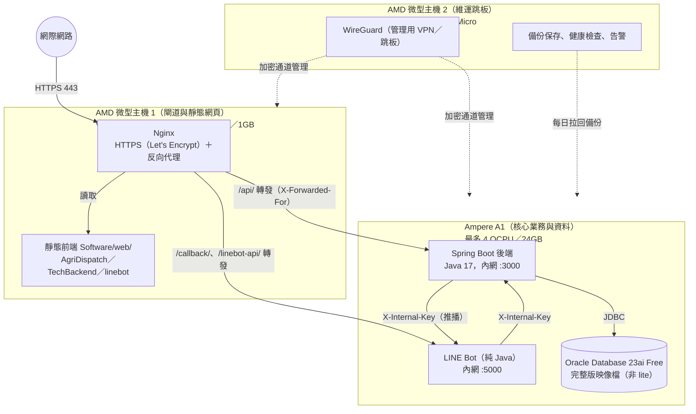

# 智農派工 (AgriDispatch) 正式環境部署規劃：Oracle Cloud 三台主機

> 版本 v1.1（2026-10-13）。原為根目錄 `Deployment_Plan_Oracle.md`（未進版控），本次移入文件區並更新：前端與資料夾現況、完整環境變數、反向代理與密鑰的安全要求、目前 DEV 的狀態對照。
> **狀態：規劃中，尚未建置。** 目前只有單機 DEV（見第五節與 `Software/deploy/dev/README.md`）。

## 一、架構總覽

以 Oracle Cloud Always Free 額度規劃三台主機：一台 Ampere A1（核心業務與資料）、兩台 AMD 微型主機（對外閘道、維運跳板）。

| 項目 | 規劃 | 現況（2026-10-13） |
|---|---|---|
| 三台主機 | 如上 | ❌ 未建立 |
| WireGuard 跳板 | AMD2 | ❌ 未建立；DEV 以 SSH 金鑰直連 |
| 每日備份 | ARM 本機備份 → AMD2 拉回異地保存 | ⚠️ DEV 單機已有每日冷備份＋資料匯出（備份與資料庫在同一台，非異地） |
| 監控告警 | AMD2 統一檢查 | ⚠️ DEV 單機已有每 5 分鐘健康檢查，告警 webhook 尚未設定 |

## 二、各節點部署細節

### 1. Ampere A1：後端、LINE Bot、資料庫

- **資料庫（Oracle Database 23ai Free）**
  - 正式環境請用**完整版映像檔**（`container-registry.oracle.com/database/free:latest`），不要用 DEV 的 `latest-lite`：lite 沒有 XDB，Data Pump 匯不出 DDL、也不能匯入，備份只能靠冷備份。
  - 建表：`Software/database/01_agridispatch_oracle_schema.sql`（種子資料前的建表部分）＋ `Software/database/migrations/*.sql`（依檔名順序、可重複執行）；目前 20 張表，說明見 `Software/database/README_ORACLE_SETUP.md`。
  - 23ai Free 本身的限制：最多 2 個 CPU 執行緒、2GB 記憶體（SGA＋PGA）、12GB 使用者資料。初期足夠；超過時需改用付費版或 Autonomous Database。
  - 1521 埠只開給本機（容器網路），不開放到 VCN 以外。
- **後端（Spring Boot）**
  - `Software/backend` 以 `mvn package` 產生 `agridispatch-backend-2.0.0.jar`，`--spring.profiles.active=oracle`（正式模式，不加 demo）。
  - 只聽內網 IP 的 3000 埠，Security List 只允許 AMD1 的內網 IP 連入。
  - 放在 Nginx 後面：後端預設 `server.forward-headers-strategy=native`（2026-10-13 起），只採信內網代理（10/8、172.16/12、192.168/16、127/8 等）送來的 `X-Forwarded-For`。AMD1 與 ARM 必須在同一 VCN、以**內網 IP** 轉送；若改用公開 IP 轉送，所有使用者會被視為同一來源 IP，登入失敗次數算在一起而被一起鎖住。
- **LINE Bot**
  - `Software/Line Bot` 以 `javac --release 17` 編譯，只聽內網 5000 埠；一支程式服務「農場主」「工作者」兩個官方帳號（`/callback/farmer`、`/callback/worker`）。
  - 規格與上線步驟：`05_LINE官方帳號拆分規格.md`、`07_LINE官方帳號上線與實機驗收手冊.md`。

### 2. AMD 微型主機 1：對外閘道與靜態網頁

- **Nginx**：
  - 靜態網頁：`Software/web/`（正式版，由 `node Software/tools/sync-frontend.js` 從 `Software/demo/` 產生；子資料夾 `AgriDispatch/`、`TechBackend/`、`linebot/`）。前端是靜態 HTML／原生 JS，部分後台頁用 Vue 3 global build，Tailwind／Chart.js／Leaflet 等都已放在各資料夾 `js/vendor/`，不依賴外部 CDN、沒有建置步驟。
  - HTTPS：Let's Encrypt（certbot 自動續期）。綠界金流回呼與 LINE webhook 都要求 HTTPS。
  - 轉送：`/api/` → ARM:3000；`/callback/`、`/linebot-api/` → ARM:5000；一律帶 `X-Forwarded-For`、`X-Forwarded-Proto`。可直接沿用 DEV 的 `/etc/nginx/agridispatch-locations.conf` 寫法（`Software/deploy/dev/server-setup.sh`），把 `127.0.0.1` 換成 ARM 內網 IP。
- 1GB 記憶體只跑 Nginx 足夠；不要在這台跑 Java。

### 3. AMD 微型主機 2：維運跳板

- **WireGuard**：管理者經 VPN 進入 VCN，再 SSH 到 ARM／AMD1；ARM 不需要公開 IP 的 SSH。
- **備份保存**：每天從 ARM 拉回當日備份（`rsync` over SSH），保留 14 天；另在 Oracle Cloud 主控台對 ARM 開機磁碟設定 Volume Backup Policy。備份方式沿用 DEV 的 `Software/deploy/dev/agri-backup.sh`（改完整版映像檔後可再加 Data Pump 含 DDL 的完整匯出）。
- **健康檢查與告警**：沿用 `agri-healthcheck.sh` 的檢查項目，改由 AMD2 從外部打 HTTPS 檢查，並設定告警 webhook。

## 三、上線必備環境變數

一律放在主機上 root 才能讀的 env 檔（DEV 為 `/etc/agridispatch/*.env`）或 systemd `EnvironmentFile`，不得寫進版本庫或文件。

### 後端（Spring Boot）

| 變數 | 必要 | 說明 |
|---|---|---|
| `AGRI_DB_URL`、`AGRI_DB_USERNAME`、`AGRI_DB_PASSWORD` | ✅ | Oracle 連線（例：`jdbc:oracle:thin:@//10.x.x.x:1521/FREEPDB1`、`AGRIDISPATCH`） |
| `AGRI_TOKEN_SECRET` | ✅ | Token 與用工證明查驗碼的簽章密鑰（≥ 32 字元隨機字串）。未設定時後端會自動產生並存到 `./data/token-secret`（`AGRI_TOKEN_SECRET_FILE` 可改路徑）重啟沿用；但多台或重建主機時會不一致，正式環境務必設定 |
| `AGRI_ADMIN_PASSWORD` | ✅ | 第一次啟動建立 `admin_tech` 的初始密碼（帳號已存在就不再使用） |
| `AGRI_CORS_ALLOWED_ORIGINS` | ✅ | 正式網域，例：`https://agridispatch.tw,https://appassets.androidplatform.net`（後者為 Android App） |
| `AGRI_SEED_DEMO_DATA` | — | 正式環境不得設 `true` |
| `AGRI_LOGIN_LOCK_ADMIN_ONLY` | — | 正式環境不得設 `true`（DEV 測試期專用） |
| `SERVER_FORWARD_HEADERS_STRATEGY` | — | 預設 `native`；只有後端直接對外（沒有反向代理）時才改 `none` |
| `AGRI_PAYMENT_PROVIDER` | ✅ | `ecpay` |
| `ECPAY_MERCHANT_ID`、`ECPAY_HASH_KEY`、`ECPAY_HASH_IV` | ✅ | 綠界**正式**商店資料 |
| `ECPAY_ACTION_URL` | ✅ | 正式環境改為綠界正式收銀台網址（預設是測試環境 `payment-stage`） |
| `ECPAY_RETURN_URL`、`ECPAY_CLIENT_BACK_URL` | ✅ | `https://<網域>/api/payments/ecpay/notify`、`https://<網域>/web/` |
| `AGRI_LINEBOT_INTERNAL_KEY` | ✅ | 與 LINE Bot 互相呼叫的共用金鑰（兩邊相同） |
| `AGRI_LINEBOT_BASE_URL` | ✅ | LINE Bot 內網位址，例：`http://127.0.0.1:5000` |
| `LINE_LOGIN_CHANNEL_ID` | ✅ | LIFF 帳號綁定驗證 ID token 用 |
| `AGRI_LINE_WORKER_HOURS`、`AGRI_LINE_TOMORROW_CRON` | — | 工作者推播時段、明日出工通知排程（預設 18:00）【待確認：時段與工時認定】 |
| `CWA_API_KEY` | ✅ | 中央氣象署開放資料授權碼（天候戰情） |
| `AGRI_WEATHER_CACHE_MINUTES` | — | 氣象資料快取分鐘數 |
| `AGRI_FCM_SERVICE_ACCOUNT_FILE`（或 `GOOGLE_APPLICATION_CREDENTIALS`） | — | App 推播（Firebase）服務帳戶 JSON 路徑，放 repo 外；未設定則不送 App 推播 |
| `AGRI_FEATURE_FOREIGN_WORKERS` | — | 外籍移工功能開關（預設 `false`，與前端、LINE Bot 一起改） |

### LINE Bot

| 變數 | 必要 | 說明 |
|---|---|---|
| `LINE_FARMER_CHANNEL_SECRET`、`LINE_FARMER_CHANNEL_ACCESS_TOKEN` | ✅ | 農場主官方帳號 |
| `LINE_WORKER_CHANNEL_SECRET`、`LINE_WORKER_CHANNEL_ACCESS_TOKEN` | ✅ | 工作者官方帳號 |
| `LINE_FARMER_BASIC_ID`、`LINE_WORKER_BASIC_ID` | ✅ | 加好友按鈕用 |
| `AGRI_LINEBOT_INTERNAL_KEY` | ✅ | 同後端 |
| `BACKEND_API_BASE` | ✅ | 後端內網 API，例：`http://127.0.0.1:3000/api` |
| `WEB_BASE_URL` | ✅ | 網頁網址，例：`https://<網域>/web` |
| `LIFF_BIND_ID` | ✅ | LIFF 綁定頁 ID |
| `LINEBOT_ADMIN_KEY` | — | 保護 LINE Bot `/api/config`；未設定則該 API 停用（正式環境建議不設） |
| `CORS_ALLOWED_ORIGINS` | — | LINE 體驗頁來源 |
| `FEATURE_FOREIGN_WORKERS`、`FEATURE_LEGALIZE`、`FEATURE_WORKER_VOICE` | — | 功能開關 |
| `OPENAI_API_KEY`、`STT_API_URL`、`STT_MODEL` | — | 工作者語音轉文字（未設定則停用） |
| `COOP_CONTACT_PHONE` | — | 卡片上的合作社聯絡電話【待確認：正式號碼】 |

後端已於 2026-10-13 移除 `POST /api/line/config`（執行中改 LINE 金鑰）；LINE 金鑰只由上表環境變數（或 LINE Bot 的 `config.properties`）提供。

## 四、上線前檢查

1. 三台主機在同一 VCN；ARM 的 3000／5000 只允許 AMD1 內網 IP，1521 不對外。
2. 以 `Software/deploy/dev/` 的腳本為基礎拆成三台版本（目前腳本是單機：Nginx＋後端＋資料庫同一台）。
3. 第三節「必要」變數全部設定；`AGRI_SEED_DEMO_DATA`、`AGRI_LOGIN_LOCK_ADMIN_ONLY` 未設定。
4. 從外部以兩個不同 IP 各輸錯密碼，確認不會互相鎖住（驗證反向代理來源 IP）。
5. 重啟後端後，先前開立的用工證明查驗碼仍可在公開頁核對（驗證 `AGRI_TOKEN_SECRET` 固定）。
6. 備份：手動執行一次並實際還原到測試 schema；確認告警 webhook 收得到。
7. 綠界正式商店、LINE 兩個官方帳號、氣象署授權碼都改成正式值；依 `07_LINE官方帳號上線與實機驗收手冊.md` 完成實機驗收。

## 五、目前的 DEV 環境（對照）

- 單機：Oracle Cloud 大阪，Oracle Linux 9 **x86_64（E 系列，2 vCPU／11GB）**，上面跑 Nginx＋後端＋LINE Bot（模擬模式）＋Oracle 23ai Free lite 容器。詳見 `Software/deploy/dev/README.md`。
- ⚠️ **費用**：這台不是 Always Free 的 Ampere A1，會產生費用。建議建立正式環境（或改建一台 A1 的 DEV）後停用並終止這台；終止前先把 `/var/lib/agridispatch/backups/` 的備份拷出。【待確認：是否保留這台、或改建 A1】
- 每日 03:30 冷備份＋資料匯出、每 5 分鐘健康檢查已於 2026-10-13 上線；備份與資料庫在同一台，主機損毀時會一起遺失，尚無異地備份。

## 六、方案優勢

- **成本低**：三台都在 Always Free 額度內（Ampere A1 4 OCPU／24GB、兩台 AMD 微型主機、合計 200GB 區塊儲存）；實際額度以 Oracle Cloud 當期公告為準。
- **動靜分離**：AMD1 負責 TLS 與靜態檔，ARM 專注 Java 與資料庫。
- **縮小暴露面**：ARM 不直接對外，對外流量只經 Nginx；管理經 WireGuard。
